<!-- Generated by peta-alur-hidup/render.py; do not edit. -->

# Peta alur sistem Kasir Bangunan &#8212; tampilan dari kode working tree

```mermaid
flowchart TD
    n_AM01["Masuk dengan username atau email, dan keluar sesi"]
    n_AM02["Periksa akun aktif, versi sesi dan peran"]
    n_AM03["Batasi arsip legacy saat cutover"]
    n_AM04["Baca dan buat akun login (username dan U+002F atau email)"]
    n_AM05["Ubah akun tanpa memutus kendali admin"]
    n_AM06["Baca dan buat master dasar"]
    n_AM07["Ubah, arsip, atau aktifkan kembali master tanpa hapus riwayat"]
    n_AM08["Kelola satuan dan kategori (termasuk aktivasi ulang)"]
    n_AM09["Kelola sopir terpisah dari akun login"]
    n_AM10["Validasi tautan produk ke opsi dan supplier"]
    n_AM11["Cari atau buat pelanggan dari kasir"]
    n_AM12["Unduh template master XLSX"]
    n_AM13["Pratinjau impor dan simpan batch tervalidasi"]
    n_AM14["Commit batch impor milik sendiri"]
    n_AM15["Pratinjau saldo awal sistem bersih"]
    n_AM16["Posting saldo awal sekali, atomik dan immutable"]
    n_AM17["Kelola Bagan Akun (COA) dan tandai Rekening Bank aktif"]
    n_RP01["Buka tagihan, penerimaan dan daftar pembayaran"]
    n_RP02["Cari barang supplier atau daftar perlu restok"]
    n_RP03["Simpan draf penerimaan baru (termasuk ongkir opsional)"]
    n_RP04["Ubah draf penerimaan"]
    n_RP05["Batalkan draf penerimaan"]
    n_RP06["Periksa konfirmasi final dan nota ganda"]
    n_RP07["Posting penerimaan final, HPP, utang, dan ongkir pembelian"]
    n_RP08["Tolak void penerimaan final"]
    n_RP09["Validasi pembayaran, rekening bank, bukti transfer, dan entri ganda"]
    n_RP10["Terima piutang tunai"]
    n_RP11["Catat transfer pelanggan menunggu (dengan rekening bank  U+0026  foto bukti)"]
    n_RP12["Ajukan pembayaran supplier"]
    n_RP13["Bayar supplier dari Kas Utama"]
    n_RP14["Bayar supplier dari laci kas harian"]
    n_RP15["Bayar supplier dari rekening bank aktif"]
    n_RP16["Setujui transfer piutang (dengan opsi koreksi rekening bank)"]
    n_RP17["Setujui pengajuan supplier (dengan opsi koreksi rekening bank)"]
    n_RP18["Tolak pembayaran menunggu"]
    n_KS01["Masuk Kasir V2 dan pembatasan peran"]
    n_KS02["Buka kas harian bersama oleh admin (sekali per tanggal)"]
    n_KS03["Susun keranjang, pembayaran, rekening bank U+002F jatuh tempo, lalu tinjau"]
    n_KS04["Validasi server, bukti transfer, kunci kas harian, dan cegah checkout ganda"]
    n_KS05["Posting nota, stok, HPP, piutang dan pendapatan secara atomik"]
    n_KS06["Cabang tunai: lunas, kembalian, dan masuk laci kas harian"]
    n_KS07["Cabang transfer: pilih rekening bank, bukti foto, dan verifikasi tertunda"]
    n_KS08["Cabang kredit: tanpa DP, DP tunai, atau DP transfer  U+002B  jatuh tempo opsional"]
    n_KS09["Pilihan kirim membuat surat jalan prepared, bukan otomatis dispatch"]
    n_KS10["Lanjutan piutang: penerimaan tunai atau pengajuan transfer berbukti"]
    n_KS11["Verifikasi (dengan opsi koreksi rekening bank) atau tolak transfer piutang"]
    n_KS12["Ambil rekap penutupan dari kas harian yang masih open"]
    n_KS13["Bandingkan uang fisik laci dengan perkiraan rekap"]
    n_KS14["Periksa otorisasi admin dan rekap kedaluwarsa di bawah kunci shift"]
    n_KS15["Tutup kas harian: cocok menjadi closed, selisih menjadi review"]
    n_KS16["Resolusi selisih kas harian oleh admin dan carry ke hari berikutnya"]
    n_PG1["Tetapkan kendaraan dan sopir pengiriman"]
    n_PG2["Kirim pengiriman prepared menjadi sent"]
    n_PG3["Konfirmasi barang kiriman diterima"]
    n_PG4["Catat biaya perjalanan langsung (tunai laci atau rekening bank)"]
    n_PG5["Keluarkan uang muka sopir (tunai laci atau rekening bank)"]
    n_PG6["Periksa biaya aktual dan sisa uang muka"]
    n_PG7["Posting pertanggungjawaban dan kunci settled"]
    n_JL1["Validasi dan posting jurnal dari transaksi"]
    n_JL2["Baca laporan operasional harian (termasuk rincian per rekening bank)"]
    n_JL3["Buka nota dan surat jalan penjualan"]
    n_JL4["Baca buku jurnal, rincian saldo kas U+002F rekening bank, dan feed pembaruan"]
    n_JL5["Hitung laba rugi dari baris jurnal"]
    n_JL6["Hitung neraca per tanggal dan keseimbangan"]
    n_JL7["Hitung arus kas dan rekonsiliasi kas serta semua rekening bank"]
    n_JL8["Catat pengeluaran operasional V2 (Kas Utama atau Rekening Bank)"]
    n_JL9["Penyesuaian saldo dan pindah dana Kas U+002F Bank V2 dengan konfirmasi password"]
    n_AM01 -->|"Sesi hasil login diperiksa kembali pada request web berikutnya"| n_AM02
    n_AM04 -->|"ID akun yang dibuat dapat menjadi target PUT U+003B  bukan urutan wajib"| n_AM05
    n_AM05 -->|"Perubahan role U+002F status U+002F password U+002F username mengubah versi pengguna yang dibandingkan middleware"| n_AM02
    n_AM06 -->|"Master dengan kind dan ID yang sama dapat diubah U+002F diarsip U+002F diaktifkan kembali"| n_AM07
    n_AM06 -->|"Create U+002F update produk memanggil resolusi relasi dalam transaksi"| n_AM10
    n_AM07 -->|"Update produk memanggil productAttributes U+002F syncProductSuppliers"| n_AM10
    n_AM08 -->|"product_options ID unit U+002F category menjadi dependensi validasi produk"| n_AM10
    n_AM13 -->|"batch_id preview yang tersimpan dipakai commit oleh actor_id yang sama"| n_AM14
    n_AM14 -->|"Commit memanggil store untuk tiap row kind batch U+003B  memakai aturan insert yang sama"| n_AM06
    n_RP03 -->|"draft_id yang baru disimpan U+003B  ubah hanya status draft dan version sesuai"| n_RP04
    n_RP03 -->|"draft_id sama U+003B  batalkan hanya selagi draft"| n_RP05
    n_RP04 -->|"draft_id sama U+003B  ubah lagi memakai version terbaru"| n_RP04
    n_RP04 -->|"draft_id sama masih draft U+003B  cancel dengan versi terbaru"| n_RP05
    n_RP03 -->|"draft_id sama U+003B  konfirmasi snapshot tersimpan"| n_RP06
    n_RP04 -->|"draft_id sama U+003B  konfirmasi versi hasil edit"| n_RP06
    n_RP06 -->|"draft_id sama tetap draft setelah duplicate_receipt U+003B  kirim ulang confirm_duplicate"| n_RP06
    n_RP06 -->|"draft_id sama U+003B  receive sukses lalu tautkan receipt_id dan status confirmed"| n_RP07
    n_RP07 -->|"receipt_id hasil konfirmasi yang sama U+003B  percobaan void ditolak tanpa transisi final"| n_RP08
    n_RP09 -->|"invoice_id sama dari request tervalidasi U+003B  pilih cabang direction U+002F method U+002F role yang cocok"| n_RP10
    n_RP09 -->|"invoice_id sama dari request tervalidasi U+003B  pilih cabang direction U+002F method U+002F role yang cocok"| n_RP11
    n_RP09 -->|"invoice_id sama dari request tervalidasi U+003B  pilih cabang direction U+002F method U+002F role yang cocok"| n_RP12
    n_RP09 -->|"invoice_id sama dari request tervalidasi U+003B  pilih cabang direction U+002F method U+002F role yang cocok"| n_RP13
    n_RP09 -->|"invoice_id sama dari request tervalidasi U+003B  pilih cabang direction U+002F method U+002F role yang cocok"| n_RP14
    n_RP09 -->|"invoice_id sama dari request tervalidasi U+003B  pilih cabang direction U+002F method U+002F role yang cocok"| n_RP15
    n_RP11 -->|"payment_id pending yang sama dan invoice_id yang sama U+003B  admin approve"| n_RP16
    n_RP11 -->|"payment_id pending yang sama U+003B  admin reject"| n_RP18
    n_RP12 -->|"payment_id proposed yang sama dan invoice_id yang sama U+003B  admin approve"| n_RP17
    n_RP12 -->|"payment_id proposed yang sama U+003B  admin reject"| n_RP18
    n_KS01 -->|"Admin membuka kas harian bersama toko (sekali per tanggal)"| n_KS02
    n_KS02 -->|"Kas harian bersama open menjadi prasyarat checkout semua kasir"| n_KS04
    n_KS03 -->|"Konfirmasi final mengirim POST sales (dan foto bukti bila transfer)"| n_KS04
    n_KS04 -->|"Checkout baru, bukan replay, lolos guard"| n_KS05
    n_KS05 -->|"Alternatif cash dalam transaksi checkout yang sama"| n_KS06
    n_KS05 -->|"Alternatif transfer dalam transaksi checkout yang sama"| n_KS07
    n_KS05 -->|"Alternatif credit dalam transaksi checkout yang sama"| n_KS08
    n_KS05 -->|"Independen metode bayar: fulfillment delivery pada sale yang sama"| n_KS09
    n_KS07 -->|"Hanya tendered positif menghasilkan payment pending untuk diverifikasi U+002F ditolak"| n_KS11
    n_KS08 -->|"Hanya DP transfer positif menghasilkan payment pending"| n_KS11
    n_KS07 -->|"AR sale masih terbuka dapat ditagih kemudian"| n_KS10
    n_KS08 -->|"Sisa AR kredit dapat ditagih kemudian"| n_KS10
    n_KS10 -->|"Alternatif pembayaran lanjutan transfer menunggu admin"| n_KS11
    n_KS02 -->|"Kas harian open boleh direkap meskipun belum ada penjualan"| n_KS12
    n_KS05 -->|"Penjualan masuk kelompok rekap melalui sale.shift_id yang sama"| n_KS12
    n_KS06 -->|"Penerimaan neto cash masuk laci melalui movement.shift_id yang sama"| n_KS12
    n_KS08 -->|"DP cash menambah collection pada kas harian yang sama"| n_KS12
    n_KS10 -->|"Hanya collection cash pada kas harian yang sama menambah laci rekap"| n_KS12
    n_KS12 -->|"Respons rekap mengisi expected dan fingerprint form"| n_KS13
    n_KS13 -->|"Counted dan token opsional dikirim admin ke close"| n_KS14
    n_KS14 -->|"Jika stale: muat ulang rekap kas harian yang sama sebelum kirim kembali"| n_KS12
    n_KS14 -->|"Lolos snapshot opsional dan guard kas harian open"| n_KS15
    n_KS15 -->|"Hanya difference nonnol: review membutuhkan resolusi admin"| n_KS16
    n_KS15 -->|"Jika closed: dapat menjadi asal carry sekali pada tanggal berikutnya"| n_KS02
    n_KS16 -->|"Setelah resolved closed: dapat menjadi asal carry sekali pada tanggal berikutnya"| n_KS02
    n_PG1 -->|"Penugasan valid pada delivery_id yang sama U+003B  dipanggil di dalam dispatch"| n_PG2
    n_PG2 -->|"Delivery yang sama sent U+003B  bukan penerimaan supplier"| n_PG3
    n_PG5 -->|"Advance ID sama masih open U+003B  pengguna menyerahkan realisasi"| n_PG6
    n_PG6 -->|"Validasi actual U+002F refund lolos U+003B  transaksi settlement yang sama"| n_PG7
    n_JL1 -->|"Header dan baris jurnal yang sudah tersimpan dibaca buku jurnal"| n_JL4
    n_JL1 -->|"Baris jurnal masuk agregasi dalam rentang transaction_date"| n_JL5
    n_JL1 -->|"Baris jurnal sampai as_of_date dibaca neraca"| n_JL6
    n_JL1 -->|"Jurnal yang menyentuh akun Kas 1101 atau Rekening Bank memengaruhi arus kas"| n_JL7
    n_JL8 -->|"OperatingExpenses::post memanggil Ledger::post reference_type operating_expense"| n_JL1
    n_JL9 -->|"Jurnal penyesuaian dan pindah dana tampil di buku jurnal serta memperbarui saldo kas U+002F bank"| n_JL4
    n_JL9 -->|"Pindah dana kas U+2194 bank U+002F antar-bank tetap seimbang dan arus bersihnya nol pada arus kas"| n_JL7
    n_RP07 -->|"AP dibuat dengan receipt_id hasil konfirmasi U+003B  pembayaran memakai invoice_id AP itu, bukan id draf"| n_RP09
    n_KS09 -->|"v2_deliveries.id terkait sale_id yang sama: prepared kemudian pengguna dispatch"| n_PG2
    n_KS05 -->|"Operations::checkout memanggil Ledger::post v2_sale dengan reference_id sale_id"| n_JL1
    n_RP07 -->|"SupplyTrips::receive memanggil Ledger::post v2_receipt dengan receipt_id final (termasuk ongkir bila ada)"| n_JL1
    n_RP10 -->|"collect tunai AR memanggil Ledger::post v2_payment untuk payment_id yang sama"| n_JL1
    n_RP13 -->|"postPayable sumber main memposting jurnal v2_payment U+003B  tanpa mutasi laci"| n_JL1
    n_RP14 -->|"postPayable sumber cash memposting jurnal v2_payment dan mutasi kas harian"| n_JL1
    n_RP15 -->|"postPayable sumber transfer memposting jurnal v2_payment dari rekening bank aktif terpilih"| n_JL1
    n_RP16 -->|"Approve AR transfer memposting jurnal untuk payment_id terverifikasi ke rekening bank terpilih"| n_JL1
    n_RP17 -->|"Approve AP memanggil postPayable untuk payment_id pengajuan yang sama"| n_JL1
    n_PG4 -->|"Trip langsung diposting dengan reference_type v2_trip  U+002F  trip_id"| n_JL1
    n_PG5 -->|"Uang muka aset diposting dengan reference_type v2_driver_advance  U+002F  advance_id"| n_JL1
    n_PG7 -->|"Settlement memposting v2_driver_advance_settlement  U+002F  settlement_id U+003B  bukan trip kedua"| n_JL1
    n_AM16 -->|"Pembukaan V2 memanggil Ledger::post dengan batch_id pembukaan"| n_JL1
    n_AM17 -->|"Akun bertanda is_bank_account aktif di COA dibaca BankAccounts pada pembayaran, pengeluaran, laporan harian, dan arus kas"| n_JL7
    n_KS05 -->|"sale_id dan snapshot item hasil checkout dibaca endpoint documents untuk sale yang sama"| n_JL3
    n_KS02 -->|"Laporan harian memilih kas harian lewat tanggal opened_at U+003B  kas harian kosong sah tanpa nota"| n_JL2
```

## Rincian langkah

| ID | Langkah | Pelaku | Syarat awal | Hasil | Bukti kode | Tabel |
| --- | --- | --- | --- | --- | --- | --- |
| AM01 | Masuk dengan username atau email&#44; dan keluar sesi | Tamu &#47; pengguna login | GET&#47;POST &#47;login hanya guest&#59; POST dibatasi throttle&#58;10&#44;1. Input identitas berupa username pendek&#44; email valid&#44; atau alias admin&#44; password wajib&#59; limiter identitas&#43;IP menolak setelah 5 kegagalan selama jendela 60 detik. | Jika input bukan format email dan bukan alias admin&#44; autentikasi diarahkan ke kolom users.username&#59; Auth&#58;&#58;attempt mensyaratkan users.is&#95;active. Berhasil meregenerasi sesi&#44; menyimpan pasangan id&#47;auth&#95;version&#44; menghapus intended URL dan menuju pos.index &#40;&#47;&#41;. POST &#47;logout &#40;auth&#41; logout&#44; invalidasi sesi dan regenerasi token. | app&#47;Http&#47;Controllers&#47;AuthController.php&#58;149 | users&#58; read |
| AM02 | Periksa akun aktif&#44; versi sesi dan peran | Middleware web &#47; pengguna terautentikasi | EnsureActiveAccount terpasang global pada web sebelum V2Cutover &#40;bootstrap&#47;app.php&#58;15&#41;. Setiap request dengan Auth membaca ulang users&#44; membandingkan v2&#95;auth&#95;stamp terhadap id&#47;auth&#95;version. | Akun hilang&#47;nonaktif atau versi tidak cocok mengakhiri sesi&#59; JSON mendapat 401&#44; HTML menuju login. Cap kosong hanya diterima untuk auth&#95;version&#61;1 atau viaRemember. Operations&#58;&#58;role membaca users aktif &#43; v2&#95;user&#95;roles dan hanya menerima admin&#47;cashier&#59; tanpa role sah 403. | app&#47;Http&#47;Middleware&#47;EnsureActiveAccount.php&#58;11 | users&#58; read&#59; v2&#95;user&#95;roles&#58; read |
| AM03 | Batasi arsip legacy saat cutover | Middleware web &#47; admin atau kasir | config&#47;v2.php&#58;2 menetapkan enabled dari V2&#95;ENABLED dengan default false&#59; nilai runtime tidak dibaca. Bila aktif&#44; demo&#45;setup ditolak 404. Jalur v2&#44; login&#44; logout&#44; up dan root memiliki pengecualian eksplisit. | Untuk jalur legacy lain yang sudah terautentikasi&#44; hanya admin dengan metode GET lolos&#59; kasir atau metode tulis ditolak 403 oleh server. Root diteruskan&#59; PosController&#58;&#58;index mendelegasikan ke workspace bila enabled. | app&#47;Http&#47;Middleware&#47;V2Cutover.php&#58;12 | users&#58; read&#59; v2&#95;user&#95;roles&#58; read |
| AM04 | Baca dan buat akun login &#40;username dan&#47;atau email&#41; | Admin aktif | GET&#47;POST &#47;v2&#47;accounts memerlukan auth dan admin aktif. POST throttle&#58;20&#44;1&#59; name wajib max255&#59; minimal salah satu dari username &#40;3&#8211;32 karakter huruf kecil&#47;angka&#47;.&#95;&#45;&#44; bukan admin&#41; atau email valid wajib&#59; password terkonfirmasi 12&#8211;128&#59; role admin&#47;cashier dan is&#95;active boolean wajib. | Daftar memakai users LEFT JOIN v2&#95;user&#95;roles tanpa hash dan respons no&#45;store. Pembuatan mengunci role&#44; memeriksa ulang admin aktif serta keunikan username&#47;email lower&#40;trim&#41;&#59; membuat users dengan password hash&#47;auth&#95;version&#61;1&#44; role dan audit create secara atomik&#44; respons 201. Akun login bukan v2&#95;parties&#40;kind&#61;employee&#41;. | app&#47;Http&#47;Controllers&#47;V2&#47;AccountController.php&#58;57 | users&#58; create&#44;read&#59; v2&#95;account&#95;audits&#58; create&#59; v2&#95;user&#95;roles&#58; create&#44;read |
| AM05 | Ubah akun tanpa memutus kendali admin | Admin aktif | PUT &#47;v2&#47;accounts&#47;&#123;id&#125; numerik&#44; throttle&#58;20&#44;1&#59; payload name&#47;role&#47;is&#95;active wajib&#44; minimal salah satu username&#47;email tetap terisi&#44; password opsional terkonfirmasi 12&#8211;128. Transaksi mengunci role&#47;aktor&#47;target&#59; target hilang 404&#44; aktor tidak sah 403. | Dilarang nonaktif&#47;demosi diri sendiri dan admin aktif terakhir &#40;422&#41;. Shift target berstatus open melarang perubahan role&#47;nonaktif. Username dan email harus unik. users dan role diperbarui&#44; audit update dibuat. Perubahan role&#44; status&#44; password&#44; ATAU username menaikkan auth&#95;version&#44; memutar remember&#95;token serta menghapus sesi DB jika tabel sessions ada. | app&#47;Http&#47;Controllers&#47;V2&#47;AccountController.php&#58;147 | sessions&#58; delete&#59; users&#58; read&#44;update&#59; v2&#95;account&#95;audits&#58; create&#59; v2&#95;shifts&#58; read&#59; v2&#95;user&#95;roles&#58; create&#44;read&#44;update |
| AM06 | Baca dan buat master dasar | Admin aktif | GET&#47;POST &#47;v2&#47;master&#47;&#123;kind&#125;&#58; kind product&#47;customer&#47;supplier&#47;employee&#47;vehicle&#59; kind tidak dikenal 404. Validasi text wajib dan batas panjang&#44; angka nonnegatif&#59; SKU&#47;kode&#47;plat tidak boleh sudah ada. | GET membaca maksimal 100 record terbaru per kind&#44; produk disertai supplier. POST atomik membuat produk stok 0&#44; kendaraan status active atau pihak is&#95;active&#61;true&#59; produk melalui resolusi satuan&#47;kategori dan supplier. Customer price&#95;tier hanya retail&#47;contractor&#59; contractor&#95;price positif atau null. Employee hanya master pihak&#44; tidak membuat users&#47;role atau akses login. | app&#47;Services&#47;V2&#47;MasterData.php&#58;96 | product&#95;options&#58; create&#44;read&#59; products&#58; create&#44;read&#59; v2&#95;parties&#58; create&#44;read&#59; v2&#95;product&#95;suppliers&#58; create&#44;read&#59; vehicles&#58; create&#44;read |
| AM07 | Ubah&#44; arsip&#44; atau aktifkan kembali master tanpa hapus riwayat | Admin aktif | PUT&#47;PATCH &#47;v2&#47;master&#47;&#123;kind&#125;&#47;&#123;id&#125; dan PATCH &#47;v2&#47;master&#47;&#123;kind&#125;&#47;&#123;id&#125;&#47;activate numerik&#59; service memeriksa admin&#47;kind dan mengunci record terikat kind. | PUT tidak mengganti kind&#47;stok&#47;status arsip&#59; HPP produk tidak boleh berubah bila stok nonzero atau ada stock&#95;movements. PATCH arsip menonaktifkan &#40;kendaraan status inactive&#44; lainnya is&#95;active&#61;false&#41; tanpa hard delete&#59; PATCH activate memulihkan kembali dari arsip &#40;active&#47;is&#95;active&#61;true&#41; dengan riwayat utuh. | app&#47;Services&#47;V2&#47;MasterData.php&#58;137 | product&#95;options&#58; create&#44;read&#59; products&#58; read&#44;update&#59; stock&#95;movements&#58; read&#59; v2&#95;parties&#58; read&#44;update&#59; v2&#95;product&#95;suppliers&#58; create&#44;read&#44;update&#44;delete&#59; vehicles&#58; read&#44;update |
| AM08 | Kelola satuan dan kategori &#40;termasuk aktivasi ulang&#41; | Admin aktif | POST&#47;PUT&#47;PATCH &#47;v2&#47;relations&#47;&#123;kind&#125;&#91;&#47;&#123;id&#125;&#93; dan PATCH &#47;v2&#47;relations&#47;&#123;kind&#125;&#47;&#123;id&#125;&#47;activate membatasi kind driver&#47;unit&#47;category dan ID numerik. Untuk unit&#47;category&#58; name wajib dengan batas 32&#47;50 dan unik dalam type. | Membuat product&#95;options aktif&#59; rename memperbarui teks unit&#47;category pada products yang terhubung ID. Arsip menyetel is&#95;active&#61;false tanpa menghapus relasi lama&#59; activate memulihkan is&#95;active&#61;true. Pilihan produk baru wajib opsi aktif&#44; sedangkan tautan lama tetap sah walau opsi diarsip. | app&#47;Services&#47;V2&#47;MasterRelations.php&#58;31 | product&#95;options&#58; create&#44;read&#44;update&#59; products&#58; read&#44;update |
| AM09 | Kelola sopir terpisah dari akun login | Admin aktif | Rute relations driver memakai MasterRelations &#40;store&#47;update&#47;archive&#47;activate&#41;. kind internal&#47;external wajib&#59; code unik. Internal wajib merujuk v2&#95;parties employee aktif yang belum dipakai sopir lain&#59; external tidak boleh employee&#95;id dan wajib nama. | Create&#47;PUT menyimpan v2&#95;drivers&#44; internal memakai nama employee&#59; saat PUT menuju external employee&#95;id dikosongkan. PATCH menonaktifkan atau mengaktifkan kembali sopir tanpa menghapus. Driver resolver menolak sopir nonaktif&#47;pegawai internal nonaktif. Tidak ada pembuatan users&#47;role pada alur ini. | app&#47;Services&#47;V2&#47;MasterRelations.php&#58;192 | v2&#95;drivers&#58; create&#44;read&#44;update&#59; v2&#95;parties&#58; read |
| AM10 | Validasi tautan produk ke opsi dan supplier | Admin melalui create&#47;update produk | Payload product menerima unit&#95;id&#47;category&#95;id atau nama teks&#59; supplier&#95;ids array ID unik dan primary&#95;supplier&#95;id opsional. Dipanggil dalam transaksi MasterData&#58;&#58;store&#47;update&#44; bukan endpoint mandiri. | Teks opsi baru dapat membuat product&#95;options saat write saja&#59; pilihan baru harus aktif&#44; tautan opsi lama boleh tetap walau arsip. Supplier baru harus kind supplier aktif&#59; supplier terarsip yang sudah tertaut boleh dipertahankan. Primary harus anggota daftar. Kesalahan membatalkan transaksi master. | app&#47;Services&#47;V2&#47;MasterRelations.php&#58;113 | product&#95;options&#58; create&#44;read&#59; v2&#95;parties&#58; read&#59; v2&#95;product&#95;suppliers&#58; create&#44;read&#44;update&#44;delete |
| AM11 | Cari atau buat pelanggan dari kasir | Admin &#47; kasir aktif | GET &#47;v2&#47;customers&#47;search menerima q wajib string max255&#59; role admin&#47;cashier. POST &#47;v2&#47;customers&#47;resolve menerima name wajib string max255&#44; service menormalkan spasi dan mensyaratkan panjang 2&#8211;255. | Search di bawah 2 karakter kosong&#59; hanya customer aktif&#44; nama mengandung term atau kode berawalan term&#44; default maksimal 8. Resolve memakai kecocokan nama case&#45;insensitive&#58; customer aktif dikembalikan&#44; terarsip ditolak 422&#59; bila belum ada dibuat kode CUS berurutan aktif. Tidak menyentuh uang&#47;stok&#47;jurnal. | app&#47;Services&#47;V2&#47;CustomerLookup.php&#58;48 | v2&#95;parties&#58; create&#44;read |
| AM12 | Unduh template master XLSX | Admin aktif | GET &#47;v2&#47;templates&#47;&#123;kind&#125;&#59; MasterData mensyaratkan admin. Hanya product&#47;customer&#47;supplier&#47;employee&#47;vehicle&#59; driver&#47;unit&#47;category secara eksplisit tidak tersedia. | Menghasilkan XLSX header sesuai columns&#40;kind&#41;&#44; sebagai unduhan private&#47;no&#45;store tanpa mutasi master. Template produk berisi sku&#44;name&#44;unit&#44;category&#44;cost&#95;price&#44;selling&#95;price&#44;min&#95;stock&#59; tidak menyediakan stok awal atau tautan supplier. | app&#47;Services&#47;V2&#47;MasterData.php&#58;374 | users&#58; read&#59; v2&#95;user&#95;roles&#58; read |
| AM13 | Pratinjau impor dan simpan batch tervalidasi | Admin aktif | POST &#47;v2&#47;imports&#47;&#123;kind&#125;&#47;preview dengan file wajib max2048 KB. Parser XLSX memeriksa header lengkap tanpa kolom asing&#47;duplikat&#47;stok&#45;saldo&#59; batas 1000 baris&#44; ZIP 100 entri&#47;10MB&#44; menolak path tidak aman&#44; macro&#44; formula dan external reference. | Validasi kolom&#47;angka dan duplikasi key dalam file maupun DB. Gagal memberi errors dan batch&#95;id&#61;null tanpa menulis master&#59; berhasil menyimpan v2&#95;import&#95;batches status preview&#44; rows normalisasi dan actor&#95;id&#44; lalu mengembalikan batch&#95;id&#47;count serta maksimal 100 baris. | app&#47;Services&#47;V2&#47;MasterData.php&#58;383 | products&#58; read&#59; v2&#95;import&#95;batches&#58; create&#59; v2&#95;parties&#58; read&#59; vehicles&#58; read |
| AM14 | Commit batch impor milik sendiri | Admin pemilik batch | POST &#47;v2&#47;import&#45;batches&#47;&#123;id&#125;&#47;commit&#44; ID numerik&#59; requireAdmin dan lock v2&#95;import&#95;batches. Batch hilang 422&#59; actor&#95;id berbeda 403. | Batch committed dikembalikan idempoten tanpa insert ulang. Batch belum committed dibaca rows&#47;kind lalu tiap baris masuk MasterData&#58;&#58;store untuk revalidasi aturan terbaru. Seluruh insert dan perubahan status committed satu transaksi&#59; produk impor tetap stok 0&#44; tanpa jurnal&#47;faktur awal. | app&#47;Services&#47;V2&#47;MasterData.php&#58;471 | product&#95;options&#58; create&#44;read&#59; products&#58; create&#44;read&#59; v2&#95;import&#95;batches&#58; read&#44;update&#59; v2&#95;parties&#58; create&#44;read&#59; vehicles&#58; create&#44;read |
| AM15 | Pratinjau saldo awal sistem bersih | Admin dengan sesi aktif | POST &#47;v2&#47;opening&#45;balances&#47;preview meneruskan payload date&#44;reference&#44;cash&#44;bank&#44;inventory&#44;receivables&#44;payables. Dilarang bila sudah ada batch pembukaan&#44; journal&#95;entries&#44; stok produk nonzero atau v2&#95;invoices. | Tanpa mutasi DB&#58; normalisasi desimal&#44; tanggal valid&#44; referensi max50&#44; kas&#47;bank&#47;qty&#47;HPP nonnegatif&#59; produk harus ada dan tidak duplikat. Piutang butuh customer aktif&#44; utang supplier aktif&#44; nomor faktur unik&#44; amount positif dan due&#95;date valid. Ringkasan serta rancangan jurnal mengimbangi selisih aset&#45;utang ke ekuitas 3101. | app&#47;Services&#47;V2&#47;OpeningBalances.php&#58;60 | journal&#95;entries&#58; read&#59; products&#58; read&#59; v2&#95;invoices&#58; read&#59; v2&#95;opening&#95;batches&#58; read&#59; v2&#95;parties&#58; read&#59; v2&#95;user&#95;roles&#58; read |
| AM16 | Posting saldo awal sekali&#44; atomik dan immutable | Admin dengan sesi aktif | POST &#47;v2&#47;opening&#45;balances dengan payload pembukaan&#59; idempotency&#95;key string 8&#8211;100 dan array inventory&#47;receivables&#47;payables masing&#45;masing max1000 pada controller. Service mengulangi validasi preview dan mengunci batch singleton&#44; akun modal serta produk. | Jika batch sudah ada&#44; key DAN hash payload sama mengembalikan idempotent&#95;ok&#59; selain itu ditolak sebagai immutable. Posting membuat v2&#95;opening&#95;batches&#44; jurnal seimbang melalui Ledger&#44; memperbarui stok&#47;HPP dan stock&#95;movements&#44; membuat faktur receivable&#47;payable open paid&#61;0 tanpa sale&#47;receipt palsu. Tidak tersedia edit&#47;reset saldo awal di routes&#47;v2.php. | app&#47;Services&#47;V2&#47;OpeningBalances.php&#58;84 | chart&#95;of&#95;accounts&#58; read&#59; journal&#95;entries&#58; create&#44;read&#59; journal&#95;entry&#95;lines&#58; create&#59; products&#58; read&#44;update&#59; stock&#95;movements&#58; create&#59; v2&#95;invoices&#58; create&#44;read&#59; v2&#95;opening&#95;batches&#58; create&#44;read&#44;update&#59; v2&#95;parties&#58; read&#59; v2&#95;user&#95;roles&#58; read |
| AM17 | Kelola Bagan Akun &#40;COA&#41; dan tandai Rekening Bank aktif | Admin aktif | POST &#47;v2&#47;chart&#45;of&#45;accounts&#44; PUT &#47;v2&#47;chart&#45;of&#45;accounts&#47;&#123;id&#125;&#44; PATCH &#47;v2&#47;chart&#45;of&#45;accounts&#47;&#123;id&#125;&#47;archive &#40;throttle&#58;30&#44;1&#44; admin wajib&#41;. Kode akun wajib cocok dengan jenis akun dan saldo normalnya. Penanda is&#95;bank&#95;account hanya sah untuk akun Aset bersaldo normal Debet yang bukan akun inti non&#45;bank&#59; 1102 wajib tetap aktif dan bertanda Rekening Bank. | Menambah&#44; memperbarui&#44; atau mengarsipkan akun pada chart&#95;of&#95;accounts tanpa hard delete&#59; akun yang sudah dipakai jurnal tidak boleh diubah kode&#47;jenis&#47;saldo normalnya dan akun inti sistem tidak boleh diubah kodenya atau diarsip. Setiap akun aktif bertanda is&#95;bank&#95;account&#61;true &#40;bersama 1102&#41; dibaca terpusat lewat BankAccounts dan otomatis tersedia sebagai pilihan Rekening Bank pada Kasir&#44; Tagihan&#44; Verifikasi&#44; Pengeluaran&#44; Perjalanan&#44; Ongkir Penerimaan&#44; Penyesuaian&#47;Pindah Dana&#44; Laporan Harian&#44; dan Arus Kas. | app&#47;Http&#47;Controllers&#47;ChartOfAccountController.php&#58;139 | chart&#95;of&#95;accounts&#58; create&#44;read&#44;update&#59; journal&#95;entry&#95;lines&#58; read&#59; users&#58; read&#59; v2&#95;user&#95;roles&#58; read |
| RP01 | Buka tagihan&#44; penerimaan dan daftar pembayaran | Admin&#59; kasir untuk tagihan&#47;pembayaran | GET &#47;v2 atau GET &#47;v2&#47;invoices &#40;filter arah&#47;status&#47;pencarian&#47;tanggal&#47;paginasi server&#41;&#44; autentikasi web dan sesi akun aktif&#59; Operations&#58;&#58;role hanya menerima admin&#47;cashier aktif. Jika konfigurasi V2 aktif&#44; &#47;v2 mengalihkan ke pos.index. | Tagihan dipaginasi di server lintas tanggal&#59; last&#95;payment&#95;id ialah pembayaran terakhir selain rejected&#44; dilengkapi riwayat pembayaran beserta penanda bukti transfer dan rekening bank. Pembayaran 50 terakhir dibatasi requested&#95;by untuk kasir. Admin membaca 50 penerimaan final dan 50 draf draft&#47;cancelled&#59; final memiliki audit konfirmasi melalui receipt&#95;id. Tidak mengubah data transaksi. | app&#47;Http&#47;Controllers&#47;V2&#47;WorkspaceController.php&#58;39 | inventory&#95;receipt&#95;items&#58; read&#59; inventory&#95;receipts&#58; read&#59; products&#58; read&#59; users&#58; read&#59; v2&#95;invoices&#58; read&#59; v2&#95;parties&#58; read&#59; v2&#95;payment&#95;proofs&#58; read&#59; v2&#95;payments&#58; read&#59; v2&#95;receipt&#95;drafts&#58; read&#59; v2&#95;user&#95;roles&#58; read |
| RP02 | Cari barang supplier atau daftar perlu restok | Admin | GET &#47;v2&#47;suppliers&#47;&#123;id&#125;&#47;products &#40;q opsional &#60;&#61;100 karakter&#41;&#44; GET &#47;v2&#47;receipts&#47;restock&#45;products&#44; dan POST &#47;v2&#47;receipts&#47;product&#45;supplier &#40;taut cepat produk ke supplier&#41;&#59; autentikasi&#44; sesi aktif&#44; role admin. | Pencarian supplier hanya mengembalikan relasi produk&#45;supplier milik id tersebut&#44; supplier aktif dan produk aktif &#40;maksimal 50 hasil&#41;. Daftar restok menyaring produk aktif berstok habis&#47;menipis dengan tautan supplier aktif. Tidak membuat penerimaan atau jurnal. | app&#47;Services&#47;V2&#47;SupplyTrips.php&#58;448 | products&#58; read&#59; v2&#95;parties&#58; read&#59; v2&#95;product&#95;suppliers&#58; read&#44;create&#59; v2&#95;user&#95;roles&#58; read |
| RP03 | Simpan draf penerimaan baru &#40;termasuk ongkir opsional&#41; | Admin | POST &#47;v2&#47;receipts memanggil ReceiptDrafts&#58;&#58;save&#44; BUKAN SupplyTrips&#58;&#58;receive langsung. Autentikasi&#44; sesi aktif dan admin&#59; supplier aktif&#44; tanggal Y&#45;m&#45;d tidak di masa depan&#44; nota opsional &#60;&#61;64&#44; catatan &#60;&#61;255&#44; 1..100 produk berbeda aktif tertaut supplier&#44; jumlah positif&#44; harga &#62;&#61;0 &#60;&#61;4 desimal&#59; total positif. Ongkir pembelian opsional&#58; freight&#95;amount &#62;&#61;0&#44; bila positif wajib freight&#95;method &#40;supplier&#124;cash&#124;bank&#41;&#44; freight&#95;account &#40;beban aktif&#41;&#44; dan freight&#95;bank&#95;account&#95;code &#40;bila bank&#44; default 1102&#41;. Kunci ASCII 1..100 karakter wajib. | Transaksi mengunci user&#44; menyimpan snapshot &#40;termasuk rincian ongkir&#41; di v2&#95;receipt&#95;drafts status draft&#47;version 1. Kunci per created&#95;by dengan hash sama mengembalikan draf yang tersimpan&#59; hash berbeda gagal validasi. Tidak membuat receipt final&#44; utang&#44; stok&#44; HPP&#44; kas&#47;bank&#44; atau jurnal. | app&#47;Services&#47;V2&#47;ReceiptDrafts.php&#58;17 | chart&#95;of&#95;accounts&#58; read&#59; products&#58; read&#59; users&#58; read&#59; v2&#95;parties&#58; read&#59; v2&#95;product&#95;suppliers&#58; read&#59; v2&#95;receipt&#95;drafts&#58; create&#44;read&#59; v2&#95;user&#95;roles&#58; read |
| RP04 | Ubah draf penerimaan | Admin&#44; tidak harus pembuat draf | POST &#47;v2&#47;receipt&#45;drafts&#47;&#123;id&#125;&#59; autentikasi&#47;sesi aktif&#44; role admin. Id draf harus ada&#44; status draft dan version input harus sama persis setelah FILTER&#95;VALIDATE&#95;INT&#59; snapshot penuh &#40;termasuk ongkir&#41; divalidasi ulang seperti draf baru. | Mengunci user serta baris draf&#59; memperbarui snapshot dan menaikkan version. Tidak mengubah request&#95;hash&#47;idempotency&#95;key awal. Status cancelled&#47;confirmed dan versi usang ditolak. Tidak ada efek ke stok&#44; HPP&#44; utang atau jurnal. | app&#47;Services&#47;V2&#47;ReceiptDrafts.php&#58;43 | chart&#95;of&#95;accounts&#58; read&#59; products&#58; read&#59; users&#58; read&#59; v2&#95;parties&#58; read&#59; v2&#95;product&#95;suppliers&#58; read&#59; v2&#95;receipt&#95;drafts&#58; read&#44;update&#59; v2&#95;user&#95;roles&#58; read |
| RP05 | Batalkan draf penerimaan | Admin&#44; tidak harus pembuat draf | POST &#47;v2&#47;receipt&#45;drafts&#47;&#123;id&#125;&#47;cancel&#59; autentikasi&#47;sesi aktif dan admin. Draf harus ada&#44; status draft dan version cocok&#59; reason setelah trim sepanjang 5..255 karakter. Jika sudah cancelled&#44; hasil lama dikembalikan sebelum cek versi&#47;alasan. | Status cancelled&#44; version bertambah dan cancelled&#95;by&#47;cancelled&#95;at&#47;cancel&#95;reason dicatat&#59; draf tidak dihapus. Confirmed tidak dapat dibatalkan. Stok&#44; HPP&#44; receipt final&#44; utang&#44; kas&#47;bank dan jurnal tidak berubah. | app&#47;Services&#47;V2&#47;ReceiptDrafts.php&#58;85 | users&#58; read&#59; v2&#95;receipt&#95;drafts&#58; read&#44;update&#59; v2&#95;user&#95;roles&#58; read |
| RP06 | Periksa konfirmasi final dan nota ganda | Admin | POST &#47;v2&#47;receipt&#45;drafts&#47;&#123;id&#125;&#47;confirm&#59; autentikasi&#47;sesi aktif&#44; admin&#44; confirm&#95;final wajib accepted. Id terkunci&#59; confirmed mengembalikan receipt&#47;invoice lama tanpa posting ulang&#59; selain itu status draft dan version cocok. Payload posting berasal dari snapshot tersimpan &#40;termasuk ongkir&#41;&#44; bukan item baru pada request. | SupplyTrips&#58;&#58;receive dipanggil dengan kunci draft&#45;receipt&#45;&#123;id&#125;. Nota opsional yang sama untuk supplier sama&#44; lower&#47;trim dan hanya receipt belum void&#44; memicu duplicate&#95;receipt bila confirm&#95;duplicate tidak benar&#59; transaksi gagal sehingga draf tetap draft. Replay v2&#95;requests dengan hash sama mengembalikan hasil lama. | app&#47;Services&#47;V2&#47;ReceiptDrafts.php&#58;54 | inventory&#95;receipts&#58; read&#59; users&#58; read&#59; v2&#95;invoices&#58; read&#59; v2&#95;parties&#58; read&#59; v2&#95;receipt&#95;drafts&#58; read&#59; v2&#95;requests&#58; read&#59; v2&#95;user&#95;roles&#58; read |
| RP07 | Posting penerimaan final&#44; HPP&#44; utang&#44; dan ongkir pembelian | Admin melalui konfirmasi draf | POST &#47;v2&#47;receipt&#45;drafts&#47;&#123;id&#125;&#47;confirm melanjutkan draf setelah semua guard. SupplyTrips mengunci actor&#44; supplier&#44; produk dan relasi. Tanggal mundur melewati stock&#95;movements lebih baru ditolak. Bila ongkir &#62; 0 metode cash&#58; wajib kas harian aktif pada tanggal penerimaan dan laci &#43; saldo 1101 cukup&#59; bila bank&#58; saldo rekening bank aktif cukup. | Dalam satu transaksi&#58; receipt RCV dan item dibuat&#59; stok naik&#44; HPP rata&#45;rata tertimbang diperbarui &#40;ongkir dicatat sebagai beban&#44; TIDAK masuk HPP&#41;&#44; mutasi v2&#95;receipt masuk. Ledger debit Persediaan 1301 sebesar nilai barang&#44; kredit Utang 2101 sebesar nilai barang &#40;&#43; ongkir bila metode supplier&#41;. Bila ongkir &#62; 0&#58; tambah debit akun beban ongkir&#59; bila metode cash&#47;bank&#44; tambah kredit 1101 atau rekening bank terpilih &#40;dan mutasi out laci jika cash&#41;. Invoice AP payable dibuat sebesar payableTotal&#59; draf menjadi confirmed. Kegagalan menggulung seluruh transaksi. | app&#47;Services&#47;V2&#47;SupplyTrips.php&#58;157 | chart&#95;of&#95;accounts&#58; read&#59; inventory&#95;receipt&#95;items&#58; create&#59; inventory&#95;receipts&#58; create&#44;update&#59; journal&#95;entries&#58; create&#59; journal&#95;entry&#95;lines&#58; create&#44;read&#59; products&#58; read&#44;update&#59; stock&#95;movements&#58; create&#44;read&#59; users&#58; read&#59; v2&#95;invoices&#58; create&#44;read&#59; v2&#95;parties&#58; read&#59; v2&#95;product&#95;suppliers&#58; read&#59; v2&#95;receipt&#95;drafts&#58; read&#44;update&#59; v2&#95;requests&#58; create&#44;read&#59; v2&#95;shift&#95;movements&#58; create&#44;read&#59; v2&#95;shifts&#58; read&#59; v2&#95;user&#95;roles&#58; read |
| RP08 | Tolak void penerimaan final | Admin | POST &#47;v2&#47;receipts&#47;&#123;id&#125;&#47;void&#59; autentikasi&#47;sesi aktif dan admin. Id merujuk inventory&#95;receipts final&#44; BUKAN id draf. Receipt tidak ditemukan menghasilkan 404. | Receipt yang ada selalu gagal validasi&#58; penerimaan sudah dikonfirmasi dan terkunci&#44; gunakan koreksi&#47;retur. Tidak ada reversal jurnal&#44; pemulihan HPP&#47;stok&#44; pembatalan invoice&#44; update voided&#95;at&#44; atau transisi kembali ke draft. | app&#47;Services&#47;V2&#47;SupplyTrips.php&#58;610 | inventory&#95;receipts&#58; read&#59; users&#58; read&#59; v2&#95;user&#95;roles&#58; read |
| RP09 | Validasi pembayaran&#44; rekening bank&#44; bukti transfer&#44; dan entri ganda | Admin atau kasir aktif | POST &#47;v2&#47;invoices&#47;&#123;id&#125;&#47;payments&#59; role admin&#47;cashier. amount string &#60;&#61;30&#44; method cash&#47;transfer&#47;main&#44; bank&#95;account&#95;code opsional &#40;divalidasi lewat BankAccounts&#58;&#58;resolve saat transfer&#41;&#44; foto transfer&#95;proof wajib untuk transfer piutang &#40;receivable&#41;&#44; idempotency&#95;key 8..100&#44; reference opsional &#60;&#61;255&#44; seen&#95;payment&#95;id dan confirm&#95;duplicate opsional. Invoice ada dan dikunci. | Kunci pembayaran dicari global&#58; pemohon harus actor sama &#40;lainnya 403&#41;&#44; hash sama mengembalikan payment lama&#59; isi berbeda ditolak. Arah invoice harus receivable&#47;payable&#59; main untuk receivable ditolak. Jika seen&#95;payment&#95;id ada tanpa confirm&#95;duplicate&#44; pembayaran lebih baru selain rejected memicu duplicate&#95;payment. Nilai baru harus &#60;&#61; sisa invoice. Bukti foto disimpan atomik via PaymentProofs&#58;&#58;record. | app&#47;Services&#47;V2&#47;Operations.php&#58;665 | chart&#95;of&#95;accounts&#58; read&#59; users&#58; read&#59; v2&#95;invoices&#58; read&#59; v2&#95;payment&#95;proofs&#58; read&#44;create&#59; v2&#95;payments&#58; read&#59; v2&#95;user&#95;roles&#58; read |
| RP10 | Terima piutang tunai | Admin atau kasir aktif saat kas harian bersama terbuka | POST &#47;v2&#47;invoices&#47;&#123;id&#125;&#47;payments&#59; setelah validasi umum&#44; invoice receivable dan method&#61;cash. Kas harian bersama toko berstatus open wajib ada dan dikunci. | Payment posted dengan shift&#95;id kas harian bersama dan approved&#95;by actor dibuat&#59; jurnal debit Kas 1101&#47;kredit Piutang 1103&#44; gerakan laci direction&#61;in&#47;kind&#61;collection. paid invoice bertambah&#44; status paid bila lunas atau open bila sebagian&#59; bila sale&#95;id ada&#44; status penjualan dihitung paid&#47;partial&#47;unpaid. | app&#47;Services&#47;V2&#47;Operations.php&#58;776 | chart&#95;of&#95;accounts&#58; read&#59; journal&#95;entries&#58; create&#59; journal&#95;entry&#95;lines&#58; create&#59; users&#58; read&#59; v2&#95;invoices&#58; read&#44;update&#59; v2&#95;payments&#58; create&#44;read&#44;update&#59; v2&#95;sales&#58; update&#59; v2&#95;shift&#95;movements&#58; create&#59; v2&#95;shifts&#58; read&#59; v2&#95;user&#95;roles&#58; read |
| RP11 | Catat transfer pelanggan menunggu &#40;dengan rekening bank &#38; foto bukti&#41; | Admin atau kasir aktif | POST &#47;v2&#47;invoices&#47;&#123;id&#125;&#47;payments&#59; validasi umum&#44; invoice receivable&#44; method&#61;transfer. Wajib unggah foto transfer&#95;proof&#59; bank&#95;account&#95;code opsional memilih rekening bank tujuan aktif &#40;bawaan 1102&#41;. Tidak memerlukan kas harian&#59; main ditolak untuk piutang. | Payment pending dengan bank&#95;account&#95;code dan bukti foto di v2&#95;payment&#95;proofs&#44; shift&#95;id&#47;approved&#95;by&#47;journal&#95;entry&#95;id null. Belum menambah paid invoice&#44; belum mengubah sale atau laci&#47;bank&#47;jurnal. Menunggu approve atau reject admin atas payment&#95;id yang sama. | app&#47;Services&#47;V2&#47;Operations.php&#58;753 | chart&#95;of&#95;accounts&#58; read&#59; users&#58; read&#59; v2&#95;invoices&#58; read&#59; v2&#95;payment&#95;proofs&#58; create&#59; v2&#95;payments&#58; create&#44;read&#59; v2&#95;user&#95;roles&#58; read |
| RP12 | Ajukan pembayaran supplier | Kasir aktif | POST &#47;v2&#47;invoices&#47;&#123;id&#125;&#47;payments&#59; validasi umum&#44; invoice payable. Pilih main &#40;Kas Utama&#41;&#44; transfer &#40;salah satu Rekening Bank aktif dari Bagan Akun&#41;&#44; atau cash &#40;Laci kas harian&#41;. Cash memerlukan kas harian bersama sedang terbuka&#59; main&#47;transfer tidak wajib shift dan tidak menyimpan shift&#95;id. | Payment proposed disimpan dengan requested&#95;by actor&#44; bank&#95;account&#95;code &#40;bila transfer&#41;&#44; approved&#95;by&#47;journal null. Kasir tidak memanggil postPayable&#59; paid invoice&#44; kas&#47;bank&#44; jurnal dan gerakan laci belum berubah. Saldo buku besar&#47;laci baru diperiksa saat admin menyetujui&#59; pengajuan tidak mereservasi sisa utang. | app&#47;Services&#47;V2&#47;Operations.php&#58;719 | chart&#95;of&#95;accounts&#58; read&#59; users&#58; read&#59; v2&#95;invoices&#58; read&#59; v2&#95;payments&#58; create&#44;read&#59; v2&#95;shifts&#58; read&#59; v2&#95;user&#95;roles&#58; read |
| RP13 | Bayar supplier dari Kas Utama | Admin aktif | POST &#47;v2&#47;invoices&#47;&#123;id&#125;&#47;payments&#59; invoice payable&#44; method&#61;main dan validasi umum. Admin membuat proposed lalu langsung postPayable dalam transaksi sama&#59; tidak memerlukan kas harian. Akun 1101 harus aktif dan saldo debit&#45;kredit cukup. | Payment menjadi posted dengan approved&#95;by admin&#47;journal&#95;id. Jurnal debit Utang supplier 2101&#47;kredit Kas 1101&#59; invoice paid bertambah&#44; status paid bila lunas atau open bila sebagian. Tidak mencatat mutasi laci. Kegagalan saldo&#47;akun membatalkan insert dan posting. | app&#47;Services&#47;V2&#47;Operations.php&#58;746 | chart&#95;of&#95;accounts&#58; read&#59; journal&#95;entries&#58; create&#59; journal&#95;entry&#95;lines&#58; create&#44;read&#59; users&#58; read&#59; v2&#95;invoices&#58; read&#44;update&#59; v2&#95;payments&#58; create&#44;read&#44;update&#59; v2&#95;user&#95;roles&#58; read |
| RP14 | Bayar supplier dari laci kas harian | Admin aktif saat kas harian bersama terbuka | POST &#47;v2&#47;invoices&#47;&#123;id&#125;&#47;payments&#59; invoice payable&#44; method&#61;cash dan validasi umum. Kas harian bersama harus terbuka &#40;status open&#44; store&#95;open&#95;key&#61;1&#41;&#59; uang laci dan saldo buku besar akun kas 1101 harus cukup. | Admin langsung memposting&#58; debit Utang supplier 2101&#47;kredit Kas 1101&#44; payment posted&#44; invoice paid bertambah&#47;status open atau paid. Gerakan out&#47;kind&#61;supplier dibuat pada kas harian yang dipakai saat pengajuan. Kegagalan satu guard menggulung transaksi. | app&#47;Services&#47;V2&#47;Operations.php&#58;940 | chart&#95;of&#95;accounts&#58; read&#59; journal&#95;entries&#58; create&#59; journal&#95;entry&#95;lines&#58; create&#44;read&#59; users&#58; read&#59; v2&#95;invoices&#58; read&#44;update&#59; v2&#95;payments&#58; create&#44;read&#44;update&#59; v2&#95;shift&#95;movements&#58; create&#44;read&#59; v2&#95;shifts&#58; read&#59; v2&#95;user&#95;roles&#58; read |
| RP15 | Bayar supplier dari rekening bank aktif | Admin aktif | POST &#47;v2&#47;invoices&#47;&#123;id&#125;&#47;payments&#59; invoice payable&#44; method&#61;transfer dan bank&#95;account&#95;code opsional &#40;default 1102&#41;. Admin langsung postPayable tanpa kas harian&#59; rekening bank terpilih harus aktif di Bagan Akun dan saldonya cukup. | Jurnal debit Utang supplier 2101&#47;kredit rekening bank terpilih&#44; payment posted dengan approved&#95;by admin&#47;journal&#95;id&#44; paid invoice naik dan status open&#47;paid. Tidak ada pending verifikasi kedua atau gerakan laci. | app&#47;Services&#47;V2&#47;Operations.php&#58;930 | chart&#95;of&#95;accounts&#58; read&#59; journal&#95;entries&#58; create&#59; journal&#95;entry&#95;lines&#58; create&#44;read&#59; users&#58; read&#59; v2&#95;invoices&#58; read&#44;update&#59; v2&#95;payments&#58; create&#44;read&#44;update&#59; v2&#95;user&#95;roles&#58; read |
| RP16 | Setujui transfer piutang &#40;dengan opsi koreksi rekening bank&#41; | Admin aktif | POST &#47;v2&#47;payments&#47;&#123;id&#125;&#47;approve &#40;opsional membawa bank&#95;account&#95;code&#41;&#59; payment ada&#44; invoice dan payment dikunci. Posted idempoten&#59; selain pending&#47;proposed ditolak. Nominal positif &#60;&#61; sisa invoice. Untuk receivable hanya method&#61;transfer diizinkan. | Jika admin mengirim bank&#95;account&#95;code&#44; kode rekening divalidasi aktif dan diperbarui pada payment sebelum posting. Jurnal debit rekening bank terpilih&#47;kredit Piutang 1103 dibuat&#44; payment menjadi posted&#44; approved&#95;by dan journal&#95;id diisi. paid invoice dan status sale terkait diperbarui. Tidak memerlukan kas harian atau gerakan laci. | app&#47;Services&#47;V2&#47;Operations.php&#58;825 | chart&#95;of&#95;accounts&#58; read&#59; journal&#95;entries&#58; create&#59; journal&#95;entry&#95;lines&#58; create&#59; users&#58; read&#59; v2&#95;invoices&#58; read&#44;update&#59; v2&#95;payments&#58; read&#44;update&#59; v2&#95;sales&#58; update&#59; v2&#95;user&#95;roles&#58; read |
| RP17 | Setujui pengajuan supplier &#40;dengan opsi koreksi rekening bank&#41; | Admin aktif&#59; boleh menyetujui pengajuan sendiri | POST &#47;v2&#47;payments&#47;&#123;id&#125;&#47;approve &#40;opsional membawa bank&#95;account&#95;code untuk transfer&#41;&#59; payment payable pending&#47;proposed&#44; nominal positif &#60;&#61; sisa invoice dan kunci invoice&#47;payment. Posted idempoten&#59; rejected tidak dapat disetujui. | Jika method&#61;transfer dan admin mengirim bank&#95;account&#95;code&#44; rekening sumber diperbarui sebelum postPayable. Memanggil postPayable&#58; main memakai Kas 1101&#44; transfer memakai rekening bank aktif terpilih tanpa laci&#59; cash memerlukan kas harian pengajuan masih open dan uang laci cukup. Semua sumber memerlukan saldo akun cukup. Payment posted&#44; approved&#95;by&#47;journal&#95;id terisi dan paid invoice diperbarui. | app&#47;Services&#47;V2&#47;Operations.php&#58;881 | chart&#95;of&#95;accounts&#58; read&#59; journal&#95;entries&#58; create&#59; journal&#95;entry&#95;lines&#58; create&#44;read&#59; users&#58; read&#59; v2&#95;invoices&#58; read&#44;update&#59; v2&#95;payments&#58; read&#44;update&#59; v2&#95;shift&#95;movements&#58; create&#44;read&#59; v2&#95;shifts&#58; read&#59; v2&#95;user&#95;roles&#58; read |
| RP18 | Tolak pembayaran menunggu | Admin aktif | POST &#47;v2&#47;payments&#47;&#123;id&#125;&#47;reject&#59; reason string panjang 5..1000 dan trim tetap 5..1000. Payment ada&#47;dikunci dan status pending&#47;proposed. Posted tidak boleh ditolak. Rejected hanya idempoten jika resolved&#95;by actor sama dan resolution&#95;note persis sama. | Payment menjadi rejected dengan resolution&#95;note&#47;resolved&#95;by&#47;resolved&#95;at. Tidak mengubah paid invoice&#44; sale&#44; stok&#44; laci&#44; saldo kas&#47;bank atau jurnal karena pembayaran belum diposting. Reject ulang dengan actor&#47;catatan berbeda gagal. | app&#47;Services&#47;V2&#47;Operations.php&#58;255 | users&#58; read&#59; v2&#95;payments&#58; read&#44;update&#59; v2&#95;user&#95;roles&#58; read |
| KS01 | Masuk Kasir V2 dan pembatasan peran | Admin&#47;kasir aktif | GET &#47; &#40;pos.index&#41; dalam grup auth&#59; ketika config v2.enabled aktif&#44; PosController&#58;&#58;index menyerahkan request ke WorkspaceController&#58;&#58;index. GET &#47;v2 mengarah ke pos.index saat V2 aktif. | Operations&#58;&#58;role mensyaratkan users.is&#95;active dan v2&#95;user&#95;roles admin&#47;cashier&#59; selain itu 403. Workspace menampilkan kas harian bersama &#40;serta penjualan kasir sendiri bagi kasir&#44; atau lintas kasir bagi admin&#41;. Cutover membuat rute legacy selain root hanya arsip GET admin&#59; bukan jalur checkout V2. | app&#47;Http&#47;Controllers&#47;PosController.php&#58;15 | users&#58; read&#59; v2&#95;sales&#58; read&#59; v2&#95;shifts&#58; read&#59; v2&#95;user&#95;roles&#58; read |
| KS02 | Buka kas harian bersama oleh admin &#40;sekali per tanggal&#41; | Admin aktif&#59; semua kasir otomatis memakai kas harian yang dibuka | POST &#47;v2&#47;shifts membawa cash string&#44; source admin&#124;carry&#124;both&#44; carry&#95;from nullable. Role server wajib admin&#59; modal tidak negatif&#59; tidak boleh masih ada kas harian berstatus open dan tanggal bisnis hari ini belum pernah dibuka. | Transaksi mengunci shift open&#47;tanggal bisnis dan shift asal bila carry&#59; asal wajib closed&#44; counted&#95;cash tersedia&#47;tidak negatif dan belum pernah dibawa. carry paling banyak uang hitung asal&#59; both wajib modal melebihi seluruh uang hitung asal serta kedua komponen positif. Insert v2&#95;shifts open dengan is&#95;shared&#61;true&#44; store&#95;open&#95;key&#61;1&#44; business&#95;date&#61;hari ini&#44; open&#95;user&#95;id&#61;admin&#44; opening&#95;cash&#47;carry&#95;amount&#47;admin&#95;amount dan carried&#95;from&#95;id. GET &#47;v2&#47;shifts&#47;active memantau status kas harian untuk semua kasir. Tidak ada jurnal modal pada openShift. | app&#47;Services&#47;V2&#47;Operations.php&#58;52 | users&#58; read&#59; v2&#95;shifts&#58; read&#44;create&#59; v2&#95;user&#95;roles&#58; read |
| KS03 | Susun keranjang&#44; pembayaran&#44; rekening bank&#47;jatuh tempo&#44; lalu tinjau | Admin&#47;kasir | Form Kasir beraksi ke route v2.sales.store &#40;POST &#47;v2&#47;sales&#41;. Pilih produk&#47;jumlah&#44; pelanggan&#44; harga retail&#47;contractor&#44; diskon item&#47;nota&#44; ongkir&#44; metode cash&#124;transfer&#124;credit&#44; rekening bank tujuan &#40;saat transfer&#47;DP transfer&#41;&#44; foto bukti transfer&#44; jatuh tempo opsional &#40;saat kredit&#41;&#44; nominal&#44; DP dan pickup&#124;delivery&#59; delivery membawa destination. | Dialog pembayaran lalu tinjau tetap belum menyimpan. Konfirmasi final menetapkan &#95;&#95;finalConfirmed dan requestSubmit&#59; handler membentuk payload &#40;termasuk bank&#95;account&#95;code&#44; due&#95;date&#44; dan berkas transfer&#95;proof bila ada&#41; serta kunci idempotensi. Respons sukses menampilkan nomor&#47;status&#47;kembalian&#44; tautan nota&#44; mengganti kunci dan mengosongkan item&#59; event v2&#58;sale&#45;saved mengubah dialog menjadi hasil. Validasi UI bukan pengganti server. | resources&#47;views&#47;v2&#47;pos&#45;cashier.blade.php&#58;17 |  |
| KS04 | Validasi server&#44; bukti transfer&#44; kunci kas harian&#44; dan cegah checkout ganda | Server atas admin&#47;kasir | POST &#47;v2&#47;sales divalidasi WorkspaceController&#58;&#58;checkout&#58; 1&#8211;100 item&#44; string nominal&#44; enum&#44; bank&#95;account&#95;code opsional&#44; due&#95;date opsional&#44; kunci 8&#8211;100 karakter dan tujuan delivery. Jika transfer atau DP transfer positif&#44; foto bukti transfer &#40;JPG&#47;PNG&#47;WebP &#60;&#61; 5 MB&#41; wajib diunggah dan diproses lewat PaymentProofs&#58;&#58;record. Operations memeriksa pelanggan aktif &#40;wajib transfer&#47;kredit&#41;&#44; metode&#44; fulfillment&#44; jatuh tempo &#62;&#61; hari ini&#44; dan diskon. | Di dalam satu transaksi&#44; openShiftFor mengunci kas harian bersama aktif &#40;is&#95;shared&#61;true&#44; store&#95;open&#95;key&#61;1&#44; status&#61;open&#41; SEBELUM mencari replay. Kunci lama hanya dapat diulang aktor sama dengan request&#95;hash sama&#59; berbeda aktor 403 atau isi berbeda ditolak. Replay mengembalikan transaksi lama tanpa menulis lagi&#59; bukti transfer yang berbeda hash pada payment yang sama ditolak. Produk duplikat&#47;tidak ditemukan&#47;arsip&#44; jumlah tidak positif dan stok kurang ditolak. | app&#47;Http&#47;Controllers&#47;V2&#47;WorkspaceController.php&#58;493 | products&#58; read&#59; users&#58; read&#59; v2&#95;deliveries&#58; read&#59; v2&#95;invoices&#58; read&#59; v2&#95;parties&#58; read&#59; v2&#95;payment&#95;proofs&#58; read&#44;create&#59; v2&#95;sales&#58; read&#59; v2&#95;shifts&#58; read&#59; v2&#95;user&#95;roles&#58; read |
| KS05 | Posting nota&#44; stok&#44; HPP&#44; piutang dan pendapatan secara atomik | Server | Checkout baru yang lolos validasi&#59; products dikunci urut id. Harga dibaca server dari selling&#95;price atau contractor&#95;price &#40;fallback eceran&#41;&#44; bukan harga kiriman klien. Qty skala 4&#44; uang skala 2&#59; HPP snapshot cost&#95;price. Total &#61; barang setelah diskon item &#8722; diskon nota &#43; ongkir&#44; wajib positif. | Dalam transaksi checkout yang sama dibuat INV v2&#95;sales dan snapshot v2&#95;sale&#95;items&#44; stok products berkurang dan stock&#95;movements reference&#95;type&#61;v2&#95;sale negatif. Semua metode membuat AR v2&#95;invoices dengan amount total&#44; paid sesuai cabang pembayaran&#44; dan due&#95;date opsional &#40;kredit&#41;&#59; invoice paid jika lunas&#44; selain itu open. Ledger v2&#95;sale&#58; DR1103 total&#59; CR4101 barang net bila positif&#59; CR4102 ongkir bila positif&#59; DR5101&#47;CR1301 HPP bila positif. Akun aktif dan jurnal seimbang wajib&#59; kegagalan membatalkan keseluruhan checkout. | app&#47;Services&#47;V2&#47;Operations.php&#58;527 | chart&#95;of&#95;accounts&#58; read&#59; journal&#95;entries&#58; create&#59; journal&#95;entry&#95;lines&#58; create&#59; products&#58; read&#44;update&#59; stock&#95;movements&#58; create&#59; v2&#95;invoices&#58; create&#44;update&#59; v2&#95;sale&#95;items&#58; create&#59; v2&#95;sales&#58; create&#44;update |
| KS06 | Cabang tunai&#58; lunas&#44; kembalian&#44; dan masuk laci kas harian | Admin&#47;kasir&#59; server posting otomatis | Alternatif payment&#95;method&#61;cash pada POST &#47;v2&#47;sales. paid&#95;amount wajib dan tendered tidak boleh kurang dari total&#59; pelanggan umum boleh tanpa customer&#95;id. | paid&#61;total&#44; change&#61;tendered&#8722;total&#44; status sale paid dan invoice paid. Buat pembayaran cash posted&#47;approved&#95;by aktor&#59; jurnal DR1101&#47;CR1103 sebesar total&#44; bukan uang diserahkan. Mutasi laci in kind sale reference v2&#95;sale sebesar paid neto pada kas harian bersama&#44; sehingga kembalian tidak dihitung sebagai penerimaan tambahan. Nota&#47;stok&#47;HPP&#47;pendapatan tetap melalui posting bersama KS05. | app&#47;Services&#47;V2&#47;Operations.php&#58;449 | chart&#95;of&#95;accounts&#58; read&#59; journal&#95;entries&#58; create&#59; journal&#95;entry&#95;lines&#58; create&#59; v2&#95;invoices&#58; create&#59; v2&#95;payments&#58; create&#44;update&#59; v2&#95;sales&#58; create&#59; v2&#95;shift&#95;movements&#58; create |
| KS07 | Cabang transfer&#58; pilih rekening bank&#44; bukti foto&#44; dan verifikasi tertunda | Admin&#47;kasir menginput&#59; admin memverifikasi terpisah | Alternatif payment&#95;method&#61;transfer&#44; customer&#95;id aktif wajib&#59; paid&#95;amount hanya boleh nol atau persis total. Jika tendered positif&#44; foto bukti transfer wajib diunggah dan rekening bank tujuan divalidasi lewat BankAccounts&#58;&#58;resolve &#40;kosong jatuh ke 1102&#41;. | paid tetap nol sehingga sale unpaid dan AR open. Jika tendered positif dibuat payment transfer pending dengan bank&#95;account&#95;code terpilih dan bukti foto tersimpan di v2&#95;payment&#95;proofs &#40;disk lokal privat&#41;&#44; shift&#95;id null&#44; approved&#95;by&#47;journal&#95;entry&#95;id null&#59; belum menambah saldo bank&#44; belum mengurangi AR dan tidak ada mutasi laci. Jika nominal nol&#44; tidak dibuat payment sama sekali. Stok&#47;HPP&#47;pendapatan tetap diposting saat checkout&#59; lanjut KS11 hanya jika payment pending benar&#45;benar ada. | app&#47;Services&#47;V2&#47;Operations.php&#58;464 | chart&#95;of&#95;accounts&#58; read&#59; v2&#95;invoices&#58; create&#59; v2&#95;payment&#95;proofs&#58; create&#59; v2&#95;payments&#58; create&#59; v2&#95;sales&#58; create |
| KS08 | Cabang kredit&#58; tanpa DP&#44; DP tunai&#44; atau DP transfer &#43; jatuh tempo opsional | Admin&#47;kasir | Alternatif payment&#95;method&#61;credit dengan pelanggan aktif. due&#95;date opsional berformat YYYY&#45;MM&#45;DD tidak sebelum hari ini. DP tidak negatif&#47;tidak melebihi total&#59; bila DP positif deposit&#95;method wajib cash&#124;transfer &#40;DP transfer wajib foto bukti dan rekening bank aktif&#41;. | Tanpa DP&#58; paid nol&#44; sale unpaid&#44; AR open &#40;dengan due&#95;date jika diisi&#41;&#44; tanpa payment. DP cash&#58; paid langsung sebesar DP&#44; payment cash posted DR1101&#47;CR1103 dan mutasi laci in kind collection reference v2&#95;payment pada kas harian bersama&#59; sale partial atau paid bila DP&#61;total. DP transfer&#58; paid tetap nol&#59; buat transfer pending beserta bank&#95;account&#95;code dan bukti foto sebesar DP&#44; tanpa bank&#47;laci&#47;penurunan AR sebelum verifikasi KS11. Label metode sale tetap credit. | app&#47;Services&#47;V2&#47;Operations.php&#58;470 | chart&#95;of&#95;accounts&#58; read&#59; journal&#95;entries&#58; create&#59; journal&#95;entry&#95;lines&#58; create&#59; v2&#95;invoices&#58; create&#59; v2&#95;payment&#95;proofs&#58; create&#59; v2&#95;payments&#58; create&#44;update&#59; v2&#95;sales&#58; create&#59; v2&#95;shift&#95;movements&#58; create |
| KS09 | Pilihan kirim membuat surat jalan prepared&#44; bukan otomatis dispatch | Admin&#47;kasir&#59; operasi pengiriman downstream terpisah | Pada checkout yang sama&#44; fulfillment&#61;delivery wajib destination&#59; pickup tidak memerlukan dokumen kirim. Ini pilihan terpisah dari tiga metode pembayaran&#44; bukan kelanjutan khusus kredit&#47;transfer. | Buat v2&#95;deliveries terkait sale&#95;id&#44; nomor SJ&#44; destination&#44; status prepared&#59; pickup tidak membuat delivery. Checkout mengembalikan sale&#95;id&#44; invoice&#95;id&#44; total&#44; paid&#44; change&#44; status dan delivery&#95;number. Surat jalan diserahkan ke alur downstream POST &#47;v2&#47;deliveries&#47;&#123;id&#125;&#47;dispatch&#44; tidak dibuktikan sebagai prasyarat tutup kas harian atau otomatis terkirim&#47;lunas. | app&#47;Services&#47;V2&#47;Operations.php&#58;631 | v2&#95;deliveries&#58; create&#44;update&#59; v2&#95;sales&#58; read |
| KS10 | Lanjutan piutang&#58; penerimaan tunai atau pengajuan transfer berbukti | Admin&#47;kasir | Untuk AR yang belum lunas dari sale terkait&#58; POST &#47;v2&#47;invoices&#47;&#123;id&#125;&#47;payments membawa amount&#44; method cash&#124;transfer&#44; bank&#95;account&#95;code opsional &#40;saat transfer&#41;&#44; foto transfer&#95;proof &#40;wajib saat transfer AR&#41;&#44; idempotency&#95;key&#44; reference opsional&#44; seen&#95;payment&#95;id dan confirm&#95;duplicate opsional. Role admin&#47;cashier&#59; invoice dikunci&#44; nominal positif tidak melebihi sisa&#59; method main ditolak untuk AR. | Transfer membuat payment pending shift&#95;id null dengan bank&#95;account&#95;code dan bukti foto di v2&#95;payment&#95;proofs tanpa mengubah AR&#47;sale&#47;laci hingga KS11. Cash wajib kas harian bersama aktif terbuka&#58; payment posted&#44; DR1101&#47;CR1103&#44; mutasi in collection pada kas harian aktif&#44; invoice.paid bertambah dan sale partial&#47;paid. | app&#47;Services&#47;V2&#47;Operations.php&#58;700 | chart&#95;of&#95;accounts&#58; read&#59; journal&#95;entries&#58; create&#59; journal&#95;entry&#95;lines&#58; create&#59; users&#58; read&#59; v2&#95;invoices&#58; read&#44;update&#59; v2&#95;payment&#95;proofs&#58; read&#44;create&#59; v2&#95;payments&#58; read&#44;create&#44;update&#59; v2&#95;sales&#58; update&#59; v2&#95;shift&#95;movements&#58; create&#59; v2&#95;shifts&#58; read&#59; v2&#95;user&#95;roles&#58; read |
| KS11 | Verifikasi &#40;dengan opsi koreksi rekening bank&#41; atau tolak transfer piutang | Admin aktif | Admin dapat membuka bukti foto lewat GET &#47;v2&#47;payments&#47;&#123;id&#125;&#47;proof lalu memanggil POST &#47;v2&#47;payments&#47;&#123;id&#125;&#47;approve &#40;opsional membawa bank&#95;account&#95;code untuk mengoreksi rekening bank tujuan tanpa menolak&#41; atau POST &#47;v2&#47;payments&#47;&#123;id&#125;&#47;reject dengan reason 5&#8211;1000 karakter. | Approve mengunci invoice&#47;payment&#44; posted replay tanpa menulis&#44; status selain pending&#47;proposed ditolak&#59; nominal positif dan tidak melebihi sisa. Bila admin mengirim bank&#95;account&#95;code&#44; kode rekening divalidasi lewat BankAccounts&#58;&#58;resolve dan diperbarui pada v2&#95;payments sebelum posting. Untuk receivable hanya transfer&#58; jurnal DR rekening bank terpilih &#40;bawaan 1102&#41;&#47;CR 1103&#44; payment posted &#43; approved&#95;by&#47;journal&#95;entry&#95;id&#44; invoice.paid bertambah dan sale partial&#47;paid. Reject menandai rejected beserta alasan&#47;audit tanpa membalik invoice&#47;stok. | app&#47;Services&#47;V2&#47;Operations.php&#58;856 | chart&#95;of&#95;accounts&#58; read&#59; journal&#95;entries&#58; create&#59; journal&#95;entry&#95;lines&#58; create&#59; users&#58; read&#59; v2&#95;invoices&#58; read&#44;update&#59; v2&#95;payments&#58; read&#44;update&#59; v2&#95;sales&#58; update&#59; v2&#95;user&#95;roles&#58; read |
| KS12 | Ambil rekap penutupan dari kas harian yang masih open | Admin &#40;seluruh penjualan kas harian&#41;&#59; kasir hanya penjualan sendiri | Dialog Tutup kas harian memanggil GET &#47;v2&#47;shifts&#47;&#123;id&#125;&#47;closing&#45;summary. ShiftClosingSummary&#58;&#58;build memastikan peran aktif&#44; mengunci shift&#59; id tidak ada 404&#44; kasir pada shift non&#45;shared bukan pemilik 403&#44; status bukan open ditolak validasi. | Read&#45;only&#58; hitung jumlah&#47;total nota v2&#95;sales.shift&#95;id &#40;dibatasi user&#95;id untuk kasir&#44; seluruh kasir untuk admin&#41; dan kelompok payment&#95;method cash&#47;transfer&#47;credit. Hitung laci bersama dari opening&#95;cash &#43; seluruh movement in &#8722; movement out&#59; rincian sale&#47;collection&#47;other in dan supplier&#47;other out. Hanya payment method cash status proposed shift&#95;id yang sama dihitung sebagai pending&#95;drawer&#95;payments. Kembalikan scope store&#47;shift&#44; sales&#95;scope&#44; serta fingerprint. | app&#47;Services&#47;V2&#47;ShiftClosingSummary.php&#58;19 | users&#58; read&#59; v2&#95;payments&#58; read&#59; v2&#95;sales&#58; read&#59; v2&#95;shift&#95;movements&#58; read&#59; v2&#95;shifts&#58; read&#59; v2&#95;user&#95;roles&#58; read |
| KS13 | Bandingkan uang fisik laci dengan perkiraan rekap | Admin | Rekap berhasil dimuat ke form tutup kas harian&#59; UI menyimpan fingerprint dan cash.expected. Admin menghitung uang fisik nyata di laci dan mengisi counted&#59; angka otomatis tidak diisikan sebagai uang fisik. | UI menampilkan total nota per metode dan kas awal&#47;masuk&#47;keluar&#47;seharusnya&#59; pending tunai diperlihatkan sebagai peringatan. BigInt menghitung sen&#58; counted&#8722;expected&#59; tampil Cocok&#44; Selisih lebih atau kurang. Saat form dikirim POST &#47;v2&#47;shifts&#47;&#123;id&#125;&#47;close membawa counted dan fingerprint atau null&#59; UI tetap mengizinkan tutup ketika fetch rekap gagal. | resources&#47;views&#47;v2&#47;workspace.blade.php&#58;670 |  |
| KS14 | Periksa otorisasi admin dan rekap kedaluwarsa di bawah kunci shift | Server atas admin | POST &#47;v2&#47;shifts&#47;&#123;id&#125;&#47;close&#58; counted wajib string&#47;tidak negatif&#59; fingerprint nullable ukuran 64 hex kecil. Role server wajib admin&#59; shift harus ada dan berstatus open. | closeShift mengunci shift lalu membandingkan hash jika fingerprint diberikan. Hash memuat status&#47;modal&#44; mutasi laci berurutan&#44; id&#47;metode&#47;total sale&#44; dan id pengajuan cash proposed pada shift. Perubahan snapshot menghasilkan penolakan &#8220;Rekap sudah berubah ... tutup ulang&#8221; tanpa menutup. Fingerprint opsional&#59; closeShift tetap menghitung expected terbaru sendiri. | app&#47;Services&#47;V2&#47;Operations.php&#58;144 | users&#58; read&#59; v2&#95;payments&#58; read&#59; v2&#95;sales&#58; read&#59; v2&#95;shift&#95;movements&#58; read&#59; v2&#95;shifts&#58; read&#59; v2&#95;user&#95;roles&#58; read |
| KS15 | Tutup kas harian&#58; cocok menjadi closed&#44; selisih menjadi review | Admin aktif | Kas harian masih open dan lolos KS14&#44; counted uang fisik nonnegatif. Tidak terdapat guard yang mewajibkan semua cash proposed&#47;transfer pending diselesaikan dulu. | Server menjumlah v2&#95;shift&#95;movements pada shift&#58; expected&#61;opening&#95;cash&#43;in&#8722;out&#59; difference&#61;counted&#8722;expected. Nol &#45;&#62; closed&#44; selain nol &#45;&#62; review. Simpan expected&#95;cash&#44; counted&#95;cash&#44; difference&#44; status&#44; closed&#95;by&#44; closed&#95;at&#44; hapus open&#95;user&#95;id dan store&#95;open&#95;key&#59; hasil JSON mengembalikan expected&#47;counted&#47;difference&#47;status. Tidak ada jurnal selisih atau pemindahan dana otomatis ke bank &#40;setor ke bank dicatat terpisah lewat Pindah Dana JL9&#41;. | app&#47;Services&#47;V2&#47;Operations.php&#58;170 | v2&#95;shift&#95;movements&#58; read&#59; v2&#95;shifts&#58; read&#44;update |
| KS16 | Resolusi selisih kas harian oleh admin dan carry ke hari berikutnya | Admin aktif | Kas harian berstatus review tampil pada Pemeriksaan selisih kas harian. POST &#47;v2&#47;shifts&#47;&#123;id&#125;&#47;resolve membawa reason 5&#8211;1000 karakter&#59; Operations&#58;&#58;resolveShift mewajibkan admin&#44; trim alasan dan kunci baris shift. | Review &#45;&#62; closed dengan reviewed&#95;by&#44; reviewed&#95;at dan review&#95;note&#59; expected&#47;count&#47;difference historis tidak diganti dan tidak ada jurnal koreksi otomatis. Pemanggilan ulang closed oleh admin dan alasan identik no&#45;op&#59; status lain&#47;closed dengan alasan lain ditolak. Setelah closed&#44; admin dapat memakai counted&#95;cash sebagai sumber carry&#47;both pada pembukaan kas harian tanggal berikutnya &#40;KS02&#41; dengan penjaga sekali pakai. | app&#47;Services&#47;V2&#47;Operations.php&#58;224 | users&#58; read&#59; v2&#95;shifts&#58; read&#44;update&#59; v2&#95;user&#95;roles&#58; read |
| PG1 | Tetapkan kendaraan dan sopir pengiriman | Admin atau kasir pemilik penjualan untuk dispatch&#59; admin untuk biaya&#47;uang muka | Pengiriman berasal dari penjualan fulfillment&#61;delivery. TransportAssignment&#58;&#58;resolve dipanggil di dalam transaksi dispatch&#44; trip atau advance&#59; driver dan kendaraan dipilih dengan ID&#44; bukan nama. | Prepared yang belum ditugaskan mendapat snapshot driver&#95;id&#44; driver&#95;name dan vehicle&#95;id. Penugasan lama harus cocok. Kendaraan wajib active&#59; sopir diperiksa melalui MasterRelations&#58;&#58;driver dan pegawai internal aktif. Nama historis tanpa driver&#95;id ditolak untuk rekonsiliasi manual&#44; tidak ditebak. | app&#47;Services&#47;V2&#47;TransportAssignment.php&#58;35 | v2&#95;deliveries&#58; read&#44;update&#59; v2&#95;drivers&#58; read&#59; v2&#95;parties&#58; read&#59; vehicles&#58; read |
| PG2 | Kirim pengiriman prepared menjadi sent | Admin atau kasir pemilik sale&#95;id pengiriman&#59; selainnya 403 | POST &#47;v2&#47;deliveries&#47;&#123;id&#125;&#47;dispatch &#8594; WorkspaceController&#58;&#58;dispatch &#8594; DeliveryTrips&#58;&#58;dispatch. ID pengiriman&#44; driver&#95;id&#44; vehicle&#95;id sah&#59; baris aktor dan pengiriman dikunci&#59; DeliveryTrips&#58;&#58;access memeriksa kepemilikan. | Penugasan dicek&#47;dicatat&#59; status sent dan dispatched&#95;by&#47;at tersimpan. Kirim ulang status sent dengan identitas sama tidak berefek&#59; pengiriman received ditolak. Tidak mengurangi stok lagi dan tidak membuat jurnal. | app&#47;Services&#47;V2&#47;DeliveryTrips.php&#58;35 | users&#58; read&#59; v2&#95;deliveries&#58; read&#44;update&#59; v2&#95;drivers&#58; read&#59; v2&#95;sales&#58; read&#59; v2&#95;user&#95;roles&#58; read&#59; vehicles&#58; read |
| PG3 | Konfirmasi barang kiriman diterima | Admin atau kasir pemilik sale&#95;id pengiriman&#59; selainnya 403 | POST &#47;v2&#47;deliveries&#47;&#123;id&#125;&#47;receive &#8594; WorkspaceController&#58;&#58;receiveDelivery &#8594; DeliveryTrips&#58;&#58;receive. delivery&#95;id yang sama harus sent&#59; aktor&#47;pengiriman dikunci dan akses diperiksa. | Status received dan received&#95;by&#47;at tersimpan. Terima ulang received tidak berefek&#59; prepared ditolak karena belum dikirim. Ini penerimaan pelanggan&#44; BUKAN penerimaan stok supplier&#59; tidak menulis stok&#47;jurnal&#47;pembayaran. | app&#47;Services&#47;V2&#47;DeliveryTrips.php&#58;71 | users&#58; read&#59; v2&#95;deliveries&#58; read&#44;update&#59; v2&#95;sales&#58; read&#59; v2&#95;user&#95;roles&#58; read |
| PG4 | Catat biaya perjalanan langsung &#40;tunai laci atau rekening bank&#41; | Admin V2 | POST &#47;v2&#47;trips &#8594; WorkspaceController&#58;&#58;trip &#8594; SupplyTrips&#58;&#58;trip. Kendaraan&#47;sopir aktif&#44; tanggal sah&#44; tujuan wajib bila tanpa delivery&#95;id&#59; fuel&#95;cost&#47;allowance tidak negatif dan total positif&#59; method cash atau transfer &#40;bank&#95;account&#95;code opsional&#44; default 1102&#41;&#59; idempotency&#95;key wajib. | v2&#95;trips posted&#59; jurnal DR 6101 beban perjalanan&#44; CR 1101 tunai atau rekening bank aktif terpilih. Cash memerlukan kas harian bersama terbuka&#44; saldo laci cukup&#44; mutasi out adjustment&#59; transfer tanpa mutasi laci. Keduanya memeriksa saldo akun. Replay muatan identik mengembalikan hasil tersimpan&#59; tidak mengubah stok dan bukan pengurang pendapatan ongkir 4102. | app&#47;Services&#47;V2&#47;SupplyTrips.php&#58;296 | chart&#95;of&#95;accounts&#58; read&#59; journal&#95;entries&#58; create&#59; journal&#95;entry&#95;lines&#58; read&#44;create&#59; users&#58; read&#59; v2&#95;deliveries&#58; read&#44;update&#59; v2&#95;drivers&#58; read&#59; v2&#95;requests&#58; read&#44;create&#59; v2&#95;shift&#95;movements&#58; read&#44;create&#59; v2&#95;shifts&#58; read&#59; v2&#95;trips&#58; create&#44;update&#59; v2&#95;user&#95;roles&#58; read&#59; vehicles&#58; read |
| PG5 | Keluarkan uang muka sopir &#40;tunai laci atau rekening bank&#41; | Admin V2 | POST &#47;v2&#47;driver&#45;advances &#8594; WorkspaceController&#58;&#58;advance &#8594; DeliveryTrips&#58;&#58;advance. Nominal positif&#44; method cash&#47;transfer &#40;bank&#95;account&#95;code opsional&#44; default 1102&#41;&#44; driver&#47;vehicle valid&#59; delivery&#95;id opsional dengan identitas cocok&#59; idempotency&#95;key wajib. Cash wajib kas harian bersama terbuka dan saldo laci cukup&#59; akun 1191 aktif dan saldo sumber cukup. | Uang muka status open dan referensi jurnal tersimpan&#59; DR 1191 aset uang muka&#44; CR 1101 atau rekening bank aktif terpilih. Cash menulis mutasi out pada kas harian bersama&#59; transfer tidak. Belum membebankan 6101 saat uang muka keluar. Replay sama tidak mengeluarkan uang dua kali. | app&#47;Services&#47;V2&#47;DeliveryTrips.php&#58;105 | chart&#95;of&#95;accounts&#58; read&#59; journal&#95;entries&#58; create&#59; journal&#95;entry&#95;lines&#58; read&#44;create&#59; users&#58; read&#59; v2&#95;deliveries&#58; read&#44;update&#59; v2&#95;driver&#95;advances&#58; create&#44;update&#59; v2&#95;drivers&#58; read&#59; v2&#95;requests&#58; read&#44;create&#59; v2&#95;shift&#95;movements&#58; read&#44;create&#59; v2&#95;shifts&#58; read&#59; v2&#95;user&#95;roles&#58; read&#59; vehicles&#58; read |
| PG6 | Periksa biaya aktual dan sisa uang muka | Admin V2 | POST &#47;v2&#47;driver&#45;advances&#47;&#123;id&#125;&#47;settle &#8594; WorkspaceController&#58;&#58;settle &#8594; DeliveryTrips&#58;&#58;settle. Advance yang sama dikunci&#59; harus ada dan belum settled&#59; fuel&#95;cost dan allowance tidak negatif&#44; actual tidak melebihi advance.amount. | Refund dihitung amount &#45; actual. Sisa positif wajib refund&#95;received&#61;true dan refund&#95;method cash&#47;transfer &#40;dengan refund&#95;bank&#95;account&#95;code opsional bila transfer&#41;&#59; tunai kembali memerlukan kas harian bersama terbuka. Biaya aktual lebih besar ditolak&#44; bukan otomatis menambah pengeluaran. | app&#47;Services&#47;V2&#47;DeliveryTrips.php&#58;278 | chart&#95;of&#95;accounts&#58; read&#59; users&#58; read&#59; v2&#95;driver&#95;advances&#58; read&#59; v2&#95;requests&#58; read&#59; v2&#95;shifts&#58; read&#59; v2&#95;user&#95;roles&#58; read |
| PG7 | Posting pertanggungjawaban dan kunci settled | Admin V2&#44; transaksi settle yang lolos PG6 | Advance ID sama&#59; actual dan refund sudah diverifikasi dalam transaksi yang sama. Ini kelanjutan internal settle&#44; bukan endpoint baru atau biaya trip kedua. | Buat v2&#95;driver&#95;advance&#95;settlements settled. DR 6101 sebesar aktual positif &#43; DR 1101 atau rekening bank pengembalian sebesar refund positif&#59; CR 1191 sebesar seluruh uang muka. Kaitkan jurnal lalu advance.status&#61;settled. Refund cash menulis mutasi in pada kas harian bersama. Tidak membuat v2&#95;trips kedua. | app&#47;Services&#47;V2&#47;DeliveryTrips.php&#58;309 | chart&#95;of&#95;accounts&#58; read&#59; journal&#95;entries&#58; create&#59; journal&#95;entry&#95;lines&#58; create&#59; v2&#95;driver&#95;advance&#95;settlements&#58; create&#44;update&#59; v2&#95;driver&#95;advances&#58; update&#59; v2&#95;requests&#58; create&#59; v2&#95;shift&#95;movements&#58; create |
| JL1 | Validasi dan posting jurnal dari transaksi | Service transaksi V2&#44; bukan tombol jurnal bebas | Operations&#44; SupplyTrips&#44; DeliveryTrips&#44; OperatingExpenses atau OpeningBalances memanggil Ledger&#58;&#58;post dengan reference&#95;type&#47;reference&#95;id&#44; tanggal opsional&#44; keterangan&#44; minimal dua baris akun&#59; debit&#47;kredit berupa string desimal atau integer&#44; bukan float&#47;bool. | Tolak referensi&#47;tanggal&#47;akun&#47;nilai tidak sah&#44; baris dua sisi sekaligus&#44; nol&#44; total nol atau debit tidak sama kredit. Dalam transaksi kunci akun aktif urut kode&#59; akun hilang menggagalkan posting&#44; tidak dibuat otomatis. Simpan journal&#95;entries dan journal&#95;entry&#95;lines dengan nama akun dari COA. Rollback mengikuti transaksi pemanggil bila gagal. | app&#47;Services&#47;V2&#47;Ledger.php&#58;19 | chart&#95;of&#95;accounts&#58; read&#59; journal&#95;entries&#58; create&#59; journal&#95;entry&#95;lines&#58; create |
| JL2 | Baca laporan operasional harian &#40;termasuk rincian per rekening bank&#41; | Admin seluruh data&#59; kasir hanya penjualan&#47;pembayaran sendiri &#43; laci kas harian bersama | GET &#47;v2&#63;date&#61;YYYY&#45;MM&#45;DD atau workspace root V2 &#8594; WorkspaceController&#58;&#58;index &#8594; ReportsDocuments&#58;&#58;daily. Tanggal harus sah. Hari bisnis penjualan&#47;laci menggunakan tanggal opened&#95;at kas harian. | Baca seluruh penjualan dalam kas harian terpilih&#44; pisahkan pendapatan barang&#47;diskon&#47;ongkir&#59; expected&#61;opening&#43;seluruh in&#45;seluruh out. Collections hanya in jenis sale&#47;collection. Counted&#47;difference null bila belum dihitung. Bank posted memakai tanggal jurnal&#59; pending&#47;proposed memakai tanggal pengajuan&#44; dan dirinci per rekening bank aktif&#47;historis pada bank.by&#95;account. Laporan read&#45;only&#44; tidak menutup periode&#47;jurnal. | app&#47;Services&#47;V2&#47;ReportsDocuments.php&#58;41 | chart&#95;of&#95;accounts&#58; read&#59; journal&#95;entries&#58; read&#59; v2&#95;invoices&#58; read&#59; v2&#95;payments&#58; read&#59; v2&#95;sales&#58; read&#59; v2&#95;shift&#95;movements&#58; read&#59; v2&#95;shifts&#58; read&#59; v2&#95;user&#95;roles&#58; read |
| JL3 | Buka nota dan surat jalan penjualan | Admin atau kasir aktif | GET &#47;v2&#47;documents&#47;&#123;id&#125;&#47;&#123;kind&#125;&#44; kind&#61;receipt atau delivery &#8594; WorkspaceController&#58;&#58;document &#8594; ReportsDocuments&#58;&#58;document. v2&#95;sales.id harus ada&#59; jenis delivery memerlukan v2&#95;deliveries terkait sale&#95;id sama. | Baca snapshot sale&#47;items beserta pelanggan dan pengiriman untuk cetak&#59; hitung goods&#95;net&#61;total&#45;delivery&#95;fee dari snapshot. Tidak mengubah stok&#44; status pengiriman&#44; piutang atau jurnal&#59; membuka surat jalan bukan otomatis dispatch&#47;receive. | app&#47;Services&#47;V2&#47;ReportsDocuments.php&#58;209 | v2&#95;deliveries&#58; read&#59; v2&#95;parties&#58; read&#59; v2&#95;sale&#95;items&#58; read&#59; v2&#95;sales&#58; read&#59; v2&#95;user&#95;roles&#58; read |
| JL4 | Baca buku jurnal&#44; rincian saldo kas&#47;rekening bank&#44; dan feed pembaruan | Admin ketika V2 cutover aktif&#59; rute legacy hanya GET | GET &#47;journals atau &#47;journals&#47;feed &#8594; JournalController&#58;&#58;index&#47;feed. V2Cutover.php&#58;28 mengizinkan arsip legacy hanya admin&#43;GET jika v2.enabled. Filter tanggal&#44; sumber&#44; akun&#44; after&#95;id divalidasi. | Baca header dan baris jurnal tersimpan&#59; saldo Kas 1101 dan saldo per Rekening Bank aktif dihitung melalui AccountBalanceService dan BankAccounts&#58;&#58;balancesByAccount&#59; feed after&#95;id membaca jurnal lebih baru tanpa menulis jurnal. Penyesuaian saldo dan pindah dana di V2 dijalankan lewat endpoint V2 khusus &#40;JL9&#41;. | app&#47;Http&#47;Controllers&#47;JournalController.php&#58;19 | chart&#95;of&#95;accounts&#58; read&#59; journal&#95;entries&#58; read&#59; journal&#95;entry&#95;lines&#58; read&#59; opening&#95;balances&#58; read&#59; v2&#95;opening&#95;batches&#58; read |
| JL5 | Hitung laba rugi dari baris jurnal | Admin melalui GET &#47;reports&#47;profit&#45;loss saat V2 aktif | ReportController&#58;&#58;profitLoss memvalidasi start&#95;date&#47;end&#95;date dan urutan tanggal&#59; AccountingReportService&#58;&#58;generateProfitAndLoss membaca journal&#95;entries.transaction&#95;date dalam rentang&#44; bukan status invoice atau uang fisik. | Kelompokkan 4xxx pendapatan&#44; 5xxx HPP&#44; 6xxx beban&#44; 7xxx penghasilan lain&#44; 8xxx beban lain. Pendapatan&#61;kredit&#45;debit&#59; beban&#61;debit&#45;kredit. Laba bersih&#61;pendapatan&#45;HPP&#45;beban&#43;penghasilan lain&#45;beban lain. Semua perhitungan BigDecimal&#59; keluaran HTML&#47;JSON atau CSV terpisah&#44; tanpa menulis saldo atau menutup buku. | app&#47;Services&#47;AccountingReportService.php&#58;96 | chart&#95;of&#95;accounts&#58; read&#59; journal&#95;entries&#58; read&#59; journal&#95;entry&#95;lines&#58; read |
| JL6 | Hitung neraca per tanggal dan keseimbangan | Admin melalui GET &#47;reports&#47;balance&#45;sheet saat V2 aktif | ReportController&#58;&#58;balanceSheet memvalidasi as&#95;of&#95;date &#40;default tanggal server&#41;. AccountingReportService&#58;&#58;generateBalanceSheet mengagregasi jurnal sampai tanggal tersebut&#59; saldo aset debet&#45;kredit dan kewajiban&#47;ekuitas kredit&#45;debet. | Tambahkan laba sampai as&#95;of&#95;date sebagai laba ditahan pada sisi ekuitas. is&#95;balanced mensyaratkan aset&#61;kewajiban&#43;ekuitas&#43;laba DAN setiap jurnal tidak kosong serta debit&#61;kredit &#40;journalsAreBalanced&#41;. Hanya pembacaan&#44; bukan membuat jurnal penutup atau approval bisnis. | app&#47;Services&#47;AccountingReportService.php&#58;230 | chart&#95;of&#95;accounts&#58; read&#59; journal&#95;entries&#58; read&#59; journal&#95;entry&#95;lines&#58; read |
| JL7 | Hitung arus kas dan rekonsiliasi kas serta semua rekening bank | Admin melalui GET &#47;reports&#47;cash&#45;flow saat V2 aktif | ReportController&#58;&#58;cashFlow memvalidasi rentang&#59; AccountingReportService&#58;&#58;generateCashFlow memperhitungkan akun Kas 1101 dan seluruh Rekening Bank dari BankAccounts&#58;&#58;cashAndBankCodes&#40;false&#41;. Saldo awal sebelum start&#95;date&#44; saldo akhir sampai end&#95;date. | Kelompok operasi&#47;investasi&#47;pendanaan menurut reference&#95;type lalu akun lawan. Perpindahan internal kas&#8596;bank maupun antar rekening bank dengan netCash nol otomatis dilewati dari arus bersih. Cek saldo awal&#43;perubahan bersih&#61;saldo akhir DAN jumlah rincian semua akun kas&#47;bank&#61;saldo akhir. is&#95;reconciled bukan bukti uang fisik laci cocok. | app&#47;Services&#47;AccountingReportService.php&#58;304 | chart&#95;of&#95;accounts&#58; read&#59; journal&#95;entries&#58; read&#59; journal&#95;entry&#95;lines&#58; read |
| JL8 | Catat pengeluaran operasional V2 &#40;Kas Utama atau Rekening Bank&#41; | Admin aktif | POST &#47;v2&#47;expenses &#40;throttle&#58;30&#44;1&#41; &#8594; OperatingExpenseController&#58;&#58;store &#8594; OperatingExpenses&#58;&#58;post. Wajib tanggal &#60;&#61; hari ini&#44; akun beban operasional aktif &#40;bukan 5101&#47;5201&#47;6201&#41;&#44; sumber cash &#40;1101&#41; atau bank &#40;rekening bank aktif&#44; bawaan 1102&#41;&#44; nominal &#62; 0 skala 2. Tidak memerlukan kas harian terbuka&#44; tetapi saldo sumber di buku besar harus cukup. | Mengunci akun beban &#38; sumber&#44; memverifikasi saldo via AccountBalanceService&#58;&#58;assertSufficient&#44; menyimpan expenses &#40;EXP&#45;YYYYMMDD&#45;&#35;&#35;&#35;&#35;&#35;&#35;&#44; bank&#95;account&#95;code bila bank&#41; lalu memposting jurnal terkunci melalui Ledger&#58;&#58;post &#40;DR akun beban &#47; CR 1101 atau rekening bank terpilih&#41;. Halaman GET &#47;expenses mendukung filter sumber termasuk per rekening bank &#40;bank&#58;&#60;kode&#62;&#41;. | app&#47;Services&#47;V2&#47;OperatingExpenses.php&#58;27 | chart&#95;of&#95;accounts&#58; read&#59; expenses&#58; create&#44;update&#59; journal&#95;entries&#58; create&#59; journal&#95;entry&#95;lines&#58; read&#44;create&#59; users&#58; read&#59; v2&#95;user&#95;roles&#58; read |
| JL9 | Penyesuaian saldo dan pindah dana Kas&#47;Bank V2 dengan konfirmasi password | Admin aktif | POST &#47;v2&#47;journals&#47;adjustments &#40;CashBankAdjustmentController&#58;&#58;store &#8594; CashBankAdjustments&#58;&#58;post&#41; untuk koreksi saldo Kas 1101 atau Rekening Bank aktif ke target&#95;balance&#59; POST &#47;v2&#47;journals&#47;transfers &#40;CashBankTransferController&#58;&#58;store &#8594; CashBankTransfers&#58;&#58;post&#41; untuk pindah dana langsung antar 1101 dan&#47;atau Rekening Bank aktif. Keduanya throttle&#58;30&#44;1&#44; mewajibkan admin&#44; konfirmasi password akun&#44; dan pembukuan sudah dimulai. | Penyesuaian mengecek saldo kas&#47;bank hasil tidak negatif dan membuat jurnal reference&#95;type&#61;adjustment seimbang tanpa mengubah saldo awal. Pindah dana mengecek saldo sumber cukup via assertSufficient dan membuat jurnal reference&#95;type&#61;cash&#95;bank&#95;transfer &#40;DR tujuan &#47; CR sumber&#41;&#59; pada Laporan Arus Kas perpindahan internal ini menghasilkan arus bersih nol. | app&#47;Services&#47;V2&#47;CashBankTransfers.php&#58;32 | chart&#95;of&#95;accounts&#58; read&#59; journal&#95;entries&#58; read&#44;create&#59; journal&#95;entry&#95;lines&#58; read&#44;create&#59; opening&#95;balances&#58; read&#59; users&#58; read&#59; v2&#95;opening&#95;batches&#58; read&#59; v2&#95;user&#95;roles&#58; read |

## Indeks tabel

| Tabel | Langkah | Operasi |
| --- | --- | --- |
| chart&#95;of&#95;accounts | AM16 | read |
| chart&#95;of&#95;accounts | AM17 | create&#44;read&#44;update |
| chart&#95;of&#95;accounts | RP03 | read |
| chart&#95;of&#95;accounts | RP04 | read |
| chart&#95;of&#95;accounts | RP07 | read |
| chart&#95;of&#95;accounts | RP09 | read |
| chart&#95;of&#95;accounts | RP10 | read |
| chart&#95;of&#95;accounts | RP11 | read |
| chart&#95;of&#95;accounts | RP12 | read |
| chart&#95;of&#95;accounts | RP13 | read |
| chart&#95;of&#95;accounts | RP14 | read |
| chart&#95;of&#95;accounts | RP15 | read |
| chart&#95;of&#95;accounts | RP16 | read |
| chart&#95;of&#95;accounts | RP17 | read |
| chart&#95;of&#95;accounts | KS05 | read |
| chart&#95;of&#95;accounts | KS06 | read |
| chart&#95;of&#95;accounts | KS07 | read |
| chart&#95;of&#95;accounts | KS08 | read |
| chart&#95;of&#95;accounts | KS10 | read |
| chart&#95;of&#95;accounts | KS11 | read |
| chart&#95;of&#95;accounts | PG4 | read |
| chart&#95;of&#95;accounts | PG5 | read |
| chart&#95;of&#95;accounts | PG6 | read |
| chart&#95;of&#95;accounts | PG7 | read |
| chart&#95;of&#95;accounts | JL1 | read |
| chart&#95;of&#95;accounts | JL2 | read |
| chart&#95;of&#95;accounts | JL4 | read |
| chart&#95;of&#95;accounts | JL5 | read |
| chart&#95;of&#95;accounts | JL6 | read |
| chart&#95;of&#95;accounts | JL7 | read |
| chart&#95;of&#95;accounts | JL8 | read |
| chart&#95;of&#95;accounts | JL9 | read |
| expenses | JL8 | create&#44;update |
| inventory&#95;receipt&#95;items | RP01 | read |
| inventory&#95;receipt&#95;items | RP07 | create |
| inventory&#95;receipts | RP01 | read |
| inventory&#95;receipts | RP06 | read |
| inventory&#95;receipts | RP07 | create&#44;update |
| inventory&#95;receipts | RP08 | read |
| journal&#95;entries | AM15 | read |
| journal&#95;entries | AM16 | create&#44;read |
| journal&#95;entries | RP07 | create |
| journal&#95;entries | RP10 | create |
| journal&#95;entries | RP13 | create |
| journal&#95;entries | RP14 | create |
| journal&#95;entries | RP15 | create |
| journal&#95;entries | RP16 | create |
| journal&#95;entries | RP17 | create |
| journal&#95;entries | KS05 | create |
| journal&#95;entries | KS06 | create |
| journal&#95;entries | KS08 | create |
| journal&#95;entries | KS10 | create |
| journal&#95;entries | KS11 | create |
| journal&#95;entries | PG4 | create |
| journal&#95;entries | PG5 | create |
| journal&#95;entries | PG7 | create |
| journal&#95;entries | JL1 | create |
| journal&#95;entries | JL2 | read |
| journal&#95;entries | JL4 | read |
| journal&#95;entries | JL5 | read |
| journal&#95;entries | JL6 | read |
| journal&#95;entries | JL7 | read |
| journal&#95;entries | JL8 | create |
| journal&#95;entries | JL9 | read&#44;create |
| journal&#95;entry&#95;lines | AM16 | create |
| journal&#95;entry&#95;lines | AM17 | read |
| journal&#95;entry&#95;lines | RP07 | create&#44;read |
| journal&#95;entry&#95;lines | RP10 | create |
| journal&#95;entry&#95;lines | RP13 | create&#44;read |
| journal&#95;entry&#95;lines | RP14 | create&#44;read |
| journal&#95;entry&#95;lines | RP15 | create&#44;read |
| journal&#95;entry&#95;lines | RP16 | create |
| journal&#95;entry&#95;lines | RP17 | create&#44;read |
| journal&#95;entry&#95;lines | KS05 | create |
| journal&#95;entry&#95;lines | KS06 | create |
| journal&#95;entry&#95;lines | KS08 | create |
| journal&#95;entry&#95;lines | KS10 | create |
| journal&#95;entry&#95;lines | KS11 | create |
| journal&#95;entry&#95;lines | PG4 | read&#44;create |
| journal&#95;entry&#95;lines | PG5 | read&#44;create |
| journal&#95;entry&#95;lines | PG7 | create |
| journal&#95;entry&#95;lines | JL1 | create |
| journal&#95;entry&#95;lines | JL4 | read |
| journal&#95;entry&#95;lines | JL5 | read |
| journal&#95;entry&#95;lines | JL6 | read |
| journal&#95;entry&#95;lines | JL7 | read |
| journal&#95;entry&#95;lines | JL8 | read&#44;create |
| journal&#95;entry&#95;lines | JL9 | read&#44;create |
| opening&#95;balances | JL4 | read |
| opening&#95;balances | JL9 | read |
| product&#95;options | AM06 | create&#44;read |
| product&#95;options | AM07 | create&#44;read |
| product&#95;options | AM08 | create&#44;read&#44;update |
| product&#95;options | AM10 | create&#44;read |
| product&#95;options | AM14 | create&#44;read |
| products | AM06 | create&#44;read |
| products | AM07 | read&#44;update |
| products | AM08 | read&#44;update |
| products | AM13 | read |
| products | AM14 | create&#44;read |
| products | AM15 | read |
| products | AM16 | read&#44;update |
| products | RP01 | read |
| products | RP02 | read |
| products | RP03 | read |
| products | RP04 | read |
| products | RP07 | read&#44;update |
| products | KS04 | read |
| products | KS05 | read&#44;update |
| sessions | AM05 | delete |
| stock&#95;movements | AM07 | read |
| stock&#95;movements | AM16 | create |
| stock&#95;movements | RP07 | create&#44;read |
| stock&#95;movements | KS05 | create |
| users | AM01 | read |
| users | AM02 | read |
| users | AM03 | read |
| users | AM04 | create&#44;read |
| users | AM05 | read&#44;update |
| users | AM12 | read |
| users | AM17 | read |
| users | RP01 | read |
| users | RP03 | read |
| users | RP04 | read |
| users | RP05 | read |
| users | RP06 | read |
| users | RP07 | read |
| users | RP08 | read |
| users | RP09 | read |
| users | RP10 | read |
| users | RP11 | read |
| users | RP12 | read |
| users | RP13 | read |
| users | RP14 | read |
| users | RP15 | read |
| users | RP16 | read |
| users | RP17 | read |
| users | RP18 | read |
| users | KS01 | read |
| users | KS02 | read |
| users | KS04 | read |
| users | KS10 | read |
| users | KS11 | read |
| users | KS12 | read |
| users | KS14 | read |
| users | KS16 | read |
| users | PG2 | read |
| users | PG3 | read |
| users | PG4 | read |
| users | PG5 | read |
| users | PG6 | read |
| users | JL8 | read |
| users | JL9 | read |
| v2&#95;account&#95;audits | AM04 | create |
| v2&#95;account&#95;audits | AM05 | create |
| v2&#95;deliveries | KS04 | read |
| v2&#95;deliveries | KS09 | create&#44;update |
| v2&#95;deliveries | PG1 | read&#44;update |
| v2&#95;deliveries | PG2 | read&#44;update |
| v2&#95;deliveries | PG3 | read&#44;update |
| v2&#95;deliveries | PG4 | read&#44;update |
| v2&#95;deliveries | PG5 | read&#44;update |
| v2&#95;deliveries | JL3 | read |
| v2&#95;driver&#95;advance&#95;settlements | PG7 | create&#44;update |
| v2&#95;driver&#95;advances | PG5 | create&#44;update |
| v2&#95;driver&#95;advances | PG6 | read |
| v2&#95;driver&#95;advances | PG7 | update |
| v2&#95;drivers | AM09 | create&#44;read&#44;update |
| v2&#95;drivers | PG1 | read |
| v2&#95;drivers | PG2 | read |
| v2&#95;drivers | PG4 | read |
| v2&#95;drivers | PG5 | read |
| v2&#95;import&#95;batches | AM13 | create |
| v2&#95;import&#95;batches | AM14 | read&#44;update |
| v2&#95;invoices | AM15 | read |
| v2&#95;invoices | AM16 | create&#44;read |
| v2&#95;invoices | RP01 | read |
| v2&#95;invoices | RP06 | read |
| v2&#95;invoices | RP07 | create&#44;read |
| v2&#95;invoices | RP09 | read |
| v2&#95;invoices | RP10 | read&#44;update |
| v2&#95;invoices | RP11 | read |
| v2&#95;invoices | RP12 | read |
| v2&#95;invoices | RP13 | read&#44;update |
| v2&#95;invoices | RP14 | read&#44;update |
| v2&#95;invoices | RP15 | read&#44;update |
| v2&#95;invoices | RP16 | read&#44;update |
| v2&#95;invoices | RP17 | read&#44;update |
| v2&#95;invoices | KS04 | read |
| v2&#95;invoices | KS05 | create&#44;update |
| v2&#95;invoices | KS06 | create |
| v2&#95;invoices | KS07 | create |
| v2&#95;invoices | KS08 | create |
| v2&#95;invoices | KS10 | read&#44;update |
| v2&#95;invoices | KS11 | read&#44;update |
| v2&#95;invoices | JL2 | read |
| v2&#95;opening&#95;batches | AM15 | read |
| v2&#95;opening&#95;batches | AM16 | create&#44;read&#44;update |
| v2&#95;opening&#95;batches | JL4 | read |
| v2&#95;opening&#95;batches | JL9 | read |
| v2&#95;parties | AM06 | create&#44;read |
| v2&#95;parties | AM07 | read&#44;update |
| v2&#95;parties | AM09 | read |
| v2&#95;parties | AM10 | read |
| v2&#95;parties | AM11 | create&#44;read |
| v2&#95;parties | AM13 | read |
| v2&#95;parties | AM14 | create&#44;read |
| v2&#95;parties | AM15 | read |
| v2&#95;parties | AM16 | read |
| v2&#95;parties | RP01 | read |
| v2&#95;parties | RP02 | read |
| v2&#95;parties | RP03 | read |
| v2&#95;parties | RP04 | read |
| v2&#95;parties | RP06 | read |
| v2&#95;parties | RP07 | read |
| v2&#95;parties | KS04 | read |
| v2&#95;parties | PG1 | read |
| v2&#95;parties | JL3 | read |
| v2&#95;payment&#95;proofs | RP01 | read |
| v2&#95;payment&#95;proofs | RP09 | read&#44;create |
| v2&#95;payment&#95;proofs | RP11 | create |
| v2&#95;payment&#95;proofs | KS04 | read&#44;create |
| v2&#95;payment&#95;proofs | KS07 | create |
| v2&#95;payment&#95;proofs | KS08 | create |
| v2&#95;payment&#95;proofs | KS10 | read&#44;create |
| v2&#95;payments | RP01 | read |
| v2&#95;payments | RP09 | read |
| v2&#95;payments | RP10 | create&#44;read&#44;update |
| v2&#95;payments | RP11 | create&#44;read |
| v2&#95;payments | RP12 | create&#44;read |
| v2&#95;payments | RP13 | create&#44;read&#44;update |
| v2&#95;payments | RP14 | create&#44;read&#44;update |
| v2&#95;payments | RP15 | create&#44;read&#44;update |
| v2&#95;payments | RP16 | read&#44;update |
| v2&#95;payments | RP17 | read&#44;update |
| v2&#95;payments | RP18 | read&#44;update |
| v2&#95;payments | KS06 | create&#44;update |
| v2&#95;payments | KS07 | create |
| v2&#95;payments | KS08 | create&#44;update |
| v2&#95;payments | KS10 | read&#44;create&#44;update |
| v2&#95;payments | KS11 | read&#44;update |
| v2&#95;payments | KS12 | read |
| v2&#95;payments | KS14 | read |
| v2&#95;payments | JL2 | read |
| v2&#95;product&#95;suppliers | AM06 | create&#44;read |
| v2&#95;product&#95;suppliers | AM07 | create&#44;read&#44;update&#44;delete |
| v2&#95;product&#95;suppliers | AM10 | create&#44;read&#44;update&#44;delete |
| v2&#95;product&#95;suppliers | RP02 | read&#44;create |
| v2&#95;product&#95;suppliers | RP03 | read |
| v2&#95;product&#95;suppliers | RP04 | read |
| v2&#95;product&#95;suppliers | RP07 | read |
| v2&#95;receipt&#95;drafts | RP01 | read |
| v2&#95;receipt&#95;drafts | RP03 | create&#44;read |
| v2&#95;receipt&#95;drafts | RP04 | read&#44;update |
| v2&#95;receipt&#95;drafts | RP05 | read&#44;update |
| v2&#95;receipt&#95;drafts | RP06 | read |
| v2&#95;receipt&#95;drafts | RP07 | read&#44;update |
| v2&#95;requests | RP06 | read |
| v2&#95;requests | RP07 | create&#44;read |
| v2&#95;requests | PG4 | read&#44;create |
| v2&#95;requests | PG5 | read&#44;create |
| v2&#95;requests | PG6 | read |
| v2&#95;requests | PG7 | create |
| v2&#95;sale&#95;items | KS05 | create |
| v2&#95;sale&#95;items | JL3 | read |
| v2&#95;sales | RP10 | update |
| v2&#95;sales | RP16 | update |
| v2&#95;sales | KS01 | read |
| v2&#95;sales | KS04 | read |
| v2&#95;sales | KS05 | create&#44;update |
| v2&#95;sales | KS06 | create |
| v2&#95;sales | KS07 | create |
| v2&#95;sales | KS08 | create |
| v2&#95;sales | KS09 | read |
| v2&#95;sales | KS10 | update |
| v2&#95;sales | KS11 | update |
| v2&#95;sales | KS12 | read |
| v2&#95;sales | KS14 | read |
| v2&#95;sales | PG2 | read |
| v2&#95;sales | PG3 | read |
| v2&#95;sales | JL2 | read |
| v2&#95;sales | JL3 | read |
| v2&#95;shift&#95;movements | RP07 | create&#44;read |
| v2&#95;shift&#95;movements | RP10 | create |
| v2&#95;shift&#95;movements | RP14 | create&#44;read |
| v2&#95;shift&#95;movements | RP17 | create&#44;read |
| v2&#95;shift&#95;movements | KS06 | create |
| v2&#95;shift&#95;movements | KS08 | create |
| v2&#95;shift&#95;movements | KS10 | create |
| v2&#95;shift&#95;movements | KS12 | read |
| v2&#95;shift&#95;movements | KS14 | read |
| v2&#95;shift&#95;movements | KS15 | read |
| v2&#95;shift&#95;movements | PG4 | read&#44;create |
| v2&#95;shift&#95;movements | PG5 | read&#44;create |
| v2&#95;shift&#95;movements | PG7 | create |
| v2&#95;shift&#95;movements | JL2 | read |
| v2&#95;shifts | AM05 | read |
| v2&#95;shifts | RP07 | read |
| v2&#95;shifts | RP10 | read |
| v2&#95;shifts | RP12 | read |
| v2&#95;shifts | RP14 | read |
| v2&#95;shifts | RP17 | read |
| v2&#95;shifts | KS01 | read |
| v2&#95;shifts | KS02 | read&#44;create |
| v2&#95;shifts | KS04 | read |
| v2&#95;shifts | KS10 | read |
| v2&#95;shifts | KS12 | read |
| v2&#95;shifts | KS14 | read |
| v2&#95;shifts | KS15 | read&#44;update |
| v2&#95;shifts | KS16 | read&#44;update |
| v2&#95;shifts | PG4 | read |
| v2&#95;shifts | PG5 | read |
| v2&#95;shifts | PG6 | read |
| v2&#95;shifts | JL2 | read |
| v2&#95;trips | PG4 | create&#44;update |
| v2&#95;user&#95;roles | AM02 | read |
| v2&#95;user&#95;roles | AM03 | read |
| v2&#95;user&#95;roles | AM04 | create&#44;read |
| v2&#95;user&#95;roles | AM05 | create&#44;read&#44;update |
| v2&#95;user&#95;roles | AM12 | read |
| v2&#95;user&#95;roles | AM15 | read |
| v2&#95;user&#95;roles | AM16 | read |
| v2&#95;user&#95;roles | AM17 | read |
| v2&#95;user&#95;roles | RP01 | read |
| v2&#95;user&#95;roles | RP02 | read |
| v2&#95;user&#95;roles | RP03 | read |
| v2&#95;user&#95;roles | RP04 | read |
| v2&#95;user&#95;roles | RP05 | read |
| v2&#95;user&#95;roles | RP06 | read |
| v2&#95;user&#95;roles | RP07 | read |
| v2&#95;user&#95;roles | RP08 | read |
| v2&#95;user&#95;roles | RP09 | read |
| v2&#95;user&#95;roles | RP10 | read |
| v2&#95;user&#95;roles | RP11 | read |
| v2&#95;user&#95;roles | RP12 | read |
| v2&#95;user&#95;roles | RP13 | read |
| v2&#95;user&#95;roles | RP14 | read |
| v2&#95;user&#95;roles | RP15 | read |
| v2&#95;user&#95;roles | RP16 | read |
| v2&#95;user&#95;roles | RP17 | read |
| v2&#95;user&#95;roles | RP18 | read |
| v2&#95;user&#95;roles | KS01 | read |
| v2&#95;user&#95;roles | KS02 | read |
| v2&#95;user&#95;roles | KS04 | read |
| v2&#95;user&#95;roles | KS10 | read |
| v2&#95;user&#95;roles | KS11 | read |
| v2&#95;user&#95;roles | KS12 | read |
| v2&#95;user&#95;roles | KS14 | read |
| v2&#95;user&#95;roles | KS16 | read |
| v2&#95;user&#95;roles | PG2 | read |
| v2&#95;user&#95;roles | PG3 | read |
| v2&#95;user&#95;roles | PG4 | read |
| v2&#95;user&#95;roles | PG5 | read |
| v2&#95;user&#95;roles | PG6 | read |
| v2&#95;user&#95;roles | JL2 | read |
| v2&#95;user&#95;roles | JL3 | read |
| v2&#95;user&#95;roles | JL8 | read |
| v2&#95;user&#95;roles | JL9 | read |
| vehicles | AM06 | create&#44;read |
| vehicles | AM07 | read&#44;update |
| vehicles | AM13 | read |
| vehicles | AM14 | create&#44;read |
| vehicles | PG1 | read |
| vehicles | PG2 | read |
| vehicles | PG4 | read |
| vehicles | PG5 | read |

## Batas analisis

- Peta ini bukan spesifikasi&#44; SOP baru&#44; atau rujukan untuk menyesuaikan kode. Sumber kebenaran adalah berkas PHP&#47;Blade working tree. Bila berbeda&#44; kode menang&#59; telusuri ulang narasi dan bukti sebelum menerbitkan ulang.
- Cakupan dominan&#58; akses&#47;akun &#40;username&#47;email&#41;&#44; master&#45;relasi &#40;termasuk aktivasi ulang&#41;&#44; Bagan Akun &#38; multi&#45;rekening bank&#44; impor XLSX&#44; pembukaan awal&#44; draf&#47;final penerimaan &#43; ongkir pembelian&#44; AP&#47;AR&#47;pembayaran &#43; foto bukti transfer&#44; checkout tunai&#47;transfer&#47;kredit &#43; jatuh tempo&#44; pengiriman&#44; biaya&#47;uang muka&#44; kas harian bersama &#40;buka&#47;rekap&#47;tutup&#47;resolusi&#41;&#44; pengeluaran operasional&#44; penyesuaian &#38; pindah dana kas&#47;bank&#44; jurnal dan tiga laporan keuangan.
- Belum dipetakan end&#45;to&#45;end&#58; provisioning akun pertama&#47;COA lewat command V2Prepare&#44; migrasi&#47;upgrade&#47;deploy&#44; seluruh alur legacy ketika V2 nonaktif&#44; demo&#45;setup&#44; stok opname legacy&#44; seluruh perhitungan dashboard&#47;insight&#47;monitor dan seluruh detail JavaScript UI.
- Tidak membaca .env&#44; seed berisi identitas&#47;kredensial&#44; dump&#44; database atau data operasional. Helper dokumentasi hanya membaca sumber dan menulis ke docx&#47;.
- Pemeriksa sinkron membandingkan SHA&#45;256 sumber dalam cakupan app PHP&#44; routes PHP&#44; migrations PHP&#44; resources views&#47;JS&#47;CSS&#44; bootstrap&#47;app.php&#44; config&#47;v2.php serta composer.json&#47;package.json. Penambahan&#47;penghapusan juga diperiksa.
- Kode bukti adalah cuplikan langsung yang diambil ulang dari berkas dan nomor baris saat build&#44; bukan pseudocode. Nilai rahasia&#47;identitas yang tidak relevan sengaja tidak dikutip.
- Cek sinkron mendeteksi drift sumber&#44; model&#47;resep dan artefak&#44; tetapi tidak membuktikan seluruh klaim semantik. Jika sumber berubah&#44; build biasa ditolak sampai alur ditelusuri kembali dan operator secara eksplisit mengakui hasil telaah.
- Pembukaan stok sekali dan penerimaan supplier adalah jalur menambah persediaan yang berbeda. Pembukaan awal mensyaratkan sistem bersih sehingga tidak boleh dipaksakan sesudah transaksi berjalan.
- 03&#45;akses&#45;master&#45;awal&#58; Analisis statis source workspace saat dibaca. Tidak menjalankan aplikasi&#44; tes&#44; Artisan&#44; migrasi&#44; query DB atau browser&#59; status operasi runtime tidak diverifikasi di sini.
- 03&#45;akses&#45;master&#45;awal&#58; Nilai V2&#95;ENABLED aktual&#44; konfigurasi session driver&#44; keberadaan tabel sessions&#44; dan kebersihan data pembukaan tidak dibaca dari .env atau database.
- 03&#45;akses&#45;master&#45;awal&#58; OpeningBalances&#58;&#58;requireAdmin memeriksa role saja&#59; jaminan akun aktif untuk rute web datang dari EnsureActiveAccount.
- 03&#45;akses&#45;master&#45;awal&#58; Pratinjau saldo awal dan posting berhubungan payload&#47;domain&#44; tetapi server tidak mengikat posting ke hasil preview&#59; karena itu tidak dibuat edge wajib preview&#8594;post.
- 03&#45;akses&#45;master&#45;awal&#58; Proofs adalah cuplikan lokasi kode tanpa menyalin identitas&#47;rahasia literal&#59; alias admin pada AuthController&#58;&#58;login tidak dikutip baris email statisnya.
- 02&#45;penerimaan&#45;pembayaran&#58; Analisis statis current working tree saja&#59; tidak menjalankan aplikasi&#44; artisan&#44; tes&#44; browser&#44; membaca env&#44; database atau rahasia. Keberadaan migrasi terpasang&#44; akun COA aktif&#44; saldo&#44; dan locking lintas koneksi tidak diverifikasi di sini.
- 02&#45;penerimaan&#45;pembayaran&#58; Tidak ditemukan rute koreksi&#47;retur penerimaan final dalam routes&#47;v2.php yang dibaca&#59; SupplyTrips&#58;&#58;voidReceipt selalu menolak. Tidak ada panah cancelled &#45;&#62; confirm atau final &#45;&#62; draft.
- 02&#45;penerimaan&#45;pembayaran&#58; Ketidaksesuaian nama&#58; POST &#47;v2&#47;receipts menyimpan draf&#44; bukan receipt posted. PHPDoc lama sebelum SupplyTrips&#58;&#58;voidReceipt masih menjelaskan reversal tetapi badan method 610..617 selalu menolak.
- 02&#45;penerimaan&#45;pembayaran&#58; Draf edit tidak memperbarui request&#95;hash awal &#40;ReceiptDrafts.php 29..47&#41;. Replay create dengan kunci&#47;hash awal mengembalikan keadaan draf saat ini.
- 02&#45;penerimaan&#45;pembayaran&#58; Guard duplicate&#95;payment opsional&#58; pemanggil tanpa seen&#95;payment&#95;id atau dengan confirm&#95;duplicate melewatinya. Pending&#47;proposed tidak mereservasi sisa utang&#47;piutang sehingga approve memeriksa ulang sisa.
- 02&#45;penerimaan&#45;pembayaran&#58; ReceiptDrafts&#58;&#58;requireAdmin dan SupplyTrips&#58;&#58;requireAdmin membaca v2&#95;user&#95;roles&#59; jaminan akun aktif pada rute web datang dari EnsureActiveAccount.
- 01&#45;kasir&#45;shift&#58; Cakupan hanya V2 Kasir&#44; AR penjualan sebagai dampak&#47;lanjutan langsung&#44; dan lifecycle kas harian bersama beserta rekap. Bukti berasal dari working tree saat inspeksi&#59; bukan spesifikasi desain.
- 01&#45;kasir&#45;shift&#58; Inspeksi statis saja&#58; tidak menjalankan aplikasi&#44; Artisan&#44; tes&#44; browser atau query database&#59; tidak membaca .env&#44; data bisnis ataupun rahasia. Tidak menyertifikasi konfigurasi v2.enabled aktif&#44; migrasi terpasang&#44; saldo runtime&#44; izin aktual atau konkurensi nyata.
- 01&#45;kasir&#45;shift&#58; Rekap ini per kas harian bersama&#44; bukan tutup buku&#47;periode akuntansi. Total nota cash&#47;transfer&#47;credit bukan jumlah penerimaan bank&#47;laci dan tidak memisahkan DP ke kelompok omzet lain.
- 01&#45;kasir&#45;shift&#58; Pembayaran supplier dan operasi kas lain di luar scope dapat memengaruhi movement laci atau daftar cash proposed&#59; paket hanya membaca dampaknya pada rekap. Pending cash proposed tidak diblokir oleh closeShift.
- 01&#45;kasir&#45;shift&#58; Token rekap opsional&#59; UI secara eksplisit mengizinkan menutup meski fetch rekap gagal. Fingerprint bukan bukti fisik uang dan bukan versi semua field invoice&#47;payment&#58; hash memakai field snapshot yang disebutkan di KS14.
- 01&#45;kasir&#45;shift&#58; Carry tidak menghapus&#47;mengurangi counted&#95;cash historis shift asal dan openShift tidak memposting jurnal modal. Setor uang tunai dari kas ke rekening bank dicatat terpisah lewat Pindah Dana &#40;JL9&#41;.
- 01&#45;kasir&#45;shift&#58; Controller checkout menerima daftar field tervalidasi tanpa vehicle&#95;id&#47;driver&#95;name walaupun service mendukungnya&#59; penugasan kendaraan&#47;sopir dilakukan saat dispatch pengiriman.
- 04&#45;pengiriman&#45;perjalanan&#58; Biaya perjalanan langsung dan uang muka adalah jalur independen&#59; kode tidak mewajibkan setiap pengiriman memiliki biaya atau uang muka. Tidak dibuat panah palsu dispatch &#8594; advance &#8594; trip.
- 04&#45;pengiriman&#45;perjalanan&#58; Penyelesaian uang muka dengan aktual melebihi advance ditolak eksplisit. Mekanisme menambah kekurangan tidak didukung di metode settle ini &#40;DeliveryTrips.php&#58;288&#45;290&#41;.
- 04&#45;pengiriman&#45;perjalanan&#58; Tidak ada klaim bahwa sopir adalah akun login atau pelanggan mengonfirmasi sendiri&#58; guard server dispatch&#47;receive hanya admin atau kasir pemilik penjualan.
- 04&#45;pengiriman&#45;perjalanan&#58; Analisis ini membaca sumber statis. Tidak menjalankan pengiriman nyata&#44; tidak membaca saldo&#44; transaksi&#44; atau penugasan operasional.
- 05&#45;jurnal&#45;laporan&#58; Tidak dibuat panah laporan harian &#8594; laba&#45;rugi &#8594; neraca &#8594; arus kas sebagai urutan wajib. Masing&#45;masing membaca sumber data berbeda&#59; laporan operasional dan laporan jurnal bukan total yang otomatis identik.
- 05&#45;jurnal&#45;laporan&#58; Pemetaan laporan keuangan dibatasi service perhitungan&#44; controller akses&#47;input&#44; jurnal baca dan CSV. Tidak mengklaim audit nominal aktual atau validasi fiskal.
- 05&#45;jurnal&#45;laporan&#58; V2Cutover hanya membatasi rute legacy ketika config v2.enabled aktif. Nilai konfigurasi runtime tidak dibaca dari .env atau aplikasi.
- 05&#45;jurnal&#45;laporan&#58; AccountAdjustmentService dan OpeningBalanceService legacy masih ada untuk mode non&#45;cutover&#44; tetapi di V2 aktif penyesuaian dan pindah dana berjalan melalui &#47;v2&#47;journals&#47;adjustments dan &#47;v2&#47;journals&#47;transfers &#40;JL9&#41;.
