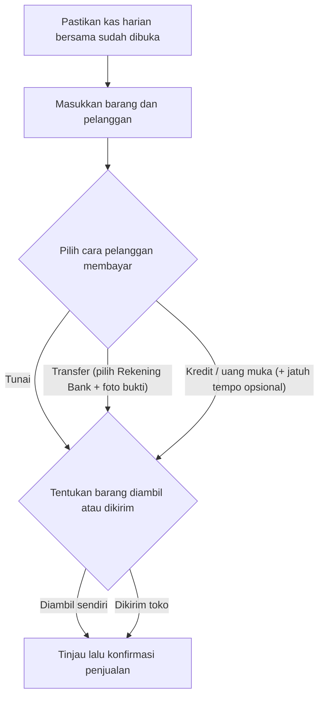
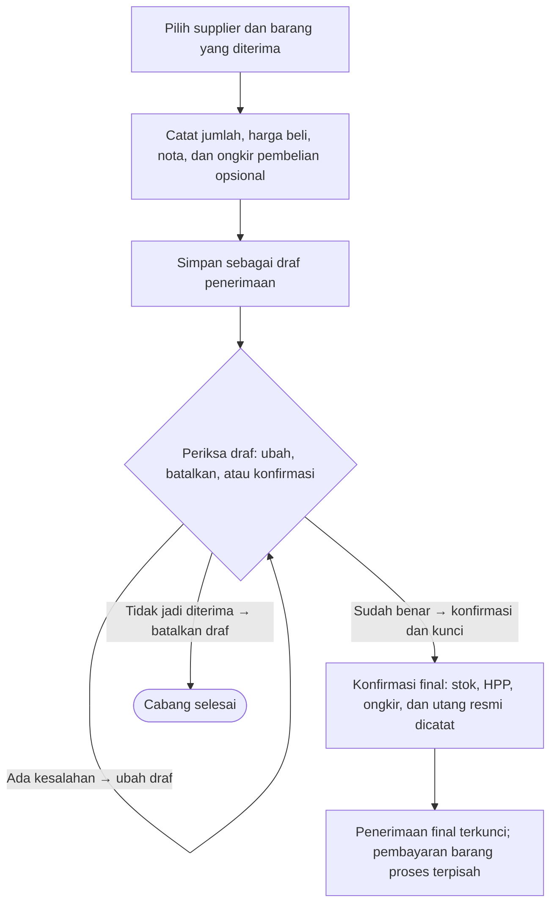
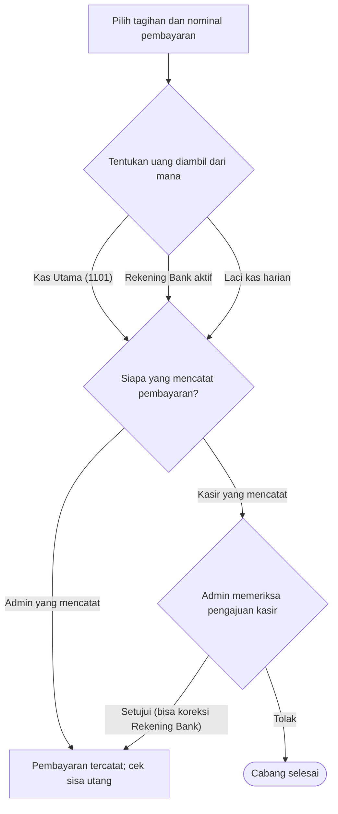
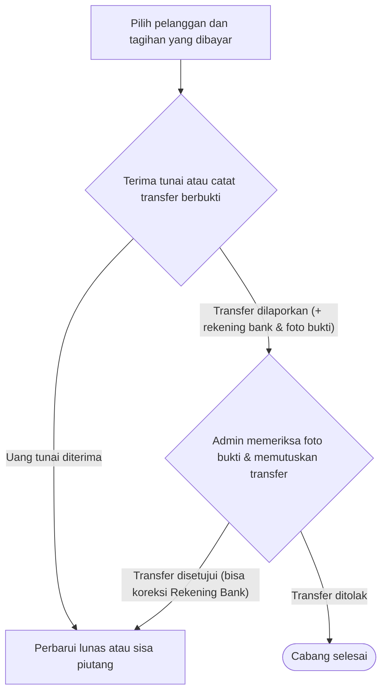
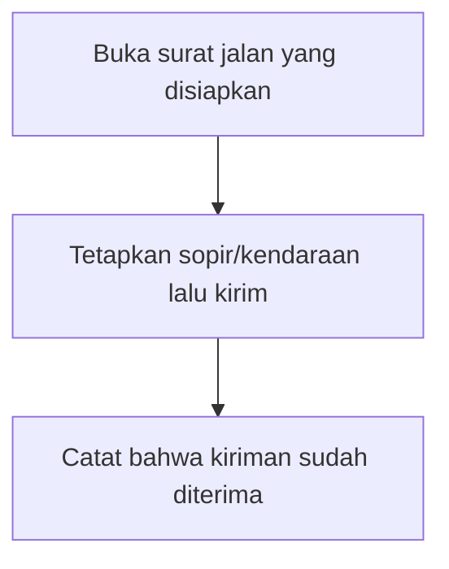
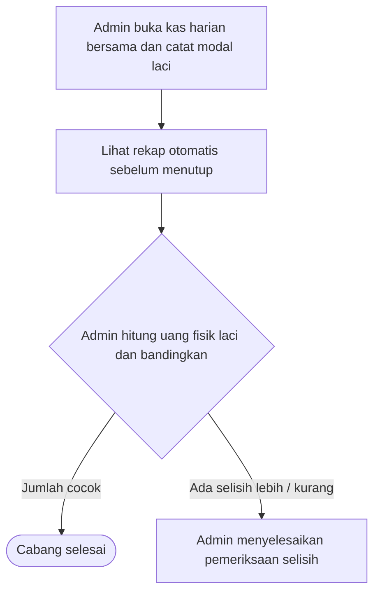
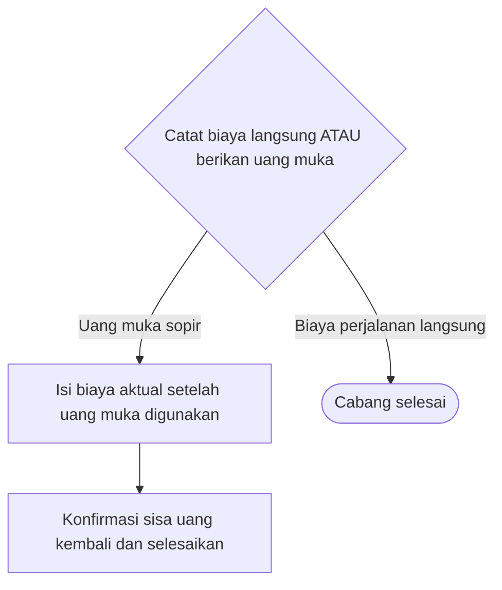
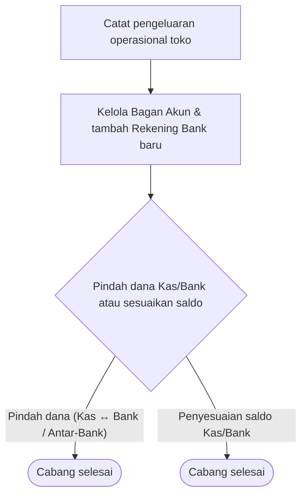
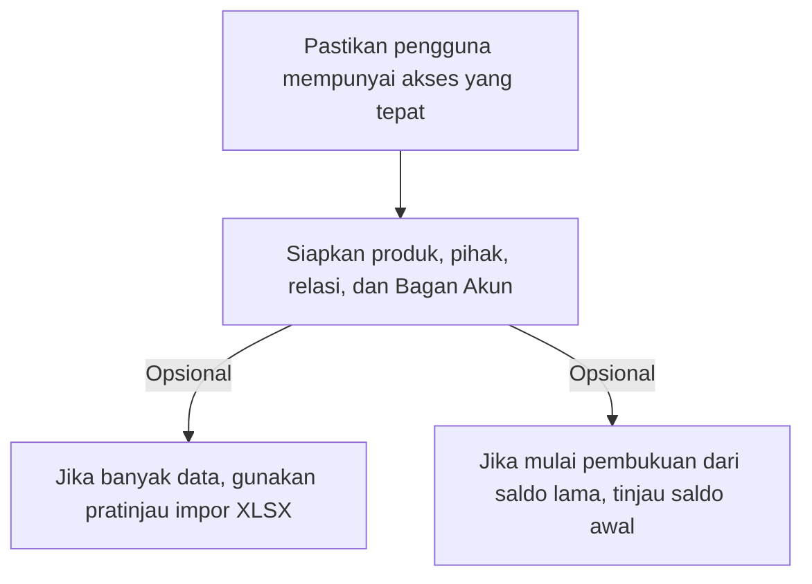
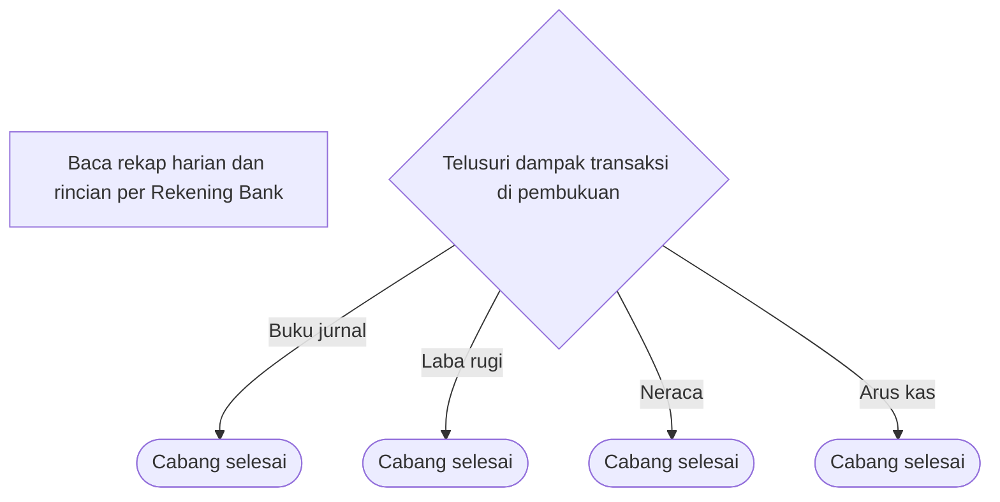

<!-- Generated by docx/live.py; edit sumber/alur-operasional.json instead. -->
# Diagram alur sistem Kasir Bangunan

Alur bisnis dari kode working tree. Pilihan/cabang bukan urutan wajib. Bukti kode ada per tahap.

Cakupan: operasional V2. Konfigurasi runtime, database, deployment dan alur V1 tidak diuji.

Batas penting: draf belum mengubah stok; final penerimaan menambah stok/utang tanpa kas keluar; transfer menunggu bukan uang bank yang sudah dibukukan.

## Penjualan

Ada pelanggan yang akan membeli barang dan kas harian bersama toko sudah dibuka admin.

| Tahap | Pelaku | Bukti sumber |
| --- | --- | --- |
| Pastikan kas harian bersama sudah dibuka | Admin membuka; semua kasir memakai bersama | app/Services/V2/Operations.php:52-142; app/Http/Controllers/V2/WorkspaceController.php:493-530; app/Services/V2/Operations.php:289-659; app/Services/V2/Operations.php:1032-1040 |
| Masukkan barang dan pelanggan | Kasir atau admin | resources/views/v2/pos-cashier.blade.php:17-34; resources/views/v2/pos-cashier-script.blade.php:179-190; resources/views/v2/workspace.blade.php:532-548; app/Http/Controllers/V2/WorkspaceController.php:493-530; app/Services/V2/Operations.php:289-659; app/Services/V2/Operations.php:1032-1040 |
| Pilih cara pelanggan membayar | Kasir atau admin | app/Services/V2/Operations.php:289-659; app/Services/V2/Operations.php:1072-1079 |
| Tentukan barang diambil atau dikirim | Kasir atau admin | app/Services/V2/Operations.php:289-659; routes/v2.php:31-35 |
| Tinjau lalu konfirmasi penjualan | Kasir atau admin; sistem menyimpan | resources/views/v2/pos-cashier.blade.php:17-34; resources/views/v2/pos-cashier-script.blade.php:179-190; resources/views/v2/workspace.blade.php:532-548; app/Services/V2/Operations.php:289-659; app/Services/V2/Operations.php:1072-1079; app/Services/V2/Ledger.php:19-131 |

Hasil: Nota tersimpan, stok sudah berkurang; pembayaran, bukti transfer, jatuh tempo kredit, dan pengiriman mengikuti pilihan transaksi.

## Barang masuk

Barang dari supplier akan dicatat sebagai penerimaan toko.

| Tahap | Pelaku | Bukti sumber |
| --- | --- | --- |
| Pilih supplier dan barang yang diterima | Admin | app/Services/V2/SupplyTrips.php:448-483; app/Http/Controllers/V2/WorkspaceController.php:668-673; app/Services/V2/MasterRelations.php:113-141; app/Services/V2/MasterRelations.php:144-190 |
| Catat jumlah, harga beli, nota, dan ongkir pembelian opsional | Admin | app/Services/V2/ReceiptDrafts.php:17-51; app/Http/Controllers/V2/WorkspaceController.php:634-639; app/Services/V2/SupplyTrips.php:620-651 |
| Simpan sebagai draf penerimaan | Admin | app/Services/V2/ReceiptDrafts.php:17-51; app/Http/Controllers/V2/WorkspaceController.php:634-639; app/Services/V2/SupplyTrips.php:620-651; app/Http/Controllers/V2/WorkspaceController.php:39-157; app/Services/V2/Operations.php:35-43 |
| Periksa draf: ubah, batalkan, atau konfirmasi | Admin | app/Services/V2/ReceiptDrafts.php:17-51; app/Services/V2/ReceiptDrafts.php:191-199; resources/views/v2/sprint2.blade.php:873-891; app/Services/V2/ReceiptDrafts.php:85-104; app/Services/V2/ReceiptDrafts.php:201-209; app/Services/V2/ReceiptDrafts.php:54-82; app/Http/Controllers/V2/WorkspaceController.php:646-652; app/Services/V2/SupplyTrips.php:42-288 |
| Konfirmasi final: stok, HPP, ongkir, dan utang resmi dicatat | Admin mengonfirmasi; sistem membukukan | app/Services/V2/ReceiptDrafts.php:54-82; app/Http/Controllers/V2/WorkspaceController.php:646-652; app/Services/V2/SupplyTrips.php:42-288 |
| Penerimaan final terkunci; pembayaran barang proses terpisah | Admin | app/Services/V2/SupplyTrips.php:610-617; app/Http/Controllers/V2/WorkspaceController.php:660-665; app/Services/V2/SupplyTrips.php:42-288; app/Services/V2/ReceiptDrafts.php:54-82; app/Services/V2/Operations.php:665-823; app/Http/Controllers/V2/WorkspaceController.php:532-545; app/Services/V2/Operations.php:1131-1143 |

Hasil: Setelah konfirmasi final, stok dan harga pokok diperbarui, ongkir pembelian (bila ada) dibebankan, dan tagihan supplier tersimpan.

## Bayar supplier

Ada utang supplier yang belum lunas dari penerimaan final atau saldo awal.

| Tahap | Pelaku | Bukti sumber |
| --- | --- | --- |
| Pilih tagihan dan nominal pembayaran | Admin atau kasir | app/Services/V2/Operations.php:665-823; app/Http/Controllers/V2/WorkspaceController.php:532-545; app/Services/V2/Operations.php:1131-1143 |
| Tentukan uang diambil dari mana | Admin atau kasir | app/Services/V2/Operations.php:665-823; app/Services/V2/Operations.php:912-994; app/Services/V2/Operations.php:996-1008 |
| Siapa yang mencatat pembayaran? | Admin atau kasir | app/Services/V2/Operations.php:665-823; app/Services/V2/Operations.php:912-994; app/Services/V2/Operations.php:996-1008 |
| Admin memeriksa pengajuan kasir | Admin | app/Services/V2/Operations.php:825-905; app/Services/V2/Operations.php:912-994; app/Services/V2/Operations.php:255-287; app/Http/Controllers/V2/WorkspaceController.php:603-612 |
| Pembayaran tercatat; cek sisa utang | Sistem | app/Services/V2/Operations.php:665-823; app/Services/V2/Operations.php:912-994; app/Services/V2/Operations.php:996-1008; app/Services/V2/Operations.php:825-905 |

Hasil: Jika pembayaran diposting, utang berkurang dan uang sumber terpilih berkurang; pengajuan yang ditolak tidak mengubah saldo.

## Tagih pelanggan

Ada tagihan pelanggan terbuka dari penjualan atau saldo awal.

| Tahap | Pelaku | Bukti sumber |
| --- | --- | --- |
| Pilih pelanggan dan tagihan yang dibayar | Kasir atau admin | app/Services/V2/Operations.php:665-823; app/Http/Controllers/V2/WorkspaceController.php:532-545; app/Services/V2/Operations.php:1131-1143 |
| Terima tunai atau catat transfer berbukti | Kasir atau admin | app/Services/V2/Operations.php:665-823 |
| Admin memeriksa foto bukti & memutuskan transfer | Admin | app/Services/V2/Operations.php:825-905; app/Services/V2/Operations.php:255-287; app/Http/Controllers/V2/WorkspaceController.php:603-612 |
| Perbarui lunas atau sisa piutang | Sistem | app/Services/V2/Operations.php:665-823; app/Services/V2/Operations.php:825-905 |

Hasil: Piutang berkurang setelah uang tunai dicatat atau transfer disetujui admin, bukan saat transfer baru diajukan.

## Pengiriman barang

Penjualan memilih kirim sehingga sudah memiliki surat jalan Disiapkan.

| Tahap | Pelaku | Bukti sumber |
| --- | --- | --- |
| Buka surat jalan yang disiapkan | Admin atau kasir pemilik penjualan | app/Services/V2/Operations.php:289-659; routes/v2.php:31-35; app/Services/V2/ReportsDocuments.php:209-291 |
| Tetapkan sopir/kendaraan lalu kirim | Admin atau kasir pemilik penjualan | app/Services/V2/TransportAssignment.php:35-63; app/Services/V2/TransportAssignment.php:24-32; app/Services/V2/DeliveryTrips.php:35-68; app/Services/V2/DeliveryTrips.php:388-401 |
| Catat bahwa kiriman sudah diterima | Admin atau kasir pemilik penjualan | app/Services/V2/DeliveryTrips.php:71-97 |

Hasil: Pengiriman berstatus Diterima, dengan catatan petugas dan waktu; pembayaran tetap alur terpisah.

## Kas harian (buka & tutup)

Toko mulai berjualan hari ini atau mengakhiri hari kerja.

| Tahap | Pelaku | Bukti sumber |
| --- | --- | --- |
| Admin buka kas harian bersama dan catat modal laci | Admin | app/Services/V2/Operations.php:52-142 |
| Lihat rekap otomatis sebelum menutup | Admin (seluruh kasir); kasir hanya rincian penjualannya | app/Services/V2/ShiftClosingSummary.php:19-121; resources/views/v2/workspace.blade.php:670-684; resources/views/v2/workspace.blade.php:702-714; resources/views/v2/workspace.blade.php:457-462 |
| Admin hitung uang fisik laci dan bandingkan | Admin | resources/views/v2/workspace.blade.php:670-684; resources/views/v2/workspace.blade.php:702-714; resources/views/v2/workspace.blade.php:457-462; app/Services/V2/Operations.php:144-204; app/Services/V2/Operations.php:207-222; app/Services/V2/Operations.php:52-142 |
| Admin menyelesaikan pemeriksaan selisih | Admin | app/Services/V2/Operations.php:224-253; resources/views/v2/sprint2.blade.php:58-75; app/Services/V2/Operations.php:144-204; app/Services/V2/Operations.php:52-142; app/Services/V2/Operations.php:825-905; app/Services/V2/Operations.php:912-994 |

Hasil: Kas harian ditutup dengan catatan uang seharusnya, uang fisik, serta selisih jika ada; setor ke bank dilakukan lewat Pindah Dana.

## Biaya dan uang muka sopir

Ada biaya perjalanan atau uang muka yang akan diberikan kepada sopir.

| Tahap | Pelaku | Bukti sumber |
| --- | --- | --- |
| Catat biaya langsung ATAU berikan uang muka | Admin | app/Services/V2/SupplyTrips.php:296-440; app/Services/V2/DeliveryTrips.php:105-226 |
| Isi biaya aktual setelah uang muka digunakan | Admin | app/Services/V2/DeliveryTrips.php:234-385 |
| Konfirmasi sisa uang kembali dan selesaikan | Admin | app/Services/V2/DeliveryTrips.php:234-385 |

Hasil: Biaya langsung tercatat, atau uang muka diselesaikan dengan rincian biaya aktual dan sisa yang kembali.

## Pengeluaran & kelola kas/bank

Ada biaya operasional toko, kebutuhan menambah rekening bank baru, setor/tarik/transfer antar kas-bank, atau koreksi saldo.

| Tahap | Pelaku | Bukti sumber |
| --- | --- | --- |
| Catat pengeluaran operasional toko | Admin aktif | app/Services/V2/OperatingExpenses.php:27-131; app/Http/Controllers/V2/OperatingExpenseController.php:14-53; app/Services/V2/Ledger.php:19-131 |
| Kelola Bagan Akun & tambah Rekening Bank baru | Admin aktif | app/Http/Controllers/ChartOfAccountController.php:139-189; app/Http/Controllers/ChartOfAccountController.php:262-277; app/Services/V2/BankAccounts.php:73-87 |
| Pindah dana Kas/Bank atau sesuaikan saldo | Admin aktif (konfirmasi kata sandi) | app/Services/V2/CashBankTransfers.php:32-150; app/Services/V2/CashBankAdjustments.php:35-138; app/Services/V2/Ledger.php:19-131 |

Hasil: Pengeluaran atau perpindahan/penyesuaian tercatat dengan jurnal seimbang dan terkunci; rekening bank baru langsung aktif di semua form pembayaran.

## Persiapan toko

Data dasar, akun, atau rekening yang diperlukan transaksi belum tersedia.

| Tahap | Pelaku | Bukti sumber |
| --- | --- | --- |
| Pastikan pengguna mempunyai akses yang tepat | Admin | app/Http/Controllers/AuthController.php:149-199; app/Http/Controllers/AuthController.php:201-208; app/Http/Middleware/EnsureActiveAccount.php:11-30; app/Services/V2/Operations.php:35-43; bootstrap/app.php:14-16; app/Http/Controllers/V2/AccountController.php:57-145; app/Http/Controllers/V2/AccountController.php:147-333; app/Services/V2/MasterRelations.php:192-215; app/Services/V2/MasterRelations.php:217-225; app/Services/V2/MasterRelations.php:96-110 |
| Siapkan produk, pihak, relasi, dan Bagan Akun | Admin | app/Services/V2/MasterData.php:96-131; app/Services/V2/MasterData.php:137-189; app/Services/V2/MasterData.php:192-208; app/Services/V2/MasterData.php:211-227; app/Services/V2/MasterRelations.php:31-44; app/Services/V2/MasterRelations.php:46-67; app/Services/V2/MasterRelations.php:82-93; app/Services/V2/MasterRelations.php:192-215; app/Services/V2/MasterRelations.php:217-225; app/Services/V2/MasterRelations.php:96-110; app/Services/V2/MasterRelations.php:113-141; app/Services/V2/MasterRelations.php:144-190; app/Http/Controllers/ChartOfAccountController.php:139-189; app/Http/Controllers/ChartOfAccountController.php:262-277; app/Services/V2/BankAccounts.php:73-87 |
| Jika banyak data, gunakan pratinjau impor XLSX | Admin | app/Services/V2/MasterData.php:374-381; app/Services/V2/MasterData.php:51-59; app/Services/V2/MasterData.php:521-527; app/Services/V2/MasterData.php:383-469; app/Http/Controllers/V2/WorkspaceController.php:621-627; app/Services/V2/MasterData.php:471-519; app/Services/V2/MasterData.php:96-131 |
| Jika mulai pembukuan dari saldo lama, tinjau saldo awal | Admin | app/Services/V2/OpeningBalances.php:60-75; app/Services/V2/OpeningBalances.php:261-292; app/Services/V2/OpeningBalances.php:84-254 |

Hasil: Barang, pelanggan/supplier, opsi, rekening bank, serta akses siap dipakai sesuai peran; stok tidak dikarang dari master.

## Rekap dan pembukuan

Ada kegiatan operasional atau jurnal yang ingin dibaca hasilnya.

| Tahap | Pelaku | Bukti sumber |
| --- | --- | --- |
| Baca rekap harian dan rincian per Rekening Bank | Admin seluruh cakupan; kasir penjualan sendiri + laci bersama | app/Services/V2/ReportsDocuments.php:41-207; app/Services/V2/ShiftClosingSummary.php:19-121 |
| Telusuri dampak transaksi di pembukuan | Admin | app/Services/V2/Ledger.php:19-131; app/Http/Controllers/JournalController.php:19-55; app/Http/Middleware/V2Cutover.php:12-31; app/Services/AccountingReportService.php:96-188; app/Services/AccountingReportService.php:38-60; app/Services/AccountingReportService.php:230-298; app/Services/AccountingReportService.php:194-224; app/Services/AccountingReportService.php:304-688 |

Hasil: Rekap dan laporan menampilkan hasil baca data; membuka laporan tidak membuat transaksi atau menutup periode.

