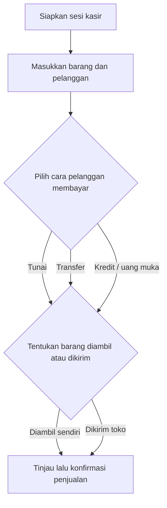
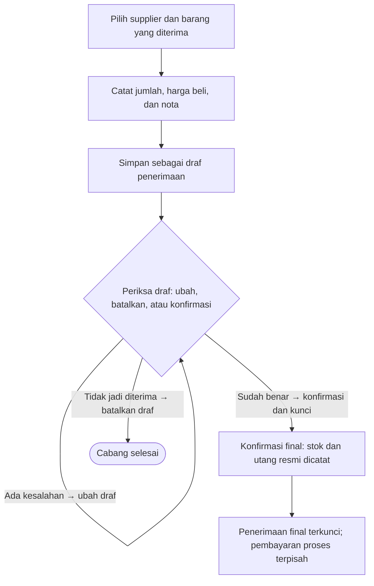
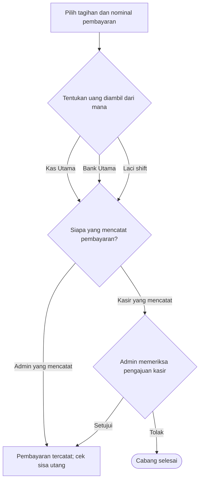
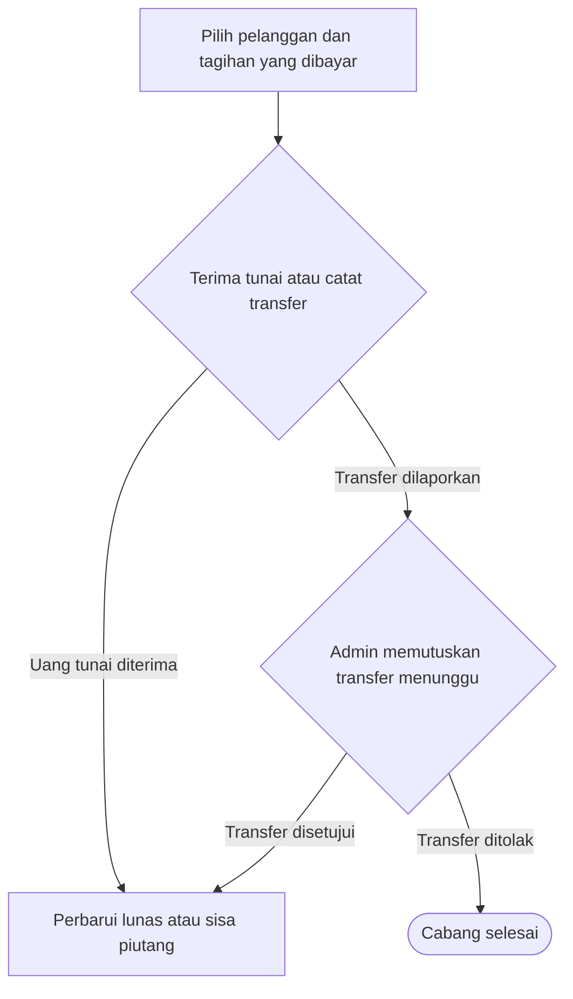
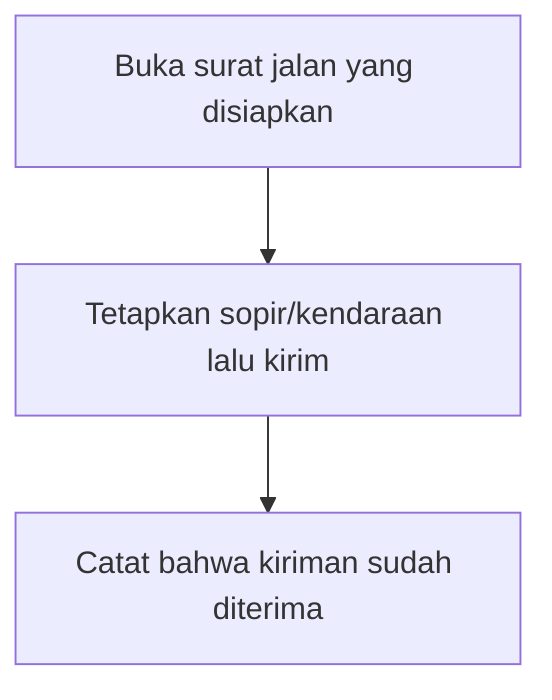
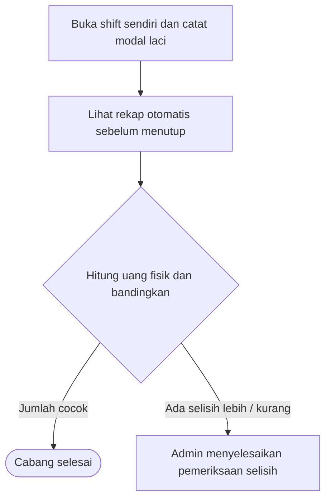
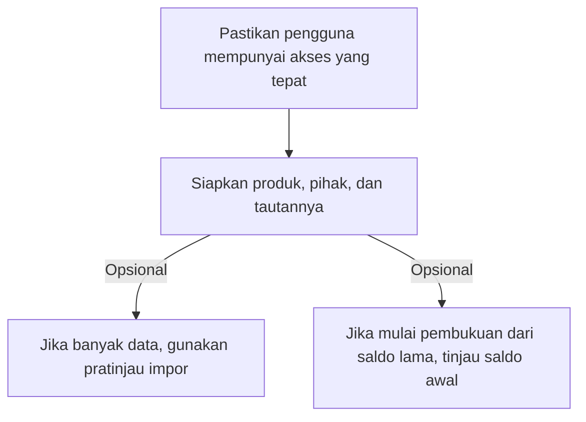
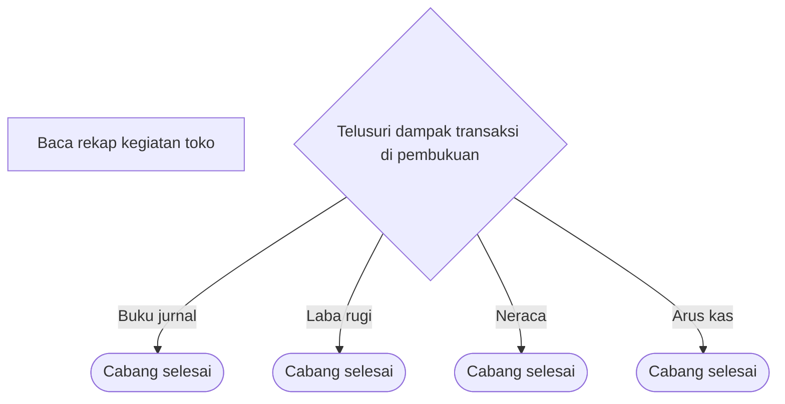

<!-- Generated by docx/live.py; edit sumber/alur-operasional.json instead. -->
# Diagram alur sistem Kasir Bangunan

Alur bisnis dari kode working tree. Pilihan/cabang bukan urutan wajib. Bukti kode ada per tahap.

Cakupan: operasional V2. Konfigurasi runtime, database, deployment dan alur V1 tidak diuji.

Batas penting: draf belum mengubah stok; final penerimaan menambah stok/utang tanpa kas keluar; transfer menunggu bukan uang bank yang sudah dibukukan.

## Penjualan

Ada pelanggan yang akan membeli barang dan kasir mempunyai shift terbuka.

| Tahap | Pelaku | Bukti sumber |
| --- | --- | --- |
| Siapkan sesi kasir | Kasir atau admin | app/Services/V2/Operations.php:51-132; app/Http/Controllers/V2/WorkspaceController.php:296-320 |
| Masukkan barang dan pelanggan | Kasir atau admin | resources/views/v2/pos-cashier.blade.php:17-30; resources/views/v2/pos-cashier-script.blade.php:155-167; resources/views/v2/workspace.blade.php:581-598; app/Http/Controllers/V2/WorkspaceController.php:296-320; app/Services/V2/Operations.php:279-633 |
| Pilih cara pelanggan membayar | Kasir atau admin | app/Services/V2/Operations.php:279-633 |
| Tentukan barang diambil atau dikirim | Kasir atau admin | app/Services/V2/Operations.php:279-633; routes/v2.php:16-19 |
| Tinjau lalu konfirmasi penjualan | Kasir atau admin; sistem menyimpan | resources/views/v2/pos-cashier.blade.php:17-30; resources/views/v2/pos-cashier-script.blade.php:155-167; resources/views/v2/workspace.blade.php:581-598; app/Services/V2/Operations.php:279-633; app/Services/V2/Ledger.php:19-131 |

Hasil: Nota tersimpan, stok sudah berkurang; pembayaran dan pengiriman mengikuti pilihan transaksi.

## Barang masuk

Barang dari supplier akan dicatat sebagai penerimaan toko.

| Tahap | Pelaku | Bukti sumber |
| --- | --- | --- |
| Pilih supplier dan barang yang diterima | Admin | app/Services/V2/SupplyTrips.php:391-423; app/Services/V2/MasterRelations.php:100-128; app/Services/V2/MasterRelations.php:131-177 |
| Catat jumlah, harga beli, dan nota | Admin | app/Services/V2/ReceiptDrafts.php:16-46; app/Services/V2/ReceiptDrafts.php:102-155 |
| Simpan sebagai draf penerimaan | Admin | app/Services/V2/ReceiptDrafts.php:16-46; app/Services/V2/ReceiptDrafts.php:102-155; app/Http/Controllers/V2/WorkspaceController.php:34-218 |
| Periksa draf: ubah, batalkan, atau konfirmasi | Admin | app/Services/V2/ReceiptDrafts.php:16-46; app/Services/V2/ReceiptDrafts.php:174-182; resources/views/v2/sprint2.blade.php:787-799; app/Services/V2/ReceiptDrafts.php:76-95; app/Services/V2/ReceiptDrafts.php:184-192; app/Services/V2/ReceiptDrafts.php:49-73 |
| Konfirmasi final: stok dan utang resmi dicatat | Admin mengonfirmasi; sistem membukukan | app/Services/V2/ReceiptDrafts.php:49-73; app/Services/V2/SupplyTrips.php:40-242 |
| Penerimaan final terkunci; pembayaran proses terpisah | Admin | app/Services/V2/SupplyTrips.php:433-440; app/Services/V2/SupplyTrips.php:40-242; app/Services/V2/ReceiptDrafts.php:49-73; app/Services/V2/Operations.php:639-782 |

Hasil: Setelah konfirmasi final, stok dan harga pokok diperbarui, dokumen penerimaan serta tagihan supplier tersimpan.

## Bayar supplier

Ada utang supplier yang belum lunas dari penerimaan final atau saldo awal.

| Tahap | Pelaku | Bukti sumber |
| --- | --- | --- |
| Pilih tagihan dan nominal pembayaran | Admin atau kasir | app/Services/V2/Operations.php:639-782 |
| Tentukan uang diambil dari mana | Admin atau kasir | app/Services/V2/Operations.php:639-782; app/Services/V2/Operations.php:855-928 |
| Siapa yang mencatat pembayaran? | Admin atau kasir | app/Services/V2/Operations.php:639-782; app/Services/V2/Operations.php:855-928 |
| Admin memeriksa pengajuan kasir | Admin | app/Services/V2/Operations.php:784-848; app/Services/V2/Operations.php:245-277 |
| Pembayaran tercatat; cek sisa utang | Sistem | app/Services/V2/Operations.php:639-782; app/Services/V2/Operations.php:855-928; app/Services/V2/Operations.php:784-848 |

Hasil: Jika pembayaran diposting, utang berkurang dan uang sumber terpilih berkurang; pengajuan yang ditolak tidak mengubah saldo.

## Tagih pelanggan

Ada tagihan pelanggan terbuka dari penjualan atau saldo awal.

| Tahap | Pelaku | Bukti sumber |
| --- | --- | --- |
| Pilih pelanggan dan tagihan yang dibayar | Kasir atau admin | app/Services/V2/Operations.php:639-782 |
| Terima tunai atau catat transfer | Kasir atau admin | app/Services/V2/Operations.php:639-782 |
| Admin memutuskan transfer menunggu | Admin | app/Services/V2/Operations.php:784-848; app/Services/V2/Operations.php:245-277 |
| Perbarui lunas atau sisa piutang | Sistem | app/Services/V2/Operations.php:639-782; app/Services/V2/Operations.php:784-848 |

Hasil: Piutang berkurang setelah uang tunai dicatat atau transfer disetujui, bukan saat transfer baru diajukan.

## Pengiriman barang

Penjualan memilih kirim sehingga sudah memiliki surat jalan Disiapkan.

| Tahap | Pelaku | Bukti sumber |
| --- | --- | --- |
| Buka surat jalan yang disiapkan | Admin atau kasir pemilik penjualan | app/Services/V2/Operations.php:279-633; routes/v2.php:16-19; app/Services/V2/ReportsDocuments.php:179-264 |
| Tetapkan sopir/kendaraan lalu kirim | Admin atau kasir pemilik penjualan | app/Services/V2/TransportAssignment.php:35-63; app/Services/V2/TransportAssignment.php:24-32; app/Services/V2/DeliveryTrips.php:34-67 |
| Catat bahwa kiriman sudah diterima | Admin atau kasir pemilik penjualan | app/Services/V2/DeliveryTrips.php:70-96 |

Hasil: Pengiriman berstatus Diterima, dengan catatan petugas dan waktu; pembayaran tetap alur terpisah.

## Buka dan tutup shift

Kasir mulai atau mengakhiri sesi kerja.

| Tahap | Pelaku | Bukti sumber |
| --- | --- | --- |
| Buka shift sendiri dan catat modal laci | Kasir atau admin | app/Services/V2/Operations.php:51-132 |
| Lihat rekap otomatis sebelum menutup | Kasir pemilik shift atau admin | app/Services/V2/ShiftClosingSummary.php:19-118; resources/views/v2/workspace.blade.php:713-725; resources/views/v2/workspace.blade.php:745-755; resources/views/v2/workspace.blade.php:508-512 |
| Hitung uang fisik dan bandingkan | Kasir pemilik shift atau admin | resources/views/v2/workspace.blade.php:713-725; resources/views/v2/workspace.blade.php:745-755; resources/views/v2/workspace.blade.php:508-512; app/Services/V2/Operations.php:134-194 |
| Admin menyelesaikan pemeriksaan selisih | Admin | app/Services/V2/Operations.php:214-243; resources/views/v2/sprint2.blade.php:58-72; app/Services/V2/Operations.php:134-194; app/Services/V2/Operations.php:784-848 |

Hasil: Shift ditutup dengan catatan uang seharusnya, uang fisik, serta selisih jika ada.

## Biaya dan uang muka sopir

Ada biaya perjalanan atau uang muka yang akan diberikan kepada sopir.

| Tahap | Pelaku | Bukti sumber |
| --- | --- | --- |
| Catat biaya langsung ATAU berikan uang muka | Admin | app/Services/V2/SupplyTrips.php:250-383; app/Services/V2/DeliveryTrips.php:104-214 |
| Isi biaya aktual setelah uang muka digunakan | Admin | app/Services/V2/DeliveryTrips.php:222-362 |
| Konfirmasi sisa uang kembali dan selesaikan | Admin | app/Services/V2/DeliveryTrips.php:222-362 |

Hasil: Biaya langsung tercatat, atau uang muka diselesaikan dengan rincian biaya aktual dan sisa yang kembali.

## Persiapan toko

Data dasar atau akses yang diperlukan transaksi belum tersedia.

| Tahap | Pelaku | Bukti sumber |
| --- | --- | --- |
| Pastikan pengguna mempunyai akses yang tepat | Admin | app/Http/Controllers/AuthController.php:126-176; app/Http/Middleware/EnsureActiveAccount.php:11-30; bootstrap/app.php:14-16; app/Http/Controllers/V2/AccountController.php:57-145; app/Http/Controllers/V2/AccountController.php:147-333; app/Services/V2/MasterRelations.php:179-202; app/Services/V2/MasterRelations.php:204-212; app/Services/V2/MasterRelations.php:83-97 |
| Siapkan produk, pihak, dan tautannya | Admin | app/Services/V2/MasterData.php:95-130; app/Services/V2/MasterData.php:240-277; app/Services/V2/MasterData.php:136-188; app/Services/V2/MasterData.php:191-207; app/Services/V2/MasterData.php:210-221; app/Services/V2/MasterRelations.php:31-44; app/Services/V2/MasterRelations.php:46-67; app/Services/V2/MasterRelations.php:100-128; app/Services/V2/MasterRelations.php:179-202; app/Services/V2/MasterRelations.php:204-212; app/Services/V2/MasterRelations.php:83-97; app/Services/V2/MasterRelations.php:131-177 |
| Jika banyak data, gunakan pratinjau impor | Admin | app/Services/V2/MasterData.php:354-361; app/Services/V2/MasterData.php:50-58; app/Services/V2/MasterData.php:501-507; app/Services/V2/MasterData.php:363-449; app/Services/V2/MasterData.php:451-499; app/Services/V2/MasterData.php:95-130 |
| Jika mulai pembukuan dari saldo lama, tinjau saldo awal | Admin | app/Services/V2/OpeningBalances.php:60-75; app/Services/V2/OpeningBalances.php:261-292; app/Services/V2/OpeningBalances.php:84-254 |

Hasil: Barang, pelanggan/supplier, opsi, serta akses siap dipakai sesuai peran; stok tidak dikarang dari master.

## Rekap dan pembukuan

Ada kegiatan operasional atau jurnal yang ingin dibaca hasilnya.

| Tahap | Pelaku | Bukti sumber |
| --- | --- | --- |
| Baca rekap kegiatan toko | Admin seluruh cakupan; kasir milik sendiri | app/Services/V2/ReportsDocuments.php:42-177; app/Services/V2/ShiftClosingSummary.php:19-118 |
| Telusuri dampak transaksi di pembukuan | Admin | app/Services/V2/Ledger.php:19-131; app/Http/Controllers/JournalController.php:18-34; app/Http/Middleware/V2Cutover.php:12-31; app/Http/Controllers/JournalController.php:36-46; app/Services/AccountingReportService.php:95-187; app/Services/AccountingReportService.php:37-59; app/Services/AccountingReportService.php:229-297; app/Services/AccountingReportService.php:193-223; app/Services/AccountingReportService.php:303-686 |

Hasil: Rekap dan laporan menampilkan hasil baca data; membuka laporan tidak membuat transaksi atau menutup periode.

