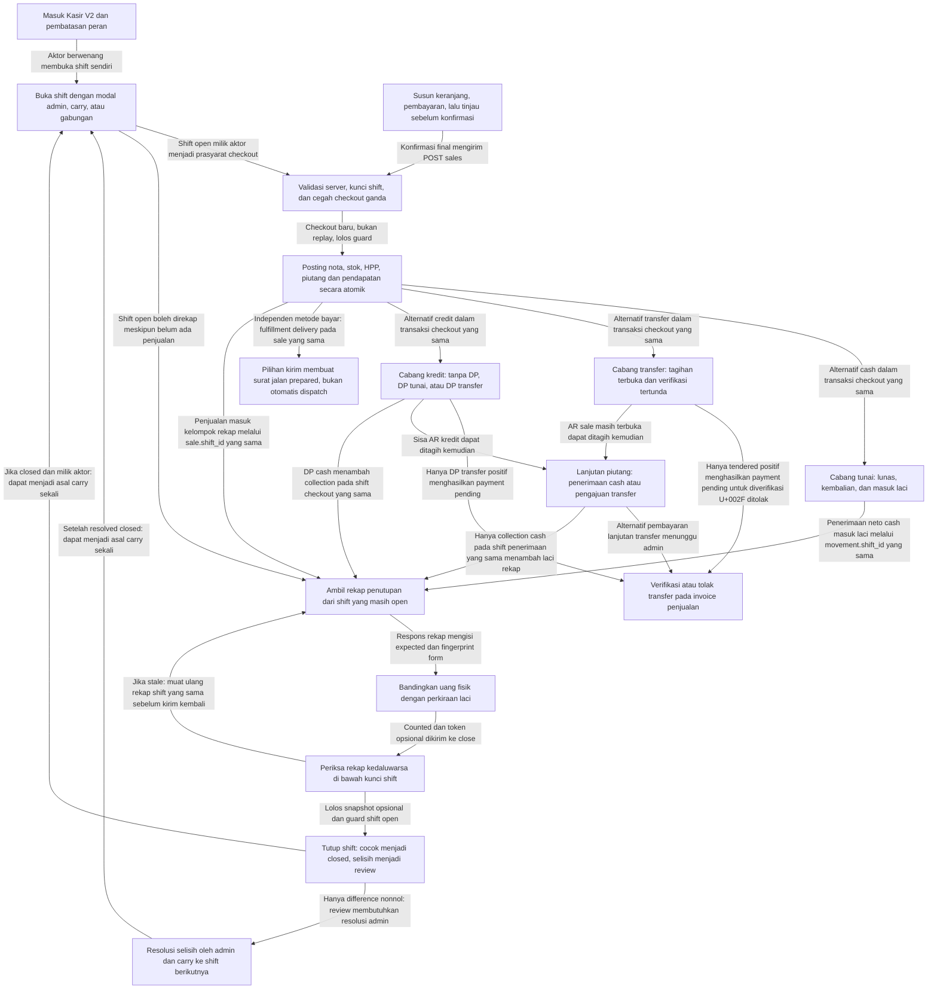

<!-- Generated by peta-alur-hidup/render.py; do not edit. -->

# Kasir V2 &#8212; Penjualan dan lifecycle shift sampai rekap penutupan &#40;berbasis kode&#41;

## Rincian langkah

| ID | Langkah | Pelaku | Syarat awal | Hasil | Bukti kode | Tabel |
| --- | --- | --- | --- | --- | --- | --- |
| KS01 | Masuk Kasir V2 dan pembatasan peran | Admin&#47;kasir aktif | GET &#47; &#40;pos.index&#41; dalam grup auth&#59; ketika config v2.enabled aktif&#44; PosController&#58;&#58;index menyerahkan request ke WorkspaceController&#58;&#58;index. GET &#47;v2 mengarah ke pos.index saat V2 aktif. | Operations&#58;&#58;role mensyaratkan users.is&#95;active dan v2&#95;user&#95;roles admin&#47;cashier&#59; selain itu 403. Workspace menampilkan shift&#47;penjualan kasir sendiri&#44; admin lintas kasir. Cutover membuat rute legacy selain root hanya arsip GET admin&#59; bukan jalur checkout V2. | app&#47;Http&#47;Controllers&#47;PosController.php&#58;15 | users&#58; read&#59; v2&#95;sales&#58; read&#59; v2&#95;shifts&#58; read&#59; v2&#95;user&#95;roles&#58; read |
| KS02 | Buka shift dengan modal admin&#44; carry&#44; atau gabungan | Admin&#47;kasir untuk shift sendiri | POST &#47;v2&#47;shifts membawa cash string&#44; source admin&#124;carry&#124;both&#44; carry&#95;from nullable. Role server wajib admin&#47;cashier&#59; modal tidak negatif&#59; aktor tidak boleh masih memiliki shift open. | Transaksi mengunci shift asal bila carry&#59; asal wajib closed&#44; milik aktor&#44; counted&#95;cash tersedia&#47;tidak negatif dan belum pernah dibawa. carry paling banyak uang hitung asal&#59; both wajib modal melebihi seluruh uang hitung asal serta kedua komponen positif. Insert v2&#95;shifts open&#44; open&#95;user&#95;id&#61;aktor&#44; opening&#95;cash&#47;carry&#95;amount&#47;admin&#95;amount dan carried&#95;from&#95;id. Tidak ada jurnal modal atau mutasi laci pada openShift&#59; sumber admin adalah label sumber&#44; bukan persetujuan admin. | app&#47;Services&#47;V2&#47;Operations.php&#58;51 | users&#58; read&#59; v2&#95;shifts&#58; read&#44;create&#59; v2&#95;user&#95;roles&#58; read |
| KS03 | Susun keranjang&#44; pembayaran&#44; lalu tinjau sebelum konfirmasi | Admin&#47;kasir | Form Kasir beraksi ke route v2.sales.store &#40;POST &#47;v2&#47;sales&#41;. Pilih produk&#47;jumlah&#44; pelanggan&#44; harga retail&#47;contractor&#44; diskon item&#47;nota&#44; ongkir&#44; metode cash&#124;transfer&#124;credit&#44; nominal&#44; DP dan pickup&#124;delivery&#59; delivery membawa destination. | Dialog pembayaran lalu tinjau tetap belum menyimpan. Konfirmasi final menetapkan &#95;&#95;finalConfirmed dan requestSubmit&#59; handler membentuk payload dan kunci idempotensi. Respons sukses menampilkan nomor&#47;status&#47;kembalian&#44; tautan nota&#44; mengganti kunci dan mengosongkan item&#59; event v2&#58;sale&#45;saved mengubah dialog menjadi hasil. Validasi UI bukan pengganti server. | resources&#47;views&#47;v2&#47;pos&#45;cashier.blade.php&#58;17 |  |
| KS04 | Validasi server&#44; kunci shift&#44; dan cegah checkout ganda | Server atas admin&#47;kasir | POST &#47;v2&#47;sales divalidasi WorkspaceController&#58;&#58;checkout&#58; 1&#8211;100 item&#44; string nominal&#44; enum&#44; kunci 8&#8211;100 karakter dan tujuan delivery. Operations memeriksa pelanggan aktif &#40;wajib transfer&#47;kredit&#41;&#44; metode&#44; fulfillment dan diskon. | Di dalam satu transaksi&#44; openShiftFor mengunci shift open milik aktor SEBELUM mencari replay. Kunci lama hanya dapat diulang aktor sama dengan request&#95;hash sama&#59; berbeda aktor 403 atau isi berbeda ditolak. Replay mengembalikan transaksi lama tanpa menulis lagi&#59; sesudah shift ditutup replay tetap dapat gagal karena syarat shift open diperiksa lebih dulu. Produk duplikat&#47;tidak ditemukan&#47;arsip&#44; jumlah tidak positif dan stok kurang ditolak. | app&#47;Http&#47;Controllers&#47;V2&#47;WorkspaceController.php&#58;297 | products&#58; read&#59; users&#58; read&#59; v2&#95;deliveries&#58; read&#59; v2&#95;invoices&#58; read&#59; v2&#95;parties&#58; read&#59; v2&#95;sales&#58; read&#59; v2&#95;shifts&#58; read&#59; v2&#95;user&#95;roles&#58; read |
| KS05 | Posting nota&#44; stok&#44; HPP&#44; piutang dan pendapatan secara atomik | Server | Checkout baru yang lolos validasi&#59; products dikunci urut id. Harga dibaca server dari selling&#95;price atau contractor&#95;price &#40;fallback eceran&#41;&#44; bukan harga kiriman klien. Qty skala 4&#44; uang skala 2&#59; HPP snapshot cost&#95;price. Total &#61; barang setelah diskon item &#8722; diskon nota &#43; ongkir&#44; wajib positif. | Dalam transaksi checkout yang sama dibuat INV v2&#95;sales dan snapshot v2&#95;sale&#95;items&#44; stok products berkurang dan stock&#95;movements reference&#95;type&#61;v2&#95;sale negatif. Semua metode membuat AR v2&#95;invoices dengan amount total dan paid sesuai cabang pembayaran&#59; invoice paid jika lunas&#44; selain itu open. Ledger v2&#95;sale&#58; DR1103 total&#59; CR4101 barang net bila positif&#59; CR4102 ongkir bila positif&#59; DR5101&#47;CR1301 HPP bila positif. Akun aktif dan jurnal seimbang wajib&#59; kegagalan membatalkan keseluruhan checkout. Pilihan cash&#47;transfer&#47;credit berikut adalah alternatif dalam transaksi ini&#44; bukan transaksi serial. | app&#47;Services&#47;V2&#47;Operations.php&#58;502 | chart&#95;of&#95;accounts&#58; read&#59; journal&#95;entries&#58; create&#59; journal&#95;entry&#95;lines&#58; create&#59; products&#58; read&#44;update&#59; stock&#95;movements&#58; create&#59; v2&#95;invoices&#58; create&#44;update&#59; v2&#95;sale&#95;items&#58; create&#59; v2&#95;sales&#58; create&#44;update |
| KS06 | Cabang tunai&#58; lunas&#44; kembalian&#44; dan masuk laci | Admin&#47;kasir&#59; server posting otomatis | Alternatif payment&#95;method&#61;cash pada POST &#47;v2&#47;sales. paid&#95;amount wajib dan tendered tidak boleh kurang dari total&#59; pelanggan umum boleh tanpa customer&#95;id. | paid&#61;total&#44; change&#61;tendered&#8722;total&#44; status sale paid dan invoice paid. Buat pembayaran cash posted&#47;approved&#95;by aktor&#59; jurnal DR1101&#47;CR1103 sebesar total&#44; bukan uang diserahkan. Mutasi laci in kind sale reference v2&#95;sale sebesar paid neto&#44; sehingga kembalian tidak dihitung sebagai penerimaan tambahan. Nota&#47;stok&#47;HPP&#47;pendapatan tetap melalui posting bersama KS05. | app&#47;Services&#47;V2&#47;Operations.php&#58;424 | chart&#95;of&#95;accounts&#58; read&#59; journal&#95;entries&#58; create&#59; journal&#95;entry&#95;lines&#58; create&#59; v2&#95;invoices&#58; create&#59; v2&#95;payments&#58; create&#44;update&#59; v2&#95;sales&#58; create&#59; v2&#95;shift&#95;movements&#58; create |
| KS07 | Cabang transfer&#58; tagihan terbuka dan verifikasi tertunda | Admin&#47;kasir menginput&#59; admin memverifikasi terpisah | Alternatif payment&#95;method&#61;transfer&#44; customer&#95;id aktif wajib&#59; paid&#95;amount hanya boleh nol atau persis total. | paid tetap nol sehingga sale unpaid dan AR open. Jika tendered positif dibuat payment transfer pending&#44; shift&#95;id null&#44; approved&#95;by&#47;journal&#95;entry&#95;id null&#59; belum menambah bank&#44; belum mengurangi AR dan tidak ada mutasi laci. Jika nominal nol&#44; tidak dibuat payment sama sekali. Stok&#47;HPP&#47;pendapatan tetap diposting saat checkout&#44; tidak menunggu verifikasi transfer&#59; lanjut KS11 hanya jika payment pending benar&#45;benar ada. | app&#47;Services&#47;V2&#47;Operations.php&#58;435 | v2&#95;invoices&#58; create&#59; v2&#95;payments&#58; create&#59; v2&#95;sales&#58; create |
| KS08 | Cabang kredit&#58; tanpa DP&#44; DP tunai&#44; atau DP transfer | Admin&#47;kasir | Alternatif payment&#95;method&#61;credit dengan pelanggan aktif. DP tidak negatif&#47;tidak melebihi total&#59; bila DP positif deposit&#95;method wajib cash&#124;transfer. | Tanpa DP&#58; paid nol&#44; sale unpaid&#44; AR open&#44; tanpa payment. DP cash&#58; paid langsung sebesar DP&#44; payment cash posted DR1101&#47;CR1103 dan mutasi laci in kind collection reference v2&#95;payment&#59; sale partial atau paid bila DP&#61;total&#44; AR open&#47;paid mengikuti. DP transfer&#58; paid tetap nol&#59; buat transfer pending hanya sebesar DP&#44; tanpa bank&#47;laci&#47;penurunan AR sebelum verifikasi KS11. Label metode sale tetap credit&#59; rekap menggolongkan total nota kredit&#44; bukan memecah DP menjadi omzet tunai. | app&#47;Services&#47;V2&#47;Operations.php&#58;444 | chart&#95;of&#95;accounts&#58; read&#59; journal&#95;entries&#58; create&#59; journal&#95;entry&#95;lines&#58; create&#59; v2&#95;invoices&#58; create&#59; v2&#95;payments&#58; create&#44;update&#59; v2&#95;sales&#58; create&#59; v2&#95;shift&#95;movements&#58; create |
| KS09 | Pilihan kirim membuat surat jalan prepared&#44; bukan otomatis dispatch | Admin&#47;kasir&#59; operasi pengiriman downstream terpisah | Pada checkout yang sama&#44; fulfillment&#61;delivery wajib destination&#59; pickup tidak memerlukan dokumen kirim. Ini pilihan terpisah dari tiga metode pembayaran&#44; bukan kelanjutan khusus kredit&#47;transfer. | Buat v2&#95;deliveries terkait sale&#95;id&#44; nomor SJ&#44; destination&#44; status prepared&#59; pickup tidak membuat delivery. Checkout mengembalikan sale&#95;id&#44; invoice&#95;id&#44; total&#44; paid&#44; change&#44; status dan delivery&#95;number. Surat jalan diserahkan ke alur downstream POST &#47;v2&#47;deliveries&#47;&#123;id&#125;&#47;dispatch&#44; tidak dibuktikan sebagai prasyarat tutup shift atau otomatis terkirim&#47;lunas. Controller checkout tidak memasukkan vehicle&#95;id&#47;driver&#95;name ke data tervalidasi meski service memiliki opsi tersebut. | app&#47;Services&#47;V2&#47;Operations.php&#58;601 | v2&#95;deliveries&#58; create&#44;update&#59; v2&#95;sales&#58; read |
| KS10 | Lanjutan piutang&#58; penerimaan cash atau pengajuan transfer | Admin&#47;kasir | Untuk AR yang belum lunas dari sale terkait&#58; POST &#47;v2&#47;invoices&#47;&#123;id&#125;&#47;payments membawa amount&#44; method cash&#124;transfer&#44; idempotency&#95;key&#44; reference opsional&#44; seen&#95;payment&#95;id dan confirm&#95;duplicate opsional. Role admin&#47;cashier&#59; invoice dikunci&#44; nominal positif tidak melebihi sisa&#59; method main ditolak untuk AR. Replay dicek aktor&#47;hash&#59; penanda pembayaran lebih baru meminta konfirmasi bila disediakan. | Transfer membuat payment pending shift&#95;id null tanpa mengubah AR&#47;sale&#47;laci hingga KS11. Cash wajib shift open milik penerima saat ini&#58; payment posted&#44; DR1101&#47;CR1103&#44; mutasi in collection pada shift penerimaan&#44; invoice.paid bertambah dan sale partial&#47;paid. Shift penerimaan bisa berbeda dari shift checkout&#59; jangan menghubungkan penerimaan ini ke rekap shift penjualan lama tanpa kecocokan shift&#95;id mutasi. | app&#47;Services&#47;V2&#47;Operations.php&#58;668 | chart&#95;of&#95;accounts&#58; read&#59; journal&#95;entries&#58; create&#59; journal&#95;entry&#95;lines&#58; create&#59; users&#58; read&#59; v2&#95;invoices&#58; read&#44;update&#59; v2&#95;payments&#58; read&#44;create&#44;update&#59; v2&#95;sales&#58; update&#59; v2&#95;shift&#95;movements&#58; create&#59; v2&#95;shifts&#58; read&#59; v2&#95;user&#95;roles&#58; read |
| KS11 | Verifikasi atau tolak transfer pada invoice penjualan | Admin aktif | POST &#47;v2&#47;payments&#47;&#123;id&#125;&#47;approve untuk payment pending terkait AR&#59; POST &#47;v2&#47;payments&#47;&#123;id&#125;&#47;reject membawa reason 5&#8211;1000 karakter. Ini dua alternatif terhadap payment yang sama&#44; bukan tahap approve lalu reject. | Approve mengunci invoice&#47;payment&#44; posted replay tanpa menulis&#44; status lain selain pending&#47;proposed ditolak&#59; nominal positif dan tidak melebihi sisa. Untuk receivable hanya transfer&#58; jurnal DR1102&#47;CR1103&#44; payment posted &#43; approved&#95;by&#47;journal&#95;entry&#95;id&#44; invoice.paid bertambah dan sale diperbarui partial&#47;paid. Tidak ada mutasi laci. Reject hanya pending&#47;proposed&#58; payment rejected beserta alasan&#47;resolved&#95;by&#47;at&#59; invoice&#44; sale&#44; stok dan jurnal penjualan tidak dibalik. Pending transfer tidak harus selesai sebelum shift ditutup karena shift&#95;id null. | app&#47;Services&#47;V2&#47;Operations.php&#58;811 | chart&#95;of&#95;accounts&#58; read&#59; journal&#95;entries&#58; create&#59; journal&#95;entry&#95;lines&#58; create&#59; users&#58; read&#59; v2&#95;invoices&#58; read&#44;update&#59; v2&#95;payments&#58; read&#44;update&#59; v2&#95;sales&#58; update&#59; v2&#95;user&#95;roles&#58; read |
| KS12 | Ambil rekap penutupan dari shift yang masih open | Admin atau kasir pemilik shift | Dialog Tutup shift memanggil GET &#47;v2&#47;shifts&#47;&#123;id&#125;&#47;closing&#45;summary. ShiftClosingSummary&#58;&#58;build memastikan peran aktif&#44; mengunci shift&#59; id tidak ada 404&#44; kasir bukan pemilik 403&#44; status bukan open ditolak validasi. Admin boleh melihat shift orang lain. | Read&#45;only&#58; hitung jumlah&#47;total nota v2&#95;sales.shift&#95;id dan kelompok payment&#95;method cash&#47;transfer&#47;credit&#44; terlepas lunas&#47;menunggu. Hitung laci dari opening&#95;cash &#43; seluruh movement in &#8722; movement out&#59; rincian sale&#47;collection&#47;other in dan supplier&#47;other out. Hanya payment method cash status proposed shift&#95;id yang sama dihitung sebagai pending&#95;drawer&#95;payments&#59; transfer pending bukan pending laci dan jumlah pending bukan pengurang expected. Kembalikan scope shift serta fingerprint&#44; tidak menulis jurnal atau saldo bank&#47;Kas Utama. | app&#47;Services&#47;V2&#47;ShiftClosingSummary.php&#58;19 | users&#58; read&#59; v2&#95;payments&#58; read&#59; v2&#95;sales&#58; read&#59; v2&#95;shift&#95;movements&#58; read&#59; v2&#95;shifts&#58; read&#59; v2&#95;user&#95;roles&#58; read |
| KS13 | Bandingkan uang fisik dengan perkiraan laci | Kasir pemilik atau admin | Rekap berhasil dimuat ke form tutup shift&#59; UI menyimpan fingerprint dan cash.expected. Pengguna menghitung uang fisik nyata dan mengisi counted&#59; angka otomatis bukan uang fisik yang diisikan otomatis. | UI menampilkan total nota per metode dan kas awal&#47;masuk&#47;keluar&#47;seharusnya&#59; pending tunai diperlihatkan sebagai peringatan. BigInt menghitung sen&#58; counted&#8722;expected&#59; tampil Cocok&#44; Selisih lebih atau kurang. Ini hanya perbandingan klien&#44; keputusan akhir tetap closeShift. Saat form dikirim POST &#47;v2&#47;shifts&#47;&#123;id&#125;&#47;close membawa counted dan fingerprint atau null&#59; UI tetap mengizinkan tutup ketika fetch rekap gagal. | resources&#47;views&#47;v2&#47;workspace.blade.php&#58;713 |  |
| KS14 | Periksa rekap kedaluwarsa di bawah kunci shift | Server | POST &#47;v2&#47;shifts&#47;&#123;id&#125;&#47;close&#58; counted wajib string&#47;tidak negatif&#59; fingerprint nullable ukuran 64 dan bila ada wajib hex kecil 64 karakter. Role server admin&#47;cashier&#59; shift harus ada&#47;open dan kasir harus pemilik &#40;admin boleh lintas kasir&#41;. | closeShift mengunci shift lalu membandingkan hash jika fingerprint diberikan. Hash memuat status&#47;modal&#44; mutasi laci berurutan&#44; id&#47;metode&#47;total sale&#44; dan id pengajuan cash proposed pada shift. Perubahan snapshot menghasilkan penolakan &#8220;Rekap sudah berubah ... tutup ulang&#8221; tanpa menutup. Fingerprint opsional&#44; jadi klien tanpa token atau fetch gagal tidak mendapat penjaga snapshot ini&#59; closeShift tetap menghitung expected terbaru sendiri. | app&#47;Services&#47;V2&#47;Operations.php&#58;132 | users&#58; read&#59; v2&#95;payments&#58; read&#59; v2&#95;sales&#58; read&#59; v2&#95;shift&#95;movements&#58; read&#59; v2&#95;shifts&#58; read&#59; v2&#95;user&#95;roles&#58; read |
| KS15 | Tutup shift&#58; cocok menjadi closed&#44; selisih menjadi review | Admin atau kasir pemilik shift | Shift masih open dan lolos KS14&#44; counted uang fisik nonnegatif. Tidak terdapat guard yang mewajibkan semua cash proposed&#47;transfer pending diselesaikan dulu. | Server menjumlah v2&#95;shift&#95;movements pada shift&#58; expected&#61;opening&#95;cash&#43;in&#8722;out&#59; difference&#61;counted&#8722;expected. Nol &#45;&#62; closed&#44; selain nol &#45;&#62; review. Simpan expected&#95;cash&#44; counted&#95;cash&#44; difference&#44; status&#44; closed&#95;at&#44; hapus open&#95;user&#95;id&#59; hasil JSON mengembalikan expected&#47;counted&#47;difference&#47;status. Tidak ada jurnal selisih&#44; pemindahan kas&#44; pembalikan sale atau perubahan payment pada closeShift. Review bukan open&#44; sehingga tidak dapat menjadi shift jual aktif ataupun asal carry sebelum diresolusi. | app&#47;Services&#47;V2&#47;Operations.php&#58;158 | v2&#95;shift&#95;movements&#58; read&#59; v2&#95;shifts&#58; read&#44;update |
| KS16 | Resolusi selisih oleh admin dan carry ke shift berikutnya | Admin aktif&#59; kasir membuka shift berikutnya sendiri | Shift review tampil pada Pemeriksaan selisih shift. POST &#47;v2&#47;shifts&#47;&#123;id&#125;&#47;resolve membawa reason 5&#8211;1000 karakter&#59; Operations&#58;&#58;resolveShift mewajibkan admin&#44; trim alasan dan kunci baris shift. | Review &#45;&#62; closed dengan reviewed&#95;by&#44; reviewed&#95;at dan review&#95;note&#59; expected&#47;count&#47;difference historis tidak diganti dan tidak ada jurnal koreksi otomatis. Pemanggilan ulang closed oleh admin dan alasan identik no&#45;op&#59; status lain&#47;closed dengan alasan lain ditolak. Setelah closed&#44; kasir pemilik dapat memakai counted&#95;cash sebagai sumber carry&#47;both pada pembukaan baru KS02 dengan penjaga sekali pakai&#59; bukan otomatis dipindahkan ketika resolve. | app&#47;Services&#47;V2&#47;Operations.php&#58;211 | users&#58; read&#59; v2&#95;shifts&#58; read&#44;update&#59; v2&#95;user&#95;roles&#58; read |

## Indeks tabel

| Tabel | Langkah | Operasi |
| --- | --- | --- |
| chart&#95;of&#95;accounts | KS05 | read |
| chart&#95;of&#95;accounts | KS06 | read |
| chart&#95;of&#95;accounts | KS08 | read |
| chart&#95;of&#95;accounts | KS10 | read |
| chart&#95;of&#95;accounts | KS11 | read |
| journal&#95;entries | KS05 | create |
| journal&#95;entries | KS06 | create |
| journal&#95;entries | KS08 | create |
| journal&#95;entries | KS10 | create |
| journal&#95;entries | KS11 | create |
| journal&#95;entry&#95;lines | KS05 | create |
| journal&#95;entry&#95;lines | KS06 | create |
| journal&#95;entry&#95;lines | KS08 | create |
| journal&#95;entry&#95;lines | KS10 | create |
| journal&#95;entry&#95;lines | KS11 | create |
| products | KS04 | read |
| products | KS05 | read&#44;update |
| stock&#95;movements | KS05 | create |
| users | KS01 | read |
| users | KS02 | read |
| users | KS04 | read |
| users | KS10 | read |
| users | KS11 | read |
| users | KS12 | read |
| users | KS14 | read |
| users | KS16 | read |
| v2&#95;deliveries | KS04 | read |
| v2&#95;deliveries | KS09 | create&#44;update |
| v2&#95;invoices | KS04 | read |
| v2&#95;invoices | KS05 | create&#44;update |
| v2&#95;invoices | KS06 | create |
| v2&#95;invoices | KS07 | create |
| v2&#95;invoices | KS08 | create |
| v2&#95;invoices | KS10 | read&#44;update |
| v2&#95;invoices | KS11 | read&#44;update |
| v2&#95;parties | KS04 | read |
| v2&#95;payments | KS06 | create&#44;update |
| v2&#95;payments | KS07 | create |
| v2&#95;payments | KS08 | create&#44;update |
| v2&#95;payments | KS10 | read&#44;create&#44;update |
| v2&#95;payments | KS11 | read&#44;update |
| v2&#95;payments | KS12 | read |
| v2&#95;payments | KS14 | read |
| v2&#95;sale&#95;items | KS05 | create |
| v2&#95;sales | KS01 | read |
| v2&#95;sales | KS04 | read |
| v2&#95;sales | KS05 | create&#44;update |
| v2&#95;sales | KS06 | create |
| v2&#95;sales | KS07 | create |
| v2&#95;sales | KS08 | create |
| v2&#95;sales | KS09 | read |
| v2&#95;sales | KS10 | update |
| v2&#95;sales | KS11 | update |
| v2&#95;sales | KS12 | read |
| v2&#95;sales | KS14 | read |
| v2&#95;shift&#95;movements | KS06 | create |
| v2&#95;shift&#95;movements | KS08 | create |
| v2&#95;shift&#95;movements | KS10 | create |
| v2&#95;shift&#95;movements | KS12 | read |
| v2&#95;shift&#95;movements | KS14 | read |
| v2&#95;shift&#95;movements | KS15 | read |
| v2&#95;shifts | KS01 | read |
| v2&#95;shifts | KS02 | read&#44;create |
| v2&#95;shifts | KS04 | read |
| v2&#95;shifts | KS10 | read |
| v2&#95;shifts | KS12 | read |
| v2&#95;shifts | KS14 | read |
| v2&#95;shifts | KS15 | read&#44;update |
| v2&#95;shifts | KS16 | read&#44;update |
| v2&#95;user&#95;roles | KS01 | read |
| v2&#95;user&#95;roles | KS02 | read |
| v2&#95;user&#95;roles | KS04 | read |
| v2&#95;user&#95;roles | KS10 | read |
| v2&#95;user&#95;roles | KS11 | read |
| v2&#95;user&#95;roles | KS12 | read |
| v2&#95;user&#95;roles | KS14 | read |
| v2&#95;user&#95;roles | KS16 | read |

## Batas analisis

- Cakupan hanya V2 Kasir&#44; AR penjualan sebagai dampak&#47;lajutan langsung&#44; dan lifecycle shift beserta rekap. Bukti berasal dari working tree saat inspeksi&#44; termasuk perubahan lokal yang belum committed&#59; bukan spesifikasi desain.
- Inspeksi statis saja&#58; tidak menjalankan aplikasi&#44; Artisan&#44; tes&#44; browser atau query database&#59; tidak membaca .env&#44; data bisnis ataupun rahasia. Tidak menyertifikasi konfigurasi v2.enabled aktif&#44; migrasi terpasang&#44; saldo runtime&#44; izin aktual atau konkurensi nyata.
- Rekap ini per shift&#44; bukan tutup buku&#47;periode akuntansi&#44; bukan omzet harian atau kas fisik gabungan seluruh toko. Total nota cash&#47;transfer&#47;credit bukan jumlah penerimaan bank&#47;laci dan tidak memisahkan DP ke kelompok omzet lain.
- Pembayaran supplier dan operasi kas lain di luar scope dapat memengaruhi movement laci atau daftar cash proposed&#59; paket hanya membaca dampaknya pada rekap. Pending cash proposed tidak diblokir oleh closeShift&#59; keberhasilan posting sumber laci setelah shift tidak open harus ditelusuri terpisah di postPayable.
- Token rekap opsional&#59; UI secara eksplisit mengizinkan menutup meski fetch rekap gagal. Fingerprint bukan bukti fisik uang dan bukan versi semua field invoice&#47;payment&#58; hash memakai field snapshot yang disebutkan di KS14.
- Carry tidak menghapus&#47;mengurangi counted&#95;cash historis shift asal dan openShift tidak memposting jurnal modal. Validitas pembatasan balapan&#47;idempotensi bergantung pula pada skema&#47;mesin database&#59; tidak diuji runtime dalam tugas ini.
- Delivery hanya pointer prepared dan endpoint dispatch&#59; proses dispatch&#47;terima barang&#44; penagihan penuh lintas modul&#44; retur&#47;void&#44; penutupan periode&#44; laporan keuangan serta isi cetak nota tidak ditelusuri di paket ini.
- Controller checkout menerima daftar field tervalidasi tanpa vehicle&#95;id&#47;driver&#95;name walaupun service mendukungnya&#59; jangan menganggap UI checkout mengirim assignment kendaraan&#47;sopir. Tidak mengubah kode untuk menutup keterbatasan tersebut.
