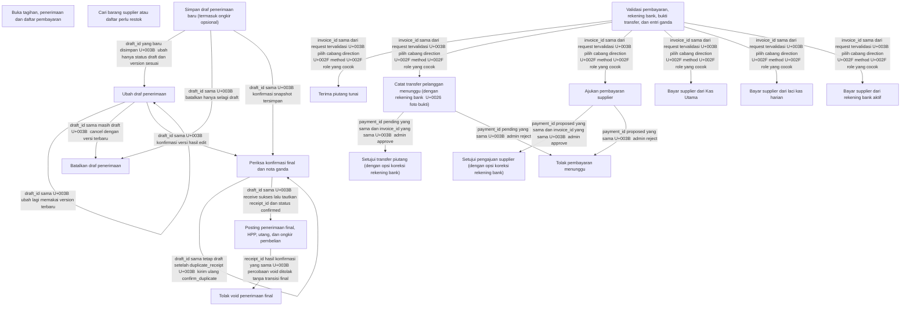

<!-- Generated by peta-alur-hidup/render.py; do not edit. -->

# Penerimaan supplier &#40;termasuk ongkir&#41; dan pembayaran invoice V2 &#8212; alur dari current working tree

## Rincian langkah

| ID | Langkah | Pelaku | Syarat awal | Hasil | Bukti kode | Tabel |
| --- | --- | --- | --- | --- | --- | --- |
| RP01 | Buka tagihan&#44; penerimaan dan daftar pembayaran | Admin&#59; kasir untuk tagihan&#47;pembayaran | GET &#47;v2 atau GET &#47;v2&#47;invoices &#40;filter arah&#47;status&#47;pencarian&#47;tanggal&#47;paginasi server&#41;&#44; autentikasi web dan sesi akun aktif&#59; Operations&#58;&#58;role hanya menerima admin&#47;cashier aktif. Jika konfigurasi V2 aktif&#44; &#47;v2 mengalihkan ke pos.index. | Tagihan dipaginasi di server lintas tanggal&#59; last&#95;payment&#95;id ialah pembayaran terakhir selain rejected&#44; dilengkapi riwayat pembayaran beserta penanda bukti transfer dan rekening bank. Pembayaran 50 terakhir dibatasi requested&#95;by untuk kasir. Admin membaca 50 penerimaan final dan 50 draf draft&#47;cancelled&#59; final memiliki audit konfirmasi melalui receipt&#95;id. Tidak mengubah data transaksi. | app&#47;Http&#47;Controllers&#47;V2&#47;WorkspaceController.php&#58;39 | inventory&#95;receipt&#95;items&#58; read&#59; inventory&#95;receipts&#58; read&#59; products&#58; read&#59; users&#58; read&#59; v2&#95;invoices&#58; read&#59; v2&#95;parties&#58; read&#59; v2&#95;payment&#95;proofs&#58; read&#59; v2&#95;payments&#58; read&#59; v2&#95;receipt&#95;drafts&#58; read&#59; v2&#95;user&#95;roles&#58; read |
| RP02 | Cari barang supplier atau daftar perlu restok | Admin | GET &#47;v2&#47;suppliers&#47;&#123;id&#125;&#47;products &#40;q opsional &#60;&#61;100 karakter&#41;&#44; GET &#47;v2&#47;receipts&#47;restock&#45;products&#44; dan POST &#47;v2&#47;receipts&#47;product&#45;supplier &#40;taut cepat produk ke supplier&#41;&#59; autentikasi&#44; sesi aktif&#44; role admin. | Pencarian supplier hanya mengembalikan relasi produk&#45;supplier milik id tersebut&#44; supplier aktif dan produk aktif &#40;maksimal 50 hasil&#41;. Daftar restok menyaring produk aktif berstok habis&#47;menipis dengan tautan supplier aktif. Tidak membuat penerimaan atau jurnal. | app&#47;Services&#47;V2&#47;SupplyTrips.php&#58;448 | products&#58; read&#59; v2&#95;parties&#58; read&#59; v2&#95;product&#95;suppliers&#58; read&#44;create&#59; v2&#95;user&#95;roles&#58; read |
| RP03 | Simpan draf penerimaan baru &#40;termasuk ongkir opsional&#41; | Admin | POST &#47;v2&#47;receipts memanggil ReceiptDrafts&#58;&#58;save&#44; BUKAN SupplyTrips&#58;&#58;receive langsung. Autentikasi&#44; sesi aktif dan admin&#59; supplier aktif&#44; tanggal Y&#45;m&#45;d tidak di masa depan&#44; nota opsional &#60;&#61;64&#44; catatan &#60;&#61;255&#44; 1..100 produk berbeda aktif tertaut supplier&#44; jumlah positif&#44; harga &#62;&#61;0 &#60;&#61;4 desimal&#59; total positif. Ongkir pembelian opsional&#58; freight&#95;amount &#62;&#61;0&#44; bila positif wajib freight&#95;method &#40;supplier&#124;cash&#124;bank&#41;&#44; freight&#95;account &#40;beban aktif&#41;&#44; dan freight&#95;bank&#95;account&#95;code &#40;bila bank&#44; default 1102&#41;. Kunci ASCII 1..100 karakter wajib. | Transaksi mengunci user&#44; menyimpan snapshot &#40;termasuk rincian ongkir&#41; di v2&#95;receipt&#95;drafts status draft&#47;version 1. Kunci per created&#95;by dengan hash sama mengembalikan draf yang tersimpan&#59; hash berbeda gagal validasi. Tidak membuat receipt final&#44; utang&#44; stok&#44; HPP&#44; kas&#47;bank&#44; atau jurnal. | app&#47;Services&#47;V2&#47;ReceiptDrafts.php&#58;17 | chart&#95;of&#95;accounts&#58; read&#59; products&#58; read&#59; users&#58; read&#59; v2&#95;parties&#58; read&#59; v2&#95;product&#95;suppliers&#58; read&#59; v2&#95;receipt&#95;drafts&#58; create&#44;read&#59; v2&#95;user&#95;roles&#58; read |
| RP04 | Ubah draf penerimaan | Admin&#44; tidak harus pembuat draf | POST &#47;v2&#47;receipt&#45;drafts&#47;&#123;id&#125;&#59; autentikasi&#47;sesi aktif&#44; role admin. Id draf harus ada&#44; status draft dan version input harus sama persis setelah FILTER&#95;VALIDATE&#95;INT&#59; snapshot penuh &#40;termasuk ongkir&#41; divalidasi ulang seperti draf baru. | Mengunci user serta baris draf&#59; memperbarui snapshot dan menaikkan version. Tidak mengubah request&#95;hash&#47;idempotency&#95;key awal. Status cancelled&#47;confirmed dan versi usang ditolak. Tidak ada efek ke stok&#44; HPP&#44; utang atau jurnal. | app&#47;Services&#47;V2&#47;ReceiptDrafts.php&#58;43 | chart&#95;of&#95;accounts&#58; read&#59; products&#58; read&#59; users&#58; read&#59; v2&#95;parties&#58; read&#59; v2&#95;product&#95;suppliers&#58; read&#59; v2&#95;receipt&#95;drafts&#58; read&#44;update&#59; v2&#95;user&#95;roles&#58; read |
| RP05 | Batalkan draf penerimaan | Admin&#44; tidak harus pembuat draf | POST &#47;v2&#47;receipt&#45;drafts&#47;&#123;id&#125;&#47;cancel&#59; autentikasi&#47;sesi aktif dan admin. Draf harus ada&#44; status draft dan version cocok&#59; reason setelah trim sepanjang 5..255 karakter. Jika sudah cancelled&#44; hasil lama dikembalikan sebelum cek versi&#47;alasan. | Status cancelled&#44; version bertambah dan cancelled&#95;by&#47;cancelled&#95;at&#47;cancel&#95;reason dicatat&#59; draf tidak dihapus. Confirmed tidak dapat dibatalkan. Stok&#44; HPP&#44; receipt final&#44; utang&#44; kas&#47;bank dan jurnal tidak berubah. | app&#47;Services&#47;V2&#47;ReceiptDrafts.php&#58;85 | users&#58; read&#59; v2&#95;receipt&#95;drafts&#58; read&#44;update&#59; v2&#95;user&#95;roles&#58; read |
| RP06 | Periksa konfirmasi final dan nota ganda | Admin | POST &#47;v2&#47;receipt&#45;drafts&#47;&#123;id&#125;&#47;confirm&#59; autentikasi&#47;sesi aktif&#44; admin&#44; confirm&#95;final wajib accepted. Id terkunci&#59; confirmed mengembalikan receipt&#47;invoice lama tanpa posting ulang&#59; selain itu status draft dan version cocok. Payload posting berasal dari snapshot tersimpan &#40;termasuk ongkir&#41;&#44; bukan item baru pada request. | SupplyTrips&#58;&#58;receive dipanggil dengan kunci draft&#45;receipt&#45;&#123;id&#125;. Nota opsional yang sama untuk supplier sama&#44; lower&#47;trim dan hanya receipt belum void&#44; memicu duplicate&#95;receipt bila confirm&#95;duplicate tidak benar&#59; transaksi gagal sehingga draf tetap draft. Replay v2&#95;requests dengan hash sama mengembalikan hasil lama. | app&#47;Services&#47;V2&#47;ReceiptDrafts.php&#58;54 | inventory&#95;receipts&#58; read&#59; users&#58; read&#59; v2&#95;invoices&#58; read&#59; v2&#95;parties&#58; read&#59; v2&#95;receipt&#95;drafts&#58; read&#59; v2&#95;requests&#58; read&#59; v2&#95;user&#95;roles&#58; read |
| RP07 | Posting penerimaan final&#44; HPP&#44; utang&#44; dan ongkir pembelian | Admin melalui konfirmasi draf | POST &#47;v2&#47;receipt&#45;drafts&#47;&#123;id&#125;&#47;confirm melanjutkan draf setelah semua guard. SupplyTrips mengunci actor&#44; supplier&#44; produk dan relasi. Tanggal mundur melewati stock&#95;movements lebih baru ditolak. Bila ongkir &#62; 0 metode cash&#58; wajib kas harian aktif pada tanggal penerimaan dan laci &#43; saldo 1101 cukup&#59; bila bank&#58; saldo rekening bank aktif cukup. | Dalam satu transaksi&#58; receipt RCV dan item dibuat&#59; stok naik&#44; HPP rata&#45;rata tertimbang diperbarui &#40;ongkir dicatat sebagai beban&#44; TIDAK masuk HPP&#41;&#44; mutasi v2&#95;receipt masuk. Ledger debit Persediaan 1301 sebesar nilai barang&#44; kredit Utang 2101 sebesar nilai barang &#40;&#43; ongkir bila metode supplier&#41;. Bila ongkir &#62; 0&#58; tambah debit akun beban ongkir&#59; bila metode cash&#47;bank&#44; tambah kredit 1101 atau rekening bank terpilih &#40;dan mutasi out laci jika cash&#41;. Invoice AP payable dibuat sebesar payableTotal&#59; draf menjadi confirmed. Kegagalan menggulung seluruh transaksi. | app&#47;Services&#47;V2&#47;SupplyTrips.php&#58;157 | chart&#95;of&#95;accounts&#58; read&#59; inventory&#95;receipt&#95;items&#58; create&#59; inventory&#95;receipts&#58; create&#44;update&#59; journal&#95;entries&#58; create&#59; journal&#95;entry&#95;lines&#58; create&#44;read&#59; products&#58; read&#44;update&#59; stock&#95;movements&#58; create&#44;read&#59; users&#58; read&#59; v2&#95;invoices&#58; create&#44;read&#59; v2&#95;parties&#58; read&#59; v2&#95;product&#95;suppliers&#58; read&#59; v2&#95;receipt&#95;drafts&#58; read&#44;update&#59; v2&#95;requests&#58; create&#44;read&#59; v2&#95;shift&#95;movements&#58; create&#44;read&#59; v2&#95;shifts&#58; read&#59; v2&#95;user&#95;roles&#58; read |
| RP08 | Tolak void penerimaan final | Admin | POST &#47;v2&#47;receipts&#47;&#123;id&#125;&#47;void&#59; autentikasi&#47;sesi aktif dan admin. Id merujuk inventory&#95;receipts final&#44; BUKAN id draf. Receipt tidak ditemukan menghasilkan 404. | Receipt yang ada selalu gagal validasi&#58; penerimaan sudah dikonfirmasi dan terkunci&#44; gunakan koreksi&#47;retur. Tidak ada reversal jurnal&#44; pemulihan HPP&#47;stok&#44; pembatalan invoice&#44; update voided&#95;at&#44; atau transisi kembali ke draft. | app&#47;Services&#47;V2&#47;SupplyTrips.php&#58;610 | inventory&#95;receipts&#58; read&#59; users&#58; read&#59; v2&#95;user&#95;roles&#58; read |
| RP09 | Validasi pembayaran&#44; rekening bank&#44; bukti transfer&#44; dan entri ganda | Admin atau kasir aktif | POST &#47;v2&#47;invoices&#47;&#123;id&#125;&#47;payments&#59; role admin&#47;cashier. amount string &#60;&#61;30&#44; method cash&#47;transfer&#47;main&#44; bank&#95;account&#95;code opsional &#40;divalidasi lewat BankAccounts&#58;&#58;resolve saat transfer&#41;&#44; foto transfer&#95;proof wajib untuk transfer piutang &#40;receivable&#41;&#44; idempotency&#95;key 8..100&#44; reference opsional &#60;&#61;255&#44; seen&#95;payment&#95;id dan confirm&#95;duplicate opsional. Invoice ada dan dikunci. | Kunci pembayaran dicari global&#58; pemohon harus actor sama &#40;lainnya 403&#41;&#44; hash sama mengembalikan payment lama&#59; isi berbeda ditolak. Arah invoice harus receivable&#47;payable&#59; main untuk receivable ditolak. Jika seen&#95;payment&#95;id ada tanpa confirm&#95;duplicate&#44; pembayaran lebih baru selain rejected memicu duplicate&#95;payment. Nilai baru harus &#60;&#61; sisa invoice. Bukti foto disimpan atomik via PaymentProofs&#58;&#58;record. | app&#47;Services&#47;V2&#47;Operations.php&#58;665 | chart&#95;of&#95;accounts&#58; read&#59; users&#58; read&#59; v2&#95;invoices&#58; read&#59; v2&#95;payment&#95;proofs&#58; read&#44;create&#59; v2&#95;payments&#58; read&#59; v2&#95;user&#95;roles&#58; read |
| RP10 | Terima piutang tunai | Admin atau kasir aktif saat kas harian bersama terbuka | POST &#47;v2&#47;invoices&#47;&#123;id&#125;&#47;payments&#59; setelah validasi umum&#44; invoice receivable dan method&#61;cash. Kas harian bersama toko berstatus open wajib ada dan dikunci. | Payment posted dengan shift&#95;id kas harian bersama dan approved&#95;by actor dibuat&#59; jurnal debit Kas 1101&#47;kredit Piutang 1103&#44; gerakan laci direction&#61;in&#47;kind&#61;collection. paid invoice bertambah&#44; status paid bila lunas atau open bila sebagian&#59; bila sale&#95;id ada&#44; status penjualan dihitung paid&#47;partial&#47;unpaid. | app&#47;Services&#47;V2&#47;Operations.php&#58;776 | chart&#95;of&#95;accounts&#58; read&#59; journal&#95;entries&#58; create&#59; journal&#95;entry&#95;lines&#58; create&#59; users&#58; read&#59; v2&#95;invoices&#58; read&#44;update&#59; v2&#95;payments&#58; create&#44;read&#44;update&#59; v2&#95;sales&#58; update&#59; v2&#95;shift&#95;movements&#58; create&#59; v2&#95;shifts&#58; read&#59; v2&#95;user&#95;roles&#58; read |
| RP11 | Catat transfer pelanggan menunggu &#40;dengan rekening bank &#38; foto bukti&#41; | Admin atau kasir aktif | POST &#47;v2&#47;invoices&#47;&#123;id&#125;&#47;payments&#59; validasi umum&#44; invoice receivable&#44; method&#61;transfer. Wajib unggah foto transfer&#95;proof&#59; bank&#95;account&#95;code opsional memilih rekening bank tujuan aktif &#40;bawaan 1102&#41;. Tidak memerlukan kas harian&#59; main ditolak untuk piutang. | Payment pending dengan bank&#95;account&#95;code dan bukti foto di v2&#95;payment&#95;proofs&#44; shift&#95;id&#47;approved&#95;by&#47;journal&#95;entry&#95;id null. Belum menambah paid invoice&#44; belum mengubah sale atau laci&#47;bank&#47;jurnal. Menunggu approve atau reject admin atas payment&#95;id yang sama. | app&#47;Services&#47;V2&#47;Operations.php&#58;753 | chart&#95;of&#95;accounts&#58; read&#59; users&#58; read&#59; v2&#95;invoices&#58; read&#59; v2&#95;payment&#95;proofs&#58; create&#59; v2&#95;payments&#58; create&#44;read&#59; v2&#95;user&#95;roles&#58; read |
| RP12 | Ajukan pembayaran supplier | Kasir aktif | POST &#47;v2&#47;invoices&#47;&#123;id&#125;&#47;payments&#59; validasi umum&#44; invoice payable. Pilih main &#40;Kas Utama&#41;&#44; transfer &#40;salah satu Rekening Bank aktif dari Bagan Akun&#41;&#44; atau cash &#40;Laci kas harian&#41;. Cash memerlukan kas harian bersama sedang terbuka&#59; main&#47;transfer tidak wajib shift dan tidak menyimpan shift&#95;id. | Payment proposed disimpan dengan requested&#95;by actor&#44; bank&#95;account&#95;code &#40;bila transfer&#41;&#44; approved&#95;by&#47;journal null. Kasir tidak memanggil postPayable&#59; paid invoice&#44; kas&#47;bank&#44; jurnal dan gerakan laci belum berubah. Saldo buku besar&#47;laci baru diperiksa saat admin menyetujui&#59; pengajuan tidak mereservasi sisa utang. | app&#47;Services&#47;V2&#47;Operations.php&#58;719 | chart&#95;of&#95;accounts&#58; read&#59; users&#58; read&#59; v2&#95;invoices&#58; read&#59; v2&#95;payments&#58; create&#44;read&#59; v2&#95;shifts&#58; read&#59; v2&#95;user&#95;roles&#58; read |
| RP13 | Bayar supplier dari Kas Utama | Admin aktif | POST &#47;v2&#47;invoices&#47;&#123;id&#125;&#47;payments&#59; invoice payable&#44; method&#61;main dan validasi umum. Admin membuat proposed lalu langsung postPayable dalam transaksi sama&#59; tidak memerlukan kas harian. Akun 1101 harus aktif dan saldo debit&#45;kredit cukup. | Payment menjadi posted dengan approved&#95;by admin&#47;journal&#95;id. Jurnal debit Utang supplier 2101&#47;kredit Kas 1101&#59; invoice paid bertambah&#44; status paid bila lunas atau open bila sebagian. Tidak mencatat mutasi laci. Kegagalan saldo&#47;akun membatalkan insert dan posting. | app&#47;Services&#47;V2&#47;Operations.php&#58;746 | chart&#95;of&#95;accounts&#58; read&#59; journal&#95;entries&#58; create&#59; journal&#95;entry&#95;lines&#58; create&#44;read&#59; users&#58; read&#59; v2&#95;invoices&#58; read&#44;update&#59; v2&#95;payments&#58; create&#44;read&#44;update&#59; v2&#95;user&#95;roles&#58; read |
| RP14 | Bayar supplier dari laci kas harian | Admin aktif saat kas harian bersama terbuka | POST &#47;v2&#47;invoices&#47;&#123;id&#125;&#47;payments&#59; invoice payable&#44; method&#61;cash dan validasi umum. Kas harian bersama harus terbuka &#40;status open&#44; store&#95;open&#95;key&#61;1&#41;&#59; uang laci dan saldo buku besar akun kas 1101 harus cukup. | Admin langsung memposting&#58; debit Utang supplier 2101&#47;kredit Kas 1101&#44; payment posted&#44; invoice paid bertambah&#47;status open atau paid. Gerakan out&#47;kind&#61;supplier dibuat pada kas harian yang dipakai saat pengajuan. Kegagalan satu guard menggulung transaksi. | app&#47;Services&#47;V2&#47;Operations.php&#58;940 | chart&#95;of&#95;accounts&#58; read&#59; journal&#95;entries&#58; create&#59; journal&#95;entry&#95;lines&#58; create&#44;read&#59; users&#58; read&#59; v2&#95;invoices&#58; read&#44;update&#59; v2&#95;payments&#58; create&#44;read&#44;update&#59; v2&#95;shift&#95;movements&#58; create&#44;read&#59; v2&#95;shifts&#58; read&#59; v2&#95;user&#95;roles&#58; read |
| RP15 | Bayar supplier dari rekening bank aktif | Admin aktif | POST &#47;v2&#47;invoices&#47;&#123;id&#125;&#47;payments&#59; invoice payable&#44; method&#61;transfer dan bank&#95;account&#95;code opsional &#40;default 1102&#41;. Admin langsung postPayable tanpa kas harian&#59; rekening bank terpilih harus aktif di Bagan Akun dan saldonya cukup. | Jurnal debit Utang supplier 2101&#47;kredit rekening bank terpilih&#44; payment posted dengan approved&#95;by admin&#47;journal&#95;id&#44; paid invoice naik dan status open&#47;paid. Tidak ada pending verifikasi kedua atau gerakan laci. | app&#47;Services&#47;V2&#47;Operations.php&#58;930 | chart&#95;of&#95;accounts&#58; read&#59; journal&#95;entries&#58; create&#59; journal&#95;entry&#95;lines&#58; create&#44;read&#59; users&#58; read&#59; v2&#95;invoices&#58; read&#44;update&#59; v2&#95;payments&#58; create&#44;read&#44;update&#59; v2&#95;user&#95;roles&#58; read |
| RP16 | Setujui transfer piutang &#40;dengan opsi koreksi rekening bank&#41; | Admin aktif | POST &#47;v2&#47;payments&#47;&#123;id&#125;&#47;approve &#40;opsional membawa bank&#95;account&#95;code&#41;&#59; payment ada&#44; invoice dan payment dikunci. Posted idempoten&#59; selain pending&#47;proposed ditolak. Nominal positif &#60;&#61; sisa invoice. Untuk receivable hanya method&#61;transfer diizinkan. | Jika admin mengirim bank&#95;account&#95;code&#44; kode rekening divalidasi aktif dan diperbarui pada payment sebelum posting. Jurnal debit rekening bank terpilih&#47;kredit Piutang 1103 dibuat&#44; payment menjadi posted&#44; approved&#95;by dan journal&#95;id diisi. paid invoice dan status sale terkait diperbarui. Tidak memerlukan kas harian atau gerakan laci. | app&#47;Services&#47;V2&#47;Operations.php&#58;825 | chart&#95;of&#95;accounts&#58; read&#59; journal&#95;entries&#58; create&#59; journal&#95;entry&#95;lines&#58; create&#59; users&#58; read&#59; v2&#95;invoices&#58; read&#44;update&#59; v2&#95;payments&#58; read&#44;update&#59; v2&#95;sales&#58; update&#59; v2&#95;user&#95;roles&#58; read |
| RP17 | Setujui pengajuan supplier &#40;dengan opsi koreksi rekening bank&#41; | Admin aktif&#59; boleh menyetujui pengajuan sendiri | POST &#47;v2&#47;payments&#47;&#123;id&#125;&#47;approve &#40;opsional membawa bank&#95;account&#95;code untuk transfer&#41;&#59; payment payable pending&#47;proposed&#44; nominal positif &#60;&#61; sisa invoice dan kunci invoice&#47;payment. Posted idempoten&#59; rejected tidak dapat disetujui. | Jika method&#61;transfer dan admin mengirim bank&#95;account&#95;code&#44; rekening sumber diperbarui sebelum postPayable. Memanggil postPayable&#58; main memakai Kas 1101&#44; transfer memakai rekening bank aktif terpilih tanpa laci&#59; cash memerlukan kas harian pengajuan masih open dan uang laci cukup. Semua sumber memerlukan saldo akun cukup. Payment posted&#44; approved&#95;by&#47;journal&#95;id terisi dan paid invoice diperbarui. | app&#47;Services&#47;V2&#47;Operations.php&#58;881 | chart&#95;of&#95;accounts&#58; read&#59; journal&#95;entries&#58; create&#59; journal&#95;entry&#95;lines&#58; create&#44;read&#59; users&#58; read&#59; v2&#95;invoices&#58; read&#44;update&#59; v2&#95;payments&#58; read&#44;update&#59; v2&#95;shift&#95;movements&#58; create&#44;read&#59; v2&#95;shifts&#58; read&#59; v2&#95;user&#95;roles&#58; read |
| RP18 | Tolak pembayaran menunggu | Admin aktif | POST &#47;v2&#47;payments&#47;&#123;id&#125;&#47;reject&#59; reason string panjang 5..1000 dan trim tetap 5..1000. Payment ada&#47;dikunci dan status pending&#47;proposed. Posted tidak boleh ditolak. Rejected hanya idempoten jika resolved&#95;by actor sama dan resolution&#95;note persis sama. | Payment menjadi rejected dengan resolution&#95;note&#47;resolved&#95;by&#47;resolved&#95;at. Tidak mengubah paid invoice&#44; sale&#44; stok&#44; laci&#44; saldo kas&#47;bank atau jurnal karena pembayaran belum diposting. Reject ulang dengan actor&#47;catatan berbeda gagal. | app&#47;Services&#47;V2&#47;Operations.php&#58;255 | users&#58; read&#59; v2&#95;payments&#58; read&#44;update&#59; v2&#95;user&#95;roles&#58; read |

## Indeks tabel

| Tabel | Langkah | Operasi |
| --- | --- | --- |
| chart&#95;of&#95;accounts | RP03 | read |
| chart&#95;of&#95;accounts | RP04 | read |
| chart&#95;of&#95;accounts | RP07 | read |
| chart&#95;of&#95;accounts | RP09 | read |
| chart&#95;of&#95;accounts | RP10 | read |
| chart&#95;of&#95;accounts | RP11 | read |
| chart&#95;of&#95;accounts | RP12 | read |
| chart&#95;of&#95;accounts | RP13 | read |
| chart&#95;of&#95;accounts | RP14 | read |
| chart&#95;of&#95;accounts | RP15 | read |
| chart&#95;of&#95;accounts | RP16 | read |
| chart&#95;of&#95;accounts | RP17 | read |
| inventory&#95;receipt&#95;items | RP01 | read |
| inventory&#95;receipt&#95;items | RP07 | create |
| inventory&#95;receipts | RP01 | read |
| inventory&#95;receipts | RP06 | read |
| inventory&#95;receipts | RP07 | create&#44;update |
| inventory&#95;receipts | RP08 | read |
| journal&#95;entries | RP07 | create |
| journal&#95;entries | RP10 | create |
| journal&#95;entries | RP13 | create |
| journal&#95;entries | RP14 | create |
| journal&#95;entries | RP15 | create |
| journal&#95;entries | RP16 | create |
| journal&#95;entries | RP17 | create |
| journal&#95;entry&#95;lines | RP07 | create&#44;read |
| journal&#95;entry&#95;lines | RP10 | create |
| journal&#95;entry&#95;lines | RP13 | create&#44;read |
| journal&#95;entry&#95;lines | RP14 | create&#44;read |
| journal&#95;entry&#95;lines | RP15 | create&#44;read |
| journal&#95;entry&#95;lines | RP16 | create |
| journal&#95;entry&#95;lines | RP17 | create&#44;read |
| products | RP01 | read |
| products | RP02 | read |
| products | RP03 | read |
| products | RP04 | read |
| products | RP07 | read&#44;update |
| stock&#95;movements | RP07 | create&#44;read |
| users | RP01 | read |
| users | RP03 | read |
| users | RP04 | read |
| users | RP05 | read |
| users | RP06 | read |
| users | RP07 | read |
| users | RP08 | read |
| users | RP09 | read |
| users | RP10 | read |
| users | RP11 | read |
| users | RP12 | read |
| users | RP13 | read |
| users | RP14 | read |
| users | RP15 | read |
| users | RP16 | read |
| users | RP17 | read |
| users | RP18 | read |
| v2&#95;invoices | RP01 | read |
| v2&#95;invoices | RP06 | read |
| v2&#95;invoices | RP07 | create&#44;read |
| v2&#95;invoices | RP09 | read |
| v2&#95;invoices | RP10 | read&#44;update |
| v2&#95;invoices | RP11 | read |
| v2&#95;invoices | RP12 | read |
| v2&#95;invoices | RP13 | read&#44;update |
| v2&#95;invoices | RP14 | read&#44;update |
| v2&#95;invoices | RP15 | read&#44;update |
| v2&#95;invoices | RP16 | read&#44;update |
| v2&#95;invoices | RP17 | read&#44;update |
| v2&#95;parties | RP01 | read |
| v2&#95;parties | RP02 | read |
| v2&#95;parties | RP03 | read |
| v2&#95;parties | RP04 | read |
| v2&#95;parties | RP06 | read |
| v2&#95;parties | RP07 | read |
| v2&#95;payment&#95;proofs | RP01 | read |
| v2&#95;payment&#95;proofs | RP09 | read&#44;create |
| v2&#95;payment&#95;proofs | RP11 | create |
| v2&#95;payments | RP01 | read |
| v2&#95;payments | RP09 | read |
| v2&#95;payments | RP10 | create&#44;read&#44;update |
| v2&#95;payments | RP11 | create&#44;read |
| v2&#95;payments | RP12 | create&#44;read |
| v2&#95;payments | RP13 | create&#44;read&#44;update |
| v2&#95;payments | RP14 | create&#44;read&#44;update |
| v2&#95;payments | RP15 | create&#44;read&#44;update |
| v2&#95;payments | RP16 | read&#44;update |
| v2&#95;payments | RP17 | read&#44;update |
| v2&#95;payments | RP18 | read&#44;update |
| v2&#95;product&#95;suppliers | RP02 | read&#44;create |
| v2&#95;product&#95;suppliers | RP03 | read |
| v2&#95;product&#95;suppliers | RP04 | read |
| v2&#95;product&#95;suppliers | RP07 | read |
| v2&#95;receipt&#95;drafts | RP01 | read |
| v2&#95;receipt&#95;drafts | RP03 | create&#44;read |
| v2&#95;receipt&#95;drafts | RP04 | read&#44;update |
| v2&#95;receipt&#95;drafts | RP05 | read&#44;update |
| v2&#95;receipt&#95;drafts | RP06 | read |
| v2&#95;receipt&#95;drafts | RP07 | read&#44;update |
| v2&#95;requests | RP06 | read |
| v2&#95;requests | RP07 | create&#44;read |
| v2&#95;sales | RP10 | update |
| v2&#95;sales | RP16 | update |
| v2&#95;shift&#95;movements | RP07 | create&#44;read |
| v2&#95;shift&#95;movements | RP10 | create |
| v2&#95;shift&#95;movements | RP14 | create&#44;read |
| v2&#95;shift&#95;movements | RP17 | create&#44;read |
| v2&#95;shifts | RP07 | read |
| v2&#95;shifts | RP10 | read |
| v2&#95;shifts | RP12 | read |
| v2&#95;shifts | RP14 | read |
| v2&#95;shifts | RP17 | read |
| v2&#95;user&#95;roles | RP01 | read |
| v2&#95;user&#95;roles | RP02 | read |
| v2&#95;user&#95;roles | RP03 | read |
| v2&#95;user&#95;roles | RP04 | read |
| v2&#95;user&#95;roles | RP05 | read |
| v2&#95;user&#95;roles | RP06 | read |
| v2&#95;user&#95;roles | RP07 | read |
| v2&#95;user&#95;roles | RP08 | read |
| v2&#95;user&#95;roles | RP09 | read |
| v2&#95;user&#95;roles | RP10 | read |
| v2&#95;user&#95;roles | RP11 | read |
| v2&#95;user&#95;roles | RP12 | read |
| v2&#95;user&#95;roles | RP13 | read |
| v2&#95;user&#95;roles | RP14 | read |
| v2&#95;user&#95;roles | RP15 | read |
| v2&#95;user&#95;roles | RP16 | read |
| v2&#95;user&#95;roles | RP17 | read |
| v2&#95;user&#95;roles | RP18 | read |

## Batas analisis

- Analisis statis current working tree saja&#59; tidak menjalankan aplikasi&#44; artisan&#44; tes&#44; browser&#44; membaca env&#44; database atau rahasia. Keberadaan migrasi terpasang&#44; akun COA aktif&#44; saldo&#44; dan locking lintas koneksi tidak diverifikasi di sini.
- Tidak ditemukan rute koreksi&#47;retur penerimaan final dalam routes&#47;v2.php yang dibaca&#59; SupplyTrips&#58;&#58;voidReceipt selalu menolak. Tidak ada panah cancelled &#45;&#62; confirm atau final &#45;&#62; draft.
- Ketidaksesuaian nama&#58; POST &#47;v2&#47;receipts menyimpan draf&#44; bukan receipt posted. PHPDoc lama sebelum SupplyTrips&#58;&#58;voidReceipt masih menjelaskan reversal tetapi badan method 610..617 selalu menolak.
- Draf edit tidak memperbarui request&#95;hash awal &#40;ReceiptDrafts.php 29..47&#41;. Replay create dengan kunci&#47;hash awal mengembalikan keadaan draf saat ini.
- Guard duplicate&#95;payment opsional&#58; pemanggil tanpa seen&#95;payment&#95;id atau dengan confirm&#95;duplicate melewatinya. Pending&#47;proposed tidak mereservasi sisa utang&#47;piutang sehingga approve memeriksa ulang sisa.
- ReceiptDrafts&#58;&#58;requireAdmin dan SupplyTrips&#58;&#58;requireAdmin membaca v2&#95;user&#95;roles&#59; jaminan akun aktif pada rute web datang dari EnsureActiveAccount.
