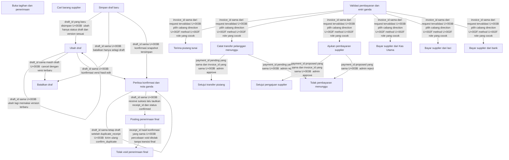

<!-- Generated by peta-alur-hidup/render.py; do not edit. -->

# Penerimaan supplier dan pembayaran invoice V2 &#8212; alur dari current working tree &#40;analisis statis&#41;

## Rincian langkah

| ID | Langkah | Pelaku | Syarat awal | Hasil | Bukti kode | Tabel |
| --- | --- | --- | --- | --- | --- | --- |
| RP01 | Buka tagihan dan penerimaan | Admin&#59; kasir untuk tagihan&#47;pembayaran | GET &#47;v2&#44; autentikasi web dan sesi akun aktif&#59; Operations&#58;&#58;role hanya menerima admin&#47;cashier aktif. Jika konfigurasi V2 aktif&#44; endpoint ini mengalihkan ke pos.index&#44; bukan langsung merender. Pemfilteran data dijelaskan untuk WorkspaceController&#58;&#58;index saat dipanggil. | Tagihan 100 terakhir dibaca tanpa pembatas pemilik&#59; last&#95;payment&#95;id ialah pembayaran terakhir selain rejected. Pembayaran 50 terakhir dibatasi requested&#95;by untuk kasir. Admin membaca 50 penerimaan final dan 50 draf draft&#47;cancelled&#59; final memiliki audit konfirmasi melalui receipt&#95;id. Tidak mengubah data transaksi. | app&#47;Http&#47;Controllers&#47;V2&#47;WorkspaceController.php&#58;34 | inventory&#95;receipt&#95;items&#58; read&#59; inventory&#95;receipts&#58; read&#59; products&#58; read&#59; users&#58; read&#59; v2&#95;invoices&#58; read&#59; v2&#95;parties&#58; read&#59; v2&#95;payments&#58; read&#59; v2&#95;receipt&#95;drafts&#58; read&#59; v2&#95;user&#95;roles&#58; read |
| RP02 | Cari barang supplier | Admin | GET &#47;v2&#47;suppliers&#47;&#123;id&#125;&#47;products&#59; autentikasi&#44; sesi aktif&#44; role admin di service. q opsional string maksimal 100 karakter&#59; supplier id numerik pada rute. | Hanya relasi produk&#45;supplier milik id tersebut&#44; supplier aktif berjenis supplier dan produk aktif. Nama&#47;SKU dicari dengan LIKE&#44; hasil diurut nama&#44; default 30 dibatasi 1..50&#59; total dan results dikembalikan. Supplier tidak cocok menghasilkan daftar kosong&#44; bukan penerimaan atau jurnal. | app&#47;Services&#47;V2&#47;SupplyTrips.php&#58;395 | products&#58; read&#59; v2&#95;parties&#58; read&#59; v2&#95;product&#95;suppliers&#58; read&#59; v2&#95;user&#95;roles&#58; read |
| RP03 | Simpan draf baru | Admin | POST &#47;v2&#47;receipts memanggil ReceiptDrafts&#58;&#58;save&#44; BUKAN SupplyTrips&#58;&#58;receive langsung. Autentikasi&#44; sesi aktif dan admin&#59; supplier aktif&#44; tanggal Y&#45;m&#45;d tidak di masa depan&#44; nota opsional &#60;&#61;64&#44; catatan &#60;&#61;255&#44; 1..100 produk berbeda aktif tertaut supplier&#44; jumlah positif dan harga &#62;&#61;0 dengan &#60;&#61;4 desimal&#59; total positif. Kunci ASCII 1..100 karakter wajib. | Transaksi mengunci user&#44; menyimpan snapshot di v2&#95;receipt&#95;drafts status draft&#47;version 1. Kunci per created&#95;by dengan hash sama mengembalikan draf yang tersimpan&#59; hash berbeda gagal validasi. Tidak membuat receipt final&#44; utang&#44; stok&#44; HPP&#44; kas&#47;bank&#44; atau jurnal. Validasi gagal membatalkan transaksi. | app&#47;Services&#47;V2&#47;ReceiptDrafts.php&#58;16 | products&#58; read&#59; users&#58; read&#59; v2&#95;parties&#58; read&#59; v2&#95;product&#95;suppliers&#58; read&#59; v2&#95;receipt&#95;drafts&#58; create&#44;read&#59; v2&#95;user&#95;roles&#58; read |
| RP04 | Ubah draf | Admin&#44; tidak harus pembuat draf | POST &#47;v2&#47;receipt&#45;drafts&#47;&#123;id&#125;&#59; autentikasi&#47;sesi aktif&#44; role admin. Id draf harus ada&#44; status draft dan version input harus sama persis setelah FILTER&#95;VALIDATE&#95;INT&#59; snapshot penuh divalidasi ulang seperti draf baru. | Mengunci user serta baris draf&#59; memperbarui snapshot dan menaikkan version. Tidak mengubah request&#95;hash&#47;idempotency&#95;key awal. Status cancelled&#47;confirmed dan versi usang ditolak. Tidak ada efek ke stok&#44; HPP&#44; utang atau jurnal. | app&#47;Services&#47;V2&#47;ReceiptDrafts.php&#58;39 | products&#58; read&#59; users&#58; read&#59; v2&#95;parties&#58; read&#59; v2&#95;product&#95;suppliers&#58; read&#59; v2&#95;receipt&#95;drafts&#58; read&#44;update&#59; v2&#95;user&#95;roles&#58; read |
| RP05 | Batalkan draf | Admin&#44; tidak harus pembuat draf | POST &#47;v2&#47;receipt&#45;drafts&#47;&#123;id&#125;&#47;cancel&#59; autentikasi&#47;sesi aktif dan admin. Draf harus ada&#44; status draft dan version cocok&#59; reason setelah trim sepanjang 5..255 karakter. Jika sudah cancelled&#44; hasil lama dikembalikan sebelum cek versi&#47;alasan. | Status cancelled&#44; version bertambah dan cancelled&#95;by&#47;cancelled&#95;at&#47;cancel&#95;reason dicatat&#59; draf tidak dihapus. Confirmed tidak dapat dibatalkan. Stok&#44; HPP&#44; receipt final&#44; utang&#44; kas&#47;bank dan jurnal tidak berubah. | app&#47;Services&#47;V2&#47;ReceiptDrafts.php&#58;76 | users&#58; read&#59; v2&#95;receipt&#95;drafts&#58; read&#44;update&#59; v2&#95;user&#95;roles&#58; read |
| RP06 | Periksa konfirmasi dan nota ganda | Admin | POST &#47;v2&#47;receipt&#45;drafts&#47;&#123;id&#125;&#47;confirm&#59; autentikasi&#47;sesi aktif&#44; admin&#44; confirm&#95;final wajib accepted. Id terkunci&#59; confirmed mengembalikan receipt&#47;invoice lama tanpa posting ulang&#59; selain itu status draft dan version cocok. Payload posting berasal dari snapshot tersimpan&#44; bukan item baru pada request. | SupplyTrips&#58;&#58;receive dipanggil dengan kunci draft&#45;receipt&#45;&#123;id&#125;. Nota opsional yang sama untuk supplier sama&#44; lower&#47;trim dan hanya receipt belum void&#44; memicu duplicate&#95;receipt bila confirm&#95;duplicate tidak benar&#59; transaksi gagal sehingga draf tetap draft. Kirim ulang konfirmasi khusus hanya melewati guard nota ganda&#44; bukan guard lain. Replay v2&#95;requests dengan hash sama mengembalikan hasil lama. | app&#47;Services&#47;V2&#47;ReceiptDrafts.php&#58;49 | inventory&#95;receipts&#58; read&#59; users&#58; read&#59; v2&#95;invoices&#58; read&#59; v2&#95;parties&#58; read&#59; v2&#95;receipt&#95;drafts&#58; read&#59; v2&#95;requests&#58; read&#59; v2&#95;user&#95;roles&#58; read |
| RP07 | Posting penerimaan final | Admin melalui konfirmasi draf | POST &#47;v2&#47;receipt&#45;drafts&#47;&#123;id&#125;&#47;confirm melanjutkan draf yang sama setelah seluruh guard. SupplyTrips mengunci actor&#44; supplier&#44; produk dan relasi. Supplier&#47;produk harus aktif&#44; semua produk ada dan tertaut&#59; tanggal mundur melewati stock&#95;movements dengan tanggal lebih baru ditolak&#59; total positif. Ledger wajib akun aktif dan jurnal seimbang. | Dalam transaksi&#58; receipt purchase bernomor RCV dan item dibuat&#59; stok naik&#44; HPP rata&#45;rata tertimbang diperbarui&#44; mutasi v2&#95;receipt masuk. Ledger debit Persediaan&#47;kredit Utang supplier memakai tanggal penerimaan&#59; receipt ditautkan jurnal. Invoice payable AP terhubung receipt&#95;id dibuat amount&#61;total&#44; paid&#61;0&#44;status&#61;open&#59; v2&#95;requests menyimpan replay. Draf menjadi confirmed&#44; version naik&#44; receipt&#95;id&#47;confirmed&#95;by&#47;confirmed&#95;at disimpan. Tidak ada kas&#47;bank keluar. Kegagalan posting menggulung seluruh konfirmasi. | app&#47;Services&#47;V2&#47;SupplyTrips.php&#58;156 | chart&#95;of&#95;accounts&#58; read&#59; inventory&#95;receipt&#95;items&#58; create&#59; inventory&#95;receipts&#58; create&#44;update&#59; journal&#95;entries&#58; create&#59; journal&#95;entry&#95;lines&#58; create&#59; products&#58; read&#44;update&#59; stock&#95;movements&#58; create&#44;read&#59; users&#58; read&#59; v2&#95;invoices&#58; create&#44;read&#59; v2&#95;parties&#58; read&#59; v2&#95;product&#95;suppliers&#58; read&#59; v2&#95;receipt&#95;drafts&#58; read&#44;update&#59; v2&#95;requests&#58; create&#44;read&#59; v2&#95;user&#95;roles&#58; read |
| RP08 | Tolak void penerimaan final | Admin | POST &#47;v2&#47;receipts&#47;&#123;id&#125;&#47;void&#59; autentikasi&#47;sesi aktif dan admin. Id merujuk inventory&#95;receipts final&#44; BUKAN id draf. Receipt tidak ditemukan menghasilkan 404. | Receipt yang ada selalu gagal validasi&#58; penerimaan sudah dikonfirmasi dan terkunci&#44; gunakan koreksi&#47;retur. Tidak ada reversal jurnal&#44; pemulihan HPP&#47;stok&#44; pembatalan invoice&#44; update voided&#95;at&#44; atau transisi kembali ke draft. Komentar lama sebelum method masih menjelaskan reversal&#44; tetapi badan method tidak melaksanakannya. | app&#47;Services&#47;V2&#47;SupplyTrips.php&#58;437 | inventory&#95;receipts&#58; read&#59; users&#58; read&#59; v2&#95;user&#95;roles&#58; read |
| RP09 | Validasi pembayaran dan entri ganda | Admin atau kasir aktif | POST &#47;v2&#47;invoices&#47;&#123;id&#125;&#47;payments&#59; autentikasi&#47;sesi aktif&#44; role admin&#47;cashier. amount string &#60;&#61;30&#44; method cash&#47;transfer&#47;main&#44; idempotency&#95;key 8..100&#44; reference opsional &#60;&#61;255&#44; seen&#95;payment&#95;id opsional integer &#62;&#61;0&#44; confirm&#95;duplicate opsional boolean. Nilai uang skala 2 harus positif&#59; invoice ada dan dikunci. | Kunci pembayaran dicari global&#58; pemohon harus actor sama &#40;lainnya 403&#41;&#44; hash invoice&#47;amount&#47;method&#47;reference sama mengembalikan payment lama&#59; isi berbeda ditolak. Arah invoice harus receivable&#47;payable&#59; main untuk receivable ditolak. Jika seen&#95;payment&#95;id ada dan tanpa confirm&#95;duplicate&#44; pembayaran id lebih baru selain rejected memicu duplicate&#95;payment. Tanpa seen&#95;payment&#95;id guard dilewati. Nilai baru harus &#60;&#61; amount&#45;paid dan sisa positif. Tidak ada pembatas kepemilikan invoice&#59; cabang lanjutan bergantung direction&#47;method&#47;role. | app&#47;Services&#47;V2&#47;Operations.php&#58;635 | users&#58; read&#59; v2&#95;invoices&#58; read&#59; v2&#95;payments&#58; read&#59; v2&#95;user&#95;roles&#58; read |
| RP10 | Terima piutang tunai | Admin atau kasir aktif dengan shift sendiri terbuka | POST &#47;v2&#47;invoices&#47;&#123;id&#125;&#47;payments&#59; setelah validasi umum&#44; invoice receivable dan method&#61;cash. Shift actor berstatus open wajib ada dan dikunci&#59; invoice bisa milik penjual lain karena collect tidak memfilter pemilik. | Payment posted dengan shift&#95;id sendiri dan approved&#95;by actor dibuat&#59; jurnal debit Kas&#47;kredit Piutang&#44; gerakan laci direction&#61;in&#47;kind&#61;collection. paid invoice bertambah&#44; status paid bila lunas atau open bila sebagian&#59; bila sale&#95;id ada&#44; status penjualan dihitung paid&#47;partial&#47;unpaid. Gagal akun&#47;jurnal atau validasi menggulung transaksi. | app&#47;Services&#47;V2&#47;Operations.php&#58;731 | chart&#95;of&#95;accounts&#58; read&#59; journal&#95;entries&#58; create&#59; journal&#95;entry&#95;lines&#58; create&#59; users&#58; read&#59; v2&#95;invoices&#58; read&#44;update&#59; v2&#95;payments&#58; create&#44;read&#44;update&#59; v2&#95;sales&#58; update&#59; v2&#95;shift&#95;movements&#58; create&#59; v2&#95;shifts&#58; read&#59; v2&#95;user&#95;roles&#58; read |
| RP11 | Catat transfer pelanggan menunggu | Admin atau kasir aktif | POST &#47;v2&#47;invoices&#47;&#123;id&#125;&#47;payments&#59; validasi umum&#44; invoice receivable&#44; method&#61;transfer. Tidak memerlukan shift&#59; main ditolak untuk piutang. | Payment pending&#44; shift&#95;id&#47;approved&#95;by&#47;journal&#95;entry&#95;id null. Belum menambah paid invoice&#44; belum mengubah sale atau laci&#47;bank&#47;jurnal. Menunggu approve admin atau reject admin atas payment&#95;id yang sama&#59; meski pencatat admin&#44; transfer piutang tetap pending. | app&#47;Services&#47;V2&#47;Operations.php&#58;713 | users&#58; read&#59; v2&#95;invoices&#58; read&#59; v2&#95;payments&#58; create&#44;read&#59; v2&#95;user&#95;roles&#58; read |
| RP12 | Ajukan pembayaran supplier | Kasir aktif | POST &#47;v2&#47;invoices&#47;&#123;id&#125;&#47;payments&#59; validasi umum&#44; invoice payable. Pilih main &#40;Kas Utama&#41;&#44; transfer &#40;Bank Utama&#41;&#44; atau cash &#40;Laci shift&#41;. Cash memerlukan shift actor sendiri terbuka&#59; main&#47;transfer tidak wajib shift. | Payment proposed disimpan dengan requested&#95;by actor&#44; approved&#95;by&#47;journal null. currentShiftId juga disimpan untuk main&#47;transfer bila ada&#44; tetapi tidak berarti laci dipakai. Kasir tidak memanggil postPayable&#59; paid invoice&#44; kas&#47;bank&#44; jurnal dan gerakan laci belum berubah. Saldo buku besar&#47;laci baru diperiksa saat posting&#59; pengajuan tidak mereservasi sisa utang. | app&#47;Services&#47;V2&#47;Operations.php&#58;683 | users&#58; read&#59; v2&#95;invoices&#58; read&#59; v2&#95;payments&#58; create&#44;read&#59; v2&#95;shifts&#58; read&#59; v2&#95;user&#95;roles&#58; read |
| RP13 | Bayar supplier dari Kas Utama | Admin aktif | POST &#47;v2&#47;invoices&#47;&#123;id&#125;&#47;payments&#59; invoice payable&#44; method&#61;main dan validasi umum. Admin membuat proposed lalu langsung postPayable dalam transaksi sama&#59; tidak memerlukan shift. Akun kas harus ada dan saldo debit&#45;kredit setelah dikurangi pembayaran tidak boleh negatif&#59; Ledger juga menuntut akun aktif. | Payment menjadi posted dengan approved&#95;by admin&#47;journal&#95;id. Jurnal debit Utang supplier&#47;kredit Kas&#59; invoice paid bertambah&#44; status paid bila lunas atau open bila sebagian. Tidak mencatat mutasi laci meskipun shift&#95;id kebetulan tersimpan. Kegagalan saldo&#47;akun membatalkan insert dan posting. | app&#47;Services&#47;V2&#47;Operations.php&#58;706 | chart&#95;of&#95;accounts&#58; read&#59; journal&#95;entries&#58; create&#59; journal&#95;entry&#95;lines&#58; create&#44;read&#59; users&#58; read&#59; v2&#95;invoices&#58; read&#44;update&#59; v2&#95;payments&#58; create&#44;read&#44;update&#59; v2&#95;shifts&#58; read&#59; v2&#95;user&#95;roles&#58; read |
| RP14 | Bayar supplier dari laci | Admin aktif dengan shift sendiri terbuka | POST &#47;v2&#47;invoices&#47;&#123;id&#125;&#47;payments&#59; invoice payable&#44; method&#61;cash dan validasi umum. Shift pemohon harus ada&#47;open&#47;milik requested&#95;by&#59; uang laci opening&#95;cash ditambah masuk dikurangi keluar harus cukup. Saldo buku besar akun kas juga harus cukup dan akun aktif untuk jurnal. | Admin langsung memposting&#58; debit Utang supplier&#47;kredit Kas&#44; payment posted&#44; invoice paid bertambah&#47;status open atau paid. Gerakan out&#47;kind&#61;supplier dibuat pada shift PEMOHON&#59; bukan mengambil shift admin penyetuju lain. Kegagalan satu guard menggulung transaksi. | app&#47;Services&#47;V2&#47;Operations.php&#58;870 | chart&#95;of&#95;accounts&#58; read&#59; journal&#95;entries&#58; create&#59; journal&#95;entry&#95;lines&#58; create&#44;read&#59; users&#58; read&#59; v2&#95;invoices&#58; read&#44;update&#59; v2&#95;payments&#58; create&#44;read&#44;update&#59; v2&#95;shift&#95;movements&#58; create&#44;read&#59; v2&#95;shifts&#58; read&#59; v2&#95;user&#95;roles&#58; read |
| RP15 | Bayar supplier dari bank | Admin aktif | POST &#47;v2&#47;invoices&#47;&#123;id&#125;&#47;payments&#59; invoice payable&#44; method&#61;transfer dan validasi umum. Berbeda dari transfer piutang&#44; admin langsung postPayable. Tidak wajib shift&#59; saldo akun bank debit&#45;kredit harus cukup dan akun aktif. | Jurnal debit Utang supplier&#47;kredit Bank&#44; payment posted dengan approved&#95;by admin&#47;journal&#95;id&#44; paid invoice naik dan status open&#47;paid. Tidak ada pending verifikasi kedua atau gerakan laci. Jika saldo&#47;akun tidak cukup transaksi gagal seluruhnya. | app&#47;Services&#47;V2&#47;Operations.php&#58;868 | chart&#95;of&#95;accounts&#58; read&#59; journal&#95;entries&#58; create&#59; journal&#95;entry&#95;lines&#58; create&#44;read&#59; users&#58; read&#59; v2&#95;invoices&#58; read&#44;update&#59; v2&#95;payments&#58; create&#44;read&#44;update&#59; v2&#95;shifts&#58; read&#59; v2&#95;user&#95;roles&#58; read |
| RP16 | Setujui transfer piutang | Admin aktif | POST &#47;v2&#47;payments&#47;&#123;id&#125;&#47;approve&#59; payment harus ada&#44; invoice terkait ada&#47;dikunci lalu payment dikunci. Posted mengembalikan sukses tanpa posting lagi&#59; selain pending&#47;proposed ditolak. Nominal positif &#60;&#61; sisa invoice. Untuk receivable hanya method&#61;transfer diizinkan. | Jurnal debit Bank&#47;kredit Piutang dibuat&#44; payment menjadi posted&#44; approved&#95;by actor dan journal&#95;id diisi. paid invoice bertambah&#47;status open atau paid&#59; sale&#95;id terkait memperbarui status sale. Tidak memerlukan shift atau gerakan laci. Nominal yang sudah terlampaui pembayaran lain menggagalkan approve tanpa mengubah pending. | app&#47;Services&#47;V2&#47;Operations.php&#58;780 | chart&#95;of&#95;accounts&#58; read&#59; journal&#95;entries&#58; create&#59; journal&#95;entry&#95;lines&#58; create&#59; users&#58; read&#59; v2&#95;invoices&#58; read&#44;update&#59; v2&#95;payments&#58; read&#44;update&#59; v2&#95;sales&#58; update&#59; v2&#95;user&#95;roles&#58; read |
| RP17 | Setujui pengajuan supplier | Admin aktif&#59; boleh menyetujui pengajuan sendiri | POST &#47;v2&#47;payments&#47;&#123;id&#125;&#47;approve&#59; payment payable pending&#47;proposed&#44; nominal positif &#60;&#61; sisa invoice dan kunci invoice&#47;payment. Posted idempoten&#59; rejected tidak dapat disetujui. Tidak ada guard pemohon harus berbeda dari penyetuju. | Memanggil postPayable untuk payment&#95;id&#47;invoice&#95;id yang sama&#58; main memakai Kas Utama&#44; transfer memakai Bank tanpa laci&#59; cash memerlukan shift PEMOHON masih open&#47;miliknya&#44; uang laci cukup dan gerakan out supplier. Semua sumber memerlukan saldo akun cukup dan akun aktif. Payment posted&#44; approved&#95;by&#47;journal&#95;id terisi dan paid invoice&#47;status diperbarui. Gagal guard mempertahankan pengajuan belum posted&#44; bukan mengganti shift atau sumber otomatis. | app&#47;Services&#47;V2&#47;Operations.php&#58;820 | chart&#95;of&#95;accounts&#58; read&#59; journal&#95;entries&#58; create&#59; journal&#95;entry&#95;lines&#58; create&#44;read&#59; users&#58; read&#59; v2&#95;invoices&#58; read&#44;update&#59; v2&#95;payments&#58; read&#44;update&#59; v2&#95;shift&#95;movements&#58; create&#44;read&#59; v2&#95;shifts&#58; read&#59; v2&#95;user&#95;roles&#58; read |
| RP18 | Tolak pembayaran menunggu | Admin aktif | POST &#47;v2&#47;payments&#47;&#123;id&#125;&#47;reject&#59; reason string panjang 5..1000 dan trim tetap 5..1000. Payment ada&#47;dikunci dan status pending&#47;proposed. Posted tidak boleh ditolak. Rejected hanya idempoten jika resolved&#95;by actor sama dan resolution&#95;note persis sama. | Payment menjadi rejected dengan resolution&#95;note&#47;resolved&#95;by&#47;resolved&#95;at. Tidak mengubah paid invoice&#44; sale&#44; stok&#44; laci&#44; saldo kas&#47;bank atau jurnal karena pembayaran belum diposting. Reject ulang dengan actor&#47;catatan berbeda gagal. Tidak ada pembukaan kembali atau reversal untuk posted di endpoint ini. | app&#47;Services&#47;V2&#47;Operations.php&#58;241 | users&#58; read&#59; v2&#95;payments&#58; read&#44;update&#59; v2&#95;user&#95;roles&#58; read |

## Indeks tabel

| Tabel | Langkah | Operasi |
| --- | --- | --- |
| chart&#95;of&#95;accounts | RP07 | read |
| chart&#95;of&#95;accounts | RP10 | read |
| chart&#95;of&#95;accounts | RP13 | read |
| chart&#95;of&#95;accounts | RP14 | read |
| chart&#95;of&#95;accounts | RP15 | read |
| chart&#95;of&#95;accounts | RP16 | read |
| chart&#95;of&#95;accounts | RP17 | read |
| inventory&#95;receipt&#95;items | RP01 | read |
| inventory&#95;receipt&#95;items | RP07 | create |
| inventory&#95;receipts | RP01 | read |
| inventory&#95;receipts | RP06 | read |
| inventory&#95;receipts | RP07 | create&#44;update |
| inventory&#95;receipts | RP08 | read |
| journal&#95;entries | RP07 | create |
| journal&#95;entries | RP10 | create |
| journal&#95;entries | RP13 | create |
| journal&#95;entries | RP14 | create |
| journal&#95;entries | RP15 | create |
| journal&#95;entries | RP16 | create |
| journal&#95;entries | RP17 | create |
| journal&#95;entry&#95;lines | RP07 | create |
| journal&#95;entry&#95;lines | RP10 | create |
| journal&#95;entry&#95;lines | RP13 | create&#44;read |
| journal&#95;entry&#95;lines | RP14 | create&#44;read |
| journal&#95;entry&#95;lines | RP15 | create&#44;read |
| journal&#95;entry&#95;lines | RP16 | create |
| journal&#95;entry&#95;lines | RP17 | create&#44;read |
| products | RP01 | read |
| products | RP02 | read |
| products | RP03 | read |
| products | RP04 | read |
| products | RP07 | read&#44;update |
| stock&#95;movements | RP07 | create&#44;read |
| users | RP01 | read |
| users | RP03 | read |
| users | RP04 | read |
| users | RP05 | read |
| users | RP06 | read |
| users | RP07 | read |
| users | RP08 | read |
| users | RP09 | read |
| users | RP10 | read |
| users | RP11 | read |
| users | RP12 | read |
| users | RP13 | read |
| users | RP14 | read |
| users | RP15 | read |
| users | RP16 | read |
| users | RP17 | read |
| users | RP18 | read |
| v2&#95;invoices | RP01 | read |
| v2&#95;invoices | RP06 | read |
| v2&#95;invoices | RP07 | create&#44;read |
| v2&#95;invoices | RP09 | read |
| v2&#95;invoices | RP10 | read&#44;update |
| v2&#95;invoices | RP11 | read |
| v2&#95;invoices | RP12 | read |
| v2&#95;invoices | RP13 | read&#44;update |
| v2&#95;invoices | RP14 | read&#44;update |
| v2&#95;invoices | RP15 | read&#44;update |
| v2&#95;invoices | RP16 | read&#44;update |
| v2&#95;invoices | RP17 | read&#44;update |
| v2&#95;parties | RP01 | read |
| v2&#95;parties | RP02 | read |
| v2&#95;parties | RP03 | read |
| v2&#95;parties | RP04 | read |
| v2&#95;parties | RP06 | read |
| v2&#95;parties | RP07 | read |
| v2&#95;payments | RP01 | read |
| v2&#95;payments | RP09 | read |
| v2&#95;payments | RP10 | create&#44;read&#44;update |
| v2&#95;payments | RP11 | create&#44;read |
| v2&#95;payments | RP12 | create&#44;read |
| v2&#95;payments | RP13 | create&#44;read&#44;update |
| v2&#95;payments | RP14 | create&#44;read&#44;update |
| v2&#95;payments | RP15 | create&#44;read&#44;update |
| v2&#95;payments | RP16 | read&#44;update |
| v2&#95;payments | RP17 | read&#44;update |
| v2&#95;payments | RP18 | read&#44;update |
| v2&#95;product&#95;suppliers | RP02 | read |
| v2&#95;product&#95;suppliers | RP03 | read |
| v2&#95;product&#95;suppliers | RP04 | read |
| v2&#95;product&#95;suppliers | RP07 | read |
| v2&#95;receipt&#95;drafts | RP01 | read |
| v2&#95;receipt&#95;drafts | RP03 | create&#44;read |
| v2&#95;receipt&#95;drafts | RP04 | read&#44;update |
| v2&#95;receipt&#95;drafts | RP05 | read&#44;update |
| v2&#95;receipt&#95;drafts | RP06 | read |
| v2&#95;receipt&#95;drafts | RP07 | read&#44;update |
| v2&#95;requests | RP06 | read |
| v2&#95;requests | RP07 | create&#44;read |
| v2&#95;sales | RP10 | update |
| v2&#95;sales | RP16 | update |
| v2&#95;shift&#95;movements | RP10 | create |
| v2&#95;shift&#95;movements | RP14 | create&#44;read |
| v2&#95;shift&#95;movements | RP17 | create&#44;read |
| v2&#95;shifts | RP10 | read |
| v2&#95;shifts | RP12 | read |
| v2&#95;shifts | RP13 | read |
| v2&#95;shifts | RP14 | read |
| v2&#95;shifts | RP15 | read |
| v2&#95;shifts | RP17 | read |
| v2&#95;user&#95;roles | RP01 | read |
| v2&#95;user&#95;roles | RP02 | read |
| v2&#95;user&#95;roles | RP03 | read |
| v2&#95;user&#95;roles | RP04 | read |
| v2&#95;user&#95;roles | RP05 | read |
| v2&#95;user&#95;roles | RP06 | read |
| v2&#95;user&#95;roles | RP07 | read |
| v2&#95;user&#95;roles | RP08 | read |
| v2&#95;user&#95;roles | RP09 | read |
| v2&#95;user&#95;roles | RP10 | read |
| v2&#95;user&#95;roles | RP11 | read |
| v2&#95;user&#95;roles | RP12 | read |
| v2&#95;user&#95;roles | RP13 | read |
| v2&#95;user&#95;roles | RP14 | read |
| v2&#95;user&#95;roles | RP15 | read |
| v2&#95;user&#95;roles | RP16 | read |
| v2&#95;user&#95;roles | RP17 | read |
| v2&#95;user&#95;roles | RP18 | read |

## Batas analisis

- Analisis statis current working tree saja&#59; tidak menjalankan aplikasi&#44; artisan&#44; tes&#44; browser&#44; membaca env&#44; database atau rahasia. Keberadaan tabel&#47;migrasi terpasang&#44; akun COA aktif&#44; saldo&#44; sesi&#44; locking lintas koneksi dan hasil runtime tidak diverifikasi.
- Cakupan hanya penerimaan supplier V2 dan pembayaran invoice. Asal invoice receivable dari checkout&#47;saldo awal serta proses shift&#47;saldo awal tidak ditelusuri end&#45;to&#45;end&#59; invoice yang sudah ada adalah input pembayaran. Ritase&#44; pengiriman&#44; uang muka&#44; transaksi V1 dan laporan di luar cakupan.
- Tidak ditemukan rute koreksi&#47;retur penerimaan final dalam routes&#47;v2.php yang dibaca&#59; SupplyTrips&#58;&#58;voidReceipt selalu menolak. Proses koreksi yang disebut pesan error bukan implementasi yang tersedia pada jalur ini. Tidak ada panah cancelled &#45;&#62; confirm atau final &#45;&#62; draft.
- Ketidaksesuaian nama&#58; POST &#47;v2&#47;receipts sekarang menyimpan draf&#44; bukan receipt posted. PHPDoc sebelum SupplyTrips&#58;&#58;voidReceipt masih menjanjikan pembatalan&#47;reversal dan prasyarat stok&#59; badan method 437..443 tidak menulis apa pun.
- UI workspace.blade.php 55..56 menimpa sourceLabel sumber pembayaran dengan peta sumber shift&#59; tampilan sumber pembayaran pada baris 283 dapat menjadi tanda kosong walau method tersimpan benar. Ini temuan statis&#44; belum diamati di browser.
- Draf edit tidak memperbarui request&#95;hash awal &#40;ReceiptDrafts.php 29..41&#41;. Replay create dengan kunci&#47;hash awal mengembalikan keadaan draf saat ini&#44; bukan snapshot awal&#59; retry create memakai payload hasil edit dengan kunci lama akan gagal hash. Tidak disimpulkan sebagai perubahan kebijakan.
- Guard duplicate&#95;payment opsional&#58; pemanggil tanpa seen&#95;payment&#95;id atau dengan confirm&#95;duplicate melewatinya. Pending&#47;proposed tidak menambah invoice.paid sehingga beberapa pengajuan dapat berjumlah lebih dari sisa&#59; approve memeriksa ulang sisa dan bisa gagal. Ini bukan reservasi utang&#47;piutang.
- ReceiptDrafts&#58;&#58;requireAdmin dan SupplyTrips&#58;&#58;requireAdmin hanya membaca role&#44; berbeda dari Operations&#58;&#58;role yang juga memeriksa users.is&#95;active. Jalur web memiliki EnsureActiveAccount &#40;bootstrap&#47;app.php 15&#44; middleware 13..27&#41;&#59; keamanan pemanggilan service di luar web tidak dibuktikan.
- Pembatas kepemilikan berlaku pada daftar pembayaran kasir &#40;WorkspaceController 53&#41;&#44; tetapi daftar invoice dan collect tidak memfilter owner. Aktor tidak disimpulkan dari label menu. Pembayaran supplier cash menggunakan laci pemohon&#44; bukan laci penyetuju&#59; main dan transfer dapat menyimpan shift&#95;id tanpa memakai laci.
- Proofs ialah rentang kutipan langsung yang dapat dibaca builder&#44; maksimal 18 baris&#47;rentang dan 3 rentang&#47;langkah. Bukti diprioritaskan pada guard serta writes&#59; tidak semua baris validasi atau dependency ditampilkan. JSON tidak memuat salinan source&#44; data operasional&#44; atau nilai rahasia.
