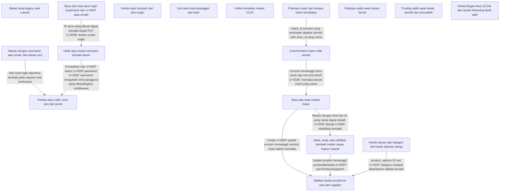

<!-- Generated by peta-alur-hidup/render.py; do not edit. -->

# Akses akun&#44; persiapan master&#44; bagan akun&#44; impor dan saldo awal &#8212; jejak sumber V2

## Rincian langkah

| ID | Langkah | Pelaku | Syarat awal | Hasil | Bukti kode | Tabel |
| --- | --- | --- | --- | --- | --- | --- |
| AM01 | Masuk dengan username atau email&#44; dan keluar sesi | Tamu &#47; pengguna login | GET&#47;POST &#47;login hanya guest&#59; POST dibatasi throttle&#58;10&#44;1. Input identitas berupa username pendek&#44; email valid&#44; atau alias admin&#44; password wajib&#59; limiter identitas&#43;IP menolak setelah 5 kegagalan selama jendela 60 detik. | Jika input bukan format email dan bukan alias admin&#44; autentikasi diarahkan ke kolom users.username&#59; Auth&#58;&#58;attempt mensyaratkan users.is&#95;active. Berhasil meregenerasi sesi&#44; menyimpan pasangan id&#47;auth&#95;version&#44; menghapus intended URL dan menuju pos.index &#40;&#47;&#41;. POST &#47;logout &#40;auth&#41; logout&#44; invalidasi sesi dan regenerasi token. | app&#47;Http&#47;Controllers&#47;AuthController.php&#58;149 | users&#58; read |
| AM02 | Periksa akun aktif&#44; versi sesi dan peran | Middleware web &#47; pengguna terautentikasi | EnsureActiveAccount terpasang global pada web sebelum V2Cutover &#40;bootstrap&#47;app.php&#58;15&#41;. Setiap request dengan Auth membaca ulang users&#44; membandingkan v2&#95;auth&#95;stamp terhadap id&#47;auth&#95;version. | Akun hilang&#47;nonaktif atau versi tidak cocok mengakhiri sesi&#59; JSON mendapat 401&#44; HTML menuju login. Cap kosong hanya diterima untuk auth&#95;version&#61;1 atau viaRemember. Operations&#58;&#58;role membaca users aktif &#43; v2&#95;user&#95;roles dan hanya menerima admin&#47;cashier&#59; tanpa role sah 403. | app&#47;Http&#47;Middleware&#47;EnsureActiveAccount.php&#58;11 | users&#58; read&#59; v2&#95;user&#95;roles&#58; read |
| AM03 | Batasi arsip legacy saat cutover | Middleware web &#47; admin atau kasir | config&#47;v2.php&#58;2 menetapkan enabled dari V2&#95;ENABLED dengan default false&#59; nilai runtime tidak dibaca. Bila aktif&#44; demo&#45;setup ditolak 404. Jalur v2&#44; login&#44; logout&#44; up dan root memiliki pengecualian eksplisit. | Untuk jalur legacy lain yang sudah terautentikasi&#44; hanya admin dengan metode GET lolos&#59; kasir atau metode tulis ditolak 403 oleh server. Root diteruskan&#59; PosController&#58;&#58;index mendelegasikan ke workspace bila enabled. | app&#47;Http&#47;Middleware&#47;V2Cutover.php&#58;12 | users&#58; read&#59; v2&#95;user&#95;roles&#58; read |
| AM04 | Baca dan buat akun login &#40;username dan&#47;atau email&#41; | Admin aktif | GET&#47;POST &#47;v2&#47;accounts memerlukan auth dan admin aktif. POST throttle&#58;20&#44;1&#59; name wajib max255&#59; minimal salah satu dari username &#40;3&#8211;32 karakter huruf kecil&#47;angka&#47;.&#95;&#45;&#44; bukan admin&#41; atau email valid wajib&#59; password terkonfirmasi 12&#8211;128&#59; role admin&#47;cashier dan is&#95;active boolean wajib. | Daftar memakai users LEFT JOIN v2&#95;user&#95;roles tanpa hash dan respons no&#45;store. Pembuatan mengunci role&#44; memeriksa ulang admin aktif serta keunikan username&#47;email lower&#40;trim&#41;&#59; membuat users dengan password hash&#47;auth&#95;version&#61;1&#44; role dan audit create secara atomik&#44; respons 201. Akun login bukan v2&#95;parties&#40;kind&#61;employee&#41;. | app&#47;Http&#47;Controllers&#47;V2&#47;AccountController.php&#58;57 | users&#58; create&#44;read&#59; v2&#95;account&#95;audits&#58; create&#59; v2&#95;user&#95;roles&#58; create&#44;read |
| AM05 | Ubah akun tanpa memutus kendali admin | Admin aktif | PUT &#47;v2&#47;accounts&#47;&#123;id&#125; numerik&#44; throttle&#58;20&#44;1&#59; payload name&#47;role&#47;is&#95;active wajib&#44; minimal salah satu username&#47;email tetap terisi&#44; password opsional terkonfirmasi 12&#8211;128. Transaksi mengunci role&#47;aktor&#47;target&#59; target hilang 404&#44; aktor tidak sah 403. | Dilarang nonaktif&#47;demosi diri sendiri dan admin aktif terakhir &#40;422&#41;. Shift target berstatus open melarang perubahan role&#47;nonaktif. Username dan email harus unik. users dan role diperbarui&#44; audit update dibuat. Perubahan role&#44; status&#44; password&#44; ATAU username menaikkan auth&#95;version&#44; memutar remember&#95;token serta menghapus sesi DB jika tabel sessions ada. | app&#47;Http&#47;Controllers&#47;V2&#47;AccountController.php&#58;147 | sessions&#58; delete&#59; users&#58; read&#44;update&#59; v2&#95;account&#95;audits&#58; create&#59; v2&#95;shifts&#58; read&#59; v2&#95;user&#95;roles&#58; create&#44;read&#44;update |
| AM06 | Baca dan buat master dasar | Admin aktif | GET&#47;POST &#47;v2&#47;master&#47;&#123;kind&#125;&#58; kind product&#47;customer&#47;supplier&#47;employee&#47;vehicle&#59; kind tidak dikenal 404. Validasi text wajib dan batas panjang&#44; angka nonnegatif&#59; SKU&#47;kode&#47;plat tidak boleh sudah ada. | GET membaca maksimal 100 record terbaru per kind&#44; produk disertai supplier. POST atomik membuat produk stok 0&#44; kendaraan status active atau pihak is&#95;active&#61;true&#59; produk melalui resolusi satuan&#47;kategori dan supplier. Customer price&#95;tier hanya retail&#47;contractor&#59; contractor&#95;price positif atau null. Employee hanya master pihak&#44; tidak membuat users&#47;role atau akses login. | app&#47;Services&#47;V2&#47;MasterData.php&#58;96 | product&#95;options&#58; create&#44;read&#59; products&#58; create&#44;read&#59; v2&#95;parties&#58; create&#44;read&#59; v2&#95;product&#95;suppliers&#58; create&#44;read&#59; vehicles&#58; create&#44;read |
| AM07 | Ubah&#44; arsip&#44; atau aktifkan kembali master tanpa hapus riwayat | Admin aktif | PUT&#47;PATCH &#47;v2&#47;master&#47;&#123;kind&#125;&#47;&#123;id&#125; dan PATCH &#47;v2&#47;master&#47;&#123;kind&#125;&#47;&#123;id&#125;&#47;activate numerik&#59; service memeriksa admin&#47;kind dan mengunci record terikat kind. | PUT tidak mengganti kind&#47;stok&#47;status arsip&#59; HPP produk tidak boleh berubah bila stok nonzero atau ada stock&#95;movements. PATCH arsip menonaktifkan &#40;kendaraan status inactive&#44; lainnya is&#95;active&#61;false&#41; tanpa hard delete&#59; PATCH activate memulihkan kembali dari arsip &#40;active&#47;is&#95;active&#61;true&#41; dengan riwayat utuh. | app&#47;Services&#47;V2&#47;MasterData.php&#58;137 | product&#95;options&#58; create&#44;read&#59; products&#58; read&#44;update&#59; stock&#95;movements&#58; read&#59; v2&#95;parties&#58; read&#44;update&#59; v2&#95;product&#95;suppliers&#58; create&#44;read&#44;update&#44;delete&#59; vehicles&#58; read&#44;update |
| AM08 | Kelola satuan dan kategori &#40;termasuk aktivasi ulang&#41; | Admin aktif | POST&#47;PUT&#47;PATCH &#47;v2&#47;relations&#47;&#123;kind&#125;&#91;&#47;&#123;id&#125;&#93; dan PATCH &#47;v2&#47;relations&#47;&#123;kind&#125;&#47;&#123;id&#125;&#47;activate membatasi kind driver&#47;unit&#47;category dan ID numerik. Untuk unit&#47;category&#58; name wajib dengan batas 32&#47;50 dan unik dalam type. | Membuat product&#95;options aktif&#59; rename memperbarui teks unit&#47;category pada products yang terhubung ID. Arsip menyetel is&#95;active&#61;false tanpa menghapus relasi lama&#59; activate memulihkan is&#95;active&#61;true. Pilihan produk baru wajib opsi aktif&#44; sedangkan tautan lama tetap sah walau opsi diarsip. | app&#47;Services&#47;V2&#47;MasterRelations.php&#58;31 | product&#95;options&#58; create&#44;read&#44;update&#59; products&#58; read&#44;update |
| AM09 | Kelola sopir terpisah dari akun login | Admin aktif | Rute relations driver memakai MasterRelations &#40;store&#47;update&#47;archive&#47;activate&#41;. kind internal&#47;external wajib&#59; code unik. Internal wajib merujuk v2&#95;parties employee aktif yang belum dipakai sopir lain&#59; external tidak boleh employee&#95;id dan wajib nama. | Create&#47;PUT menyimpan v2&#95;drivers&#44; internal memakai nama employee&#59; saat PUT menuju external employee&#95;id dikosongkan. PATCH menonaktifkan atau mengaktifkan kembali sopir tanpa menghapus. Driver resolver menolak sopir nonaktif&#47;pegawai internal nonaktif. Tidak ada pembuatan users&#47;role pada alur ini. | app&#47;Services&#47;V2&#47;MasterRelations.php&#58;192 | v2&#95;drivers&#58; create&#44;read&#44;update&#59; v2&#95;parties&#58; read |
| AM10 | Validasi tautan produk ke opsi dan supplier | Admin melalui create&#47;update produk | Payload product menerima unit&#95;id&#47;category&#95;id atau nama teks&#59; supplier&#95;ids array ID unik dan primary&#95;supplier&#95;id opsional. Dipanggil dalam transaksi MasterData&#58;&#58;store&#47;update&#44; bukan endpoint mandiri. | Teks opsi baru dapat membuat product&#95;options saat write saja&#59; pilihan baru harus aktif&#44; tautan opsi lama boleh tetap walau arsip. Supplier baru harus kind supplier aktif&#59; supplier terarsip yang sudah tertaut boleh dipertahankan. Primary harus anggota daftar. Kesalahan membatalkan transaksi master. | app&#47;Services&#47;V2&#47;MasterRelations.php&#58;113 | product&#95;options&#58; create&#44;read&#59; v2&#95;parties&#58; read&#59; v2&#95;product&#95;suppliers&#58; create&#44;read&#44;update&#44;delete |
| AM11 | Cari atau buat pelanggan dari kasir | Admin &#47; kasir aktif | GET &#47;v2&#47;customers&#47;search menerima q wajib string max255&#59; role admin&#47;cashier. POST &#47;v2&#47;customers&#47;resolve menerima name wajib string max255&#44; service menormalkan spasi dan mensyaratkan panjang 2&#8211;255. | Search di bawah 2 karakter kosong&#59; hanya customer aktif&#44; nama mengandung term atau kode berawalan term&#44; default maksimal 8. Resolve memakai kecocokan nama case&#45;insensitive&#58; customer aktif dikembalikan&#44; terarsip ditolak 422&#59; bila belum ada dibuat kode CUS berurutan aktif. Tidak menyentuh uang&#47;stok&#47;jurnal. | app&#47;Services&#47;V2&#47;CustomerLookup.php&#58;48 | v2&#95;parties&#58; create&#44;read |
| AM12 | Unduh template master XLSX | Admin aktif | GET &#47;v2&#47;templates&#47;&#123;kind&#125;&#59; MasterData mensyaratkan admin. Hanya product&#47;customer&#47;supplier&#47;employee&#47;vehicle&#59; driver&#47;unit&#47;category secara eksplisit tidak tersedia. | Menghasilkan XLSX header sesuai columns&#40;kind&#41;&#44; sebagai unduhan private&#47;no&#45;store tanpa mutasi master. Template produk berisi sku&#44;name&#44;unit&#44;category&#44;cost&#95;price&#44;selling&#95;price&#44;min&#95;stock&#59; tidak menyediakan stok awal atau tautan supplier. | app&#47;Services&#47;V2&#47;MasterData.php&#58;374 | users&#58; read&#59; v2&#95;user&#95;roles&#58; read |
| AM13 | Pratinjau impor dan simpan batch tervalidasi | Admin aktif | POST &#47;v2&#47;imports&#47;&#123;kind&#125;&#47;preview dengan file wajib max2048 KB. Parser XLSX memeriksa header lengkap tanpa kolom asing&#47;duplikat&#47;stok&#45;saldo&#59; batas 1000 baris&#44; ZIP 100 entri&#47;10MB&#44; menolak path tidak aman&#44; macro&#44; formula dan external reference. | Validasi kolom&#47;angka dan duplikasi key dalam file maupun DB. Gagal memberi errors dan batch&#95;id&#61;null tanpa menulis master&#59; berhasil menyimpan v2&#95;import&#95;batches status preview&#44; rows normalisasi dan actor&#95;id&#44; lalu mengembalikan batch&#95;id&#47;count serta maksimal 100 baris. | app&#47;Services&#47;V2&#47;MasterData.php&#58;383 | products&#58; read&#59; v2&#95;import&#95;batches&#58; create&#59; v2&#95;parties&#58; read&#59; vehicles&#58; read |
| AM14 | Commit batch impor milik sendiri | Admin pemilik batch | POST &#47;v2&#47;import&#45;batches&#47;&#123;id&#125;&#47;commit&#44; ID numerik&#59; requireAdmin dan lock v2&#95;import&#95;batches. Batch hilang 422&#59; actor&#95;id berbeda 403. | Batch committed dikembalikan idempoten tanpa insert ulang. Batch belum committed dibaca rows&#47;kind lalu tiap baris masuk MasterData&#58;&#58;store untuk revalidasi aturan terbaru. Seluruh insert dan perubahan status committed satu transaksi&#59; produk impor tetap stok 0&#44; tanpa jurnal&#47;faktur awal. | app&#47;Services&#47;V2&#47;MasterData.php&#58;471 | product&#95;options&#58; create&#44;read&#59; products&#58; create&#44;read&#59; v2&#95;import&#95;batches&#58; read&#44;update&#59; v2&#95;parties&#58; create&#44;read&#59; vehicles&#58; create&#44;read |
| AM15 | Pratinjau saldo awal sistem bersih | Admin dengan sesi aktif | POST &#47;v2&#47;opening&#45;balances&#47;preview meneruskan payload date&#44;reference&#44;cash&#44;bank&#44;inventory&#44;receivables&#44;payables. Dilarang bila sudah ada batch pembukaan&#44; journal&#95;entries&#44; stok produk nonzero atau v2&#95;invoices. | Tanpa mutasi DB&#58; normalisasi desimal&#44; tanggal valid&#44; referensi max50&#44; kas&#47;bank&#47;qty&#47;HPP nonnegatif&#59; produk harus ada dan tidak duplikat. Piutang butuh customer aktif&#44; utang supplier aktif&#44; nomor faktur unik&#44; amount positif dan due&#95;date valid. Ringkasan serta rancangan jurnal mengimbangi selisih aset&#45;utang ke ekuitas 3101. | app&#47;Services&#47;V2&#47;OpeningBalances.php&#58;60 | journal&#95;entries&#58; read&#59; products&#58; read&#59; v2&#95;invoices&#58; read&#59; v2&#95;opening&#95;batches&#58; read&#59; v2&#95;parties&#58; read&#59; v2&#95;user&#95;roles&#58; read |
| AM16 | Posting saldo awal sekali&#44; atomik dan immutable | Admin dengan sesi aktif | POST &#47;v2&#47;opening&#45;balances dengan payload pembukaan&#59; idempotency&#95;key string 8&#8211;100 dan array inventory&#47;receivables&#47;payables masing&#45;masing max1000 pada controller. Service mengulangi validasi preview dan mengunci batch singleton&#44; akun modal serta produk. | Jika batch sudah ada&#44; key DAN hash payload sama mengembalikan idempotent&#95;ok&#59; selain itu ditolak sebagai immutable. Posting membuat v2&#95;opening&#95;batches&#44; jurnal seimbang melalui Ledger&#44; memperbarui stok&#47;HPP dan stock&#95;movements&#44; membuat faktur receivable&#47;payable open paid&#61;0 tanpa sale&#47;receipt palsu. Tidak tersedia edit&#47;reset saldo awal di routes&#47;v2.php. | app&#47;Services&#47;V2&#47;OpeningBalances.php&#58;84 | chart&#95;of&#95;accounts&#58; read&#59; journal&#95;entries&#58; create&#44;read&#59; journal&#95;entry&#95;lines&#58; create&#59; products&#58; read&#44;update&#59; stock&#95;movements&#58; create&#59; v2&#95;invoices&#58; create&#44;read&#59; v2&#95;opening&#95;batches&#58; create&#44;read&#44;update&#59; v2&#95;parties&#58; read&#59; v2&#95;user&#95;roles&#58; read |
| AM17 | Kelola Bagan Akun &#40;COA&#41; dan tandai Rekening Bank aktif | Admin aktif | POST &#47;v2&#47;chart&#45;of&#45;accounts&#44; PUT &#47;v2&#47;chart&#45;of&#45;accounts&#47;&#123;id&#125;&#44; PATCH &#47;v2&#47;chart&#45;of&#45;accounts&#47;&#123;id&#125;&#47;archive &#40;throttle&#58;30&#44;1&#44; admin wajib&#41;. Kode akun wajib cocok dengan jenis akun dan saldo normalnya. Penanda is&#95;bank&#95;account hanya sah untuk akun Aset bersaldo normal Debet yang bukan akun inti non&#45;bank&#59; 1102 wajib tetap aktif dan bertanda Rekening Bank. | Menambah&#44; memperbarui&#44; atau mengarsipkan akun pada chart&#95;of&#95;accounts tanpa hard delete&#59; akun yang sudah dipakai jurnal tidak boleh diubah kode&#47;jenis&#47;saldo normalnya dan akun inti sistem tidak boleh diubah kodenya atau diarsip. Setiap akun aktif bertanda is&#95;bank&#95;account&#61;true &#40;bersama 1102&#41; dibaca terpusat lewat BankAccounts dan otomatis tersedia sebagai pilihan Rekening Bank pada Kasir&#44; Tagihan&#44; Verifikasi&#44; Pengeluaran&#44; Perjalanan&#44; Ongkir Penerimaan&#44; Penyesuaian&#47;Pindah Dana&#44; Laporan Harian&#44; dan Arus Kas. | app&#47;Http&#47;Controllers&#47;ChartOfAccountController.php&#58;139 | chart&#95;of&#95;accounts&#58; create&#44;read&#44;update&#59; journal&#95;entry&#95;lines&#58; read&#59; users&#58; read&#59; v2&#95;user&#95;roles&#58; read |

## Indeks tabel

| Tabel | Langkah | Operasi |
| --- | --- | --- |
| chart&#95;of&#95;accounts | AM16 | read |
| chart&#95;of&#95;accounts | AM17 | create&#44;read&#44;update |
| journal&#95;entries | AM15 | read |
| journal&#95;entries | AM16 | create&#44;read |
| journal&#95;entry&#95;lines | AM16 | create |
| journal&#95;entry&#95;lines | AM17 | read |
| product&#95;options | AM06 | create&#44;read |
| product&#95;options | AM07 | create&#44;read |
| product&#95;options | AM08 | create&#44;read&#44;update |
| product&#95;options | AM10 | create&#44;read |
| product&#95;options | AM14 | create&#44;read |
| products | AM06 | create&#44;read |
| products | AM07 | read&#44;update |
| products | AM08 | read&#44;update |
| products | AM13 | read |
| products | AM14 | create&#44;read |
| products | AM15 | read |
| products | AM16 | read&#44;update |
| sessions | AM05 | delete |
| stock&#95;movements | AM07 | read |
| stock&#95;movements | AM16 | create |
| users | AM01 | read |
| users | AM02 | read |
| users | AM03 | read |
| users | AM04 | create&#44;read |
| users | AM05 | read&#44;update |
| users | AM12 | read |
| users | AM17 | read |
| v2&#95;account&#95;audits | AM04 | create |
| v2&#95;account&#95;audits | AM05 | create |
| v2&#95;drivers | AM09 | create&#44;read&#44;update |
| v2&#95;import&#95;batches | AM13 | create |
| v2&#95;import&#95;batches | AM14 | read&#44;update |
| v2&#95;invoices | AM15 | read |
| v2&#95;invoices | AM16 | create&#44;read |
| v2&#95;opening&#95;batches | AM15 | read |
| v2&#95;opening&#95;batches | AM16 | create&#44;read&#44;update |
| v2&#95;parties | AM06 | create&#44;read |
| v2&#95;parties | AM07 | read&#44;update |
| v2&#95;parties | AM09 | read |
| v2&#95;parties | AM10 | read |
| v2&#95;parties | AM11 | create&#44;read |
| v2&#95;parties | AM13 | read |
| v2&#95;parties | AM14 | create&#44;read |
| v2&#95;parties | AM15 | read |
| v2&#95;parties | AM16 | read |
| v2&#95;product&#95;suppliers | AM06 | create&#44;read |
| v2&#95;product&#95;suppliers | AM07 | create&#44;read&#44;update&#44;delete |
| v2&#95;product&#95;suppliers | AM10 | create&#44;read&#44;update&#44;delete |
| v2&#95;shifts | AM05 | read |
| v2&#95;user&#95;roles | AM02 | read |
| v2&#95;user&#95;roles | AM03 | read |
| v2&#95;user&#95;roles | AM04 | create&#44;read |
| v2&#95;user&#95;roles | AM05 | create&#44;read&#44;update |
| v2&#95;user&#95;roles | AM12 | read |
| v2&#95;user&#95;roles | AM15 | read |
| v2&#95;user&#95;roles | AM16 | read |
| v2&#95;user&#95;roles | AM17 | read |
| vehicles | AM06 | create&#44;read |
| vehicles | AM07 | read&#44;update |
| vehicles | AM13 | read |
| vehicles | AM14 | create&#44;read |

## Batas analisis

- Analisis statis source workspace saat dibaca. Tidak menjalankan aplikasi&#44; tes&#44; Artisan&#44; migrasi&#44; query DB atau browser&#59; status operasi runtime tidak diverifikasi di sini.
- Nilai V2&#95;ENABLED aktual&#44; konfigurasi session driver&#44; keberadaan tabel sessions&#44; dan kebersihan data pembukaan tidak dibaca dari .env atau database.
- OpeningBalances&#58;&#58;requireAdmin memeriksa role saja&#59; jaminan akun aktif untuk rute web datang dari EnsureActiveAccount.
- Pratinjau saldo awal dan posting berhubungan payload&#47;domain&#44; tetapi server tidak mengikat posting ke hasil preview&#59; karena itu tidak dibuat edge wajib preview&#8594;post.
- Proofs adalah cuplikan lokasi kode tanpa menyalin identitas&#47;rahasia literal&#59; alias admin pada AuthController&#58;&#58;login tidak dikutip baris email statisnya.
