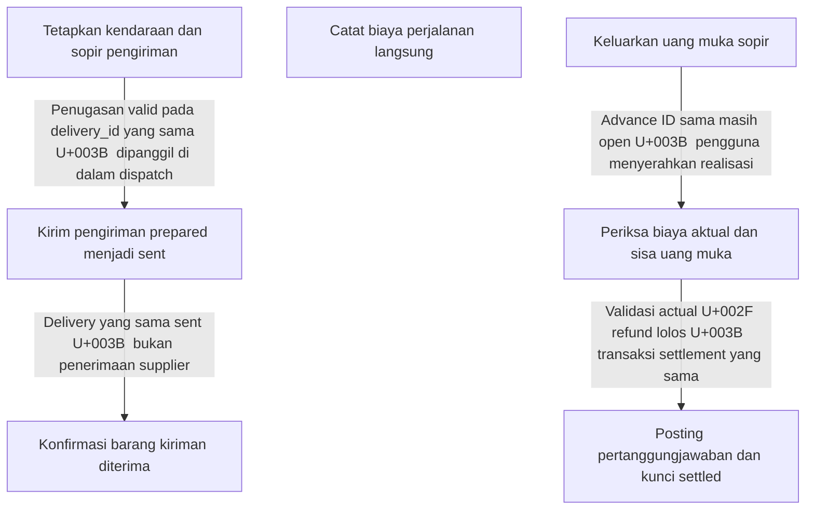

<!-- Generated by peta-alur-hidup/render.py; do not edit. -->

# Pengiriman&#44; perjalanan&#44; dan pertanggungjawaban uang muka

## Rincian langkah

| ID | Langkah | Pelaku | Syarat awal | Hasil | Bukti kode | Tabel |
| --- | --- | --- | --- | --- | --- | --- |
| PG1 | Tetapkan kendaraan dan sopir pengiriman | Admin atau kasir pemilik penjualan untuk dispatch&#59; admin untuk biaya&#47;uang muka | Pengiriman berasal dari penjualan fulfillment&#61;delivery. TransportAssignment&#58;&#58;resolve dipanggil di dalam transaksi dispatch&#44; trip atau advance&#59; driver dan kendaraan dipilih dengan ID&#44; bukan nama. | Prepared yang belum ditugaskan mendapat snapshot driver&#95;id&#44; driver&#95;name dan vehicle&#95;id. Penugasan lama harus cocok. Kendaraan wajib active&#59; sopir diperiksa melalui MasterRelations&#58;&#58;driver dan pegawai internal aktif. Nama historis tanpa driver&#95;id ditolak untuk rekonsiliasi manual&#44; tidak ditebak. | app&#47;Services&#47;V2&#47;TransportAssignment.php&#58;35 | v2&#95;deliveries&#58; read&#44;update&#59; v2&#95;drivers&#58; read&#59; v2&#95;parties&#58; read&#59; vehicles&#58; read |
| PG2 | Kirim pengiriman prepared menjadi sent | Admin atau kasir pemilik sale&#95;id pengiriman&#59; selainnya 403 | POST &#47;v2&#47;deliveries&#47;&#123;id&#125;&#47;dispatch &#8594; WorkspaceController&#58;&#58;dispatch &#8594; DeliveryTrips&#58;&#58;dispatch. ID pengiriman&#44; driver&#95;id&#44; vehicle&#95;id sah&#59; baris aktor dan pengiriman dikunci&#59; DeliveryTrips&#58;&#58;access memeriksa kepemilikan. | Penugasan dicek&#47;dicatat&#59; status sent dan dispatched&#95;by&#47;at tersimpan. Kirim ulang status sent dengan identitas sama tidak berefek&#59; pengiriman received ditolak. Tidak mengurangi stok lagi dan tidak membuat jurnal. | app&#47;Services&#47;V2&#47;DeliveryTrips.php&#58;34 | users&#58; read&#59; v2&#95;deliveries&#58; read&#44;update&#59; v2&#95;drivers&#58; read&#59; v2&#95;sales&#58; read&#59; v2&#95;user&#95;roles&#58; read&#59; vehicles&#58; read |
| PG3 | Konfirmasi barang kiriman diterima | Admin atau kasir pemilik sale&#95;id pengiriman&#59; selainnya 403 | POST &#47;v2&#47;deliveries&#47;&#123;id&#125;&#47;receive &#8594; WorkspaceController&#58;&#58;receiveDelivery &#8594; DeliveryTrips&#58;&#58;receive. delivery&#95;id yang sama harus sent&#59; aktor&#47;pengiriman dikunci dan akses diperiksa. | Status received dan received&#95;by&#47;at tersimpan. Terima ulang received tidak berefek&#59; prepared ditolak karena belum dikirim. Ini penerimaan pelanggan&#44; BUKAN penerimaan stok supplier&#59; tidak menulis stok&#47;jurnal&#47;pembayaran. | app&#47;Services&#47;V2&#47;DeliveryTrips.php&#58;70 | users&#58; read&#59; v2&#95;deliveries&#58; read&#44;update&#59; v2&#95;sales&#58; read&#59; v2&#95;user&#95;roles&#58; read |
| PG4 | Catat biaya perjalanan langsung | Admin V2 | POST &#47;v2&#47;trips &#8594; WorkspaceController&#58;&#58;trip &#8594; SupplyTrips&#58;&#58;trip. Kendaraan&#47;sopir aktif&#44; tanggal sah&#44; tujuan wajib bila tanpa delivery&#95;id&#59; fuel&#95;cost&#47;allowance tidak negatif dan total positif&#59; method cash atau transfer&#59; idempotency&#95;key wajib. Bila terkait pengiriman&#44; identitas harus cocok. | v2&#95;trips posted&#59; jurnal DR 6101 beban perjalanan&#44; CR 1101 tunai atau 1102 bank. Cash memerlukan shift admin terbuka&#44; saldo laci cukup&#44; mutasi out adjustment&#59; transfer tanpa mutasi laci. Keduanya memeriksa saldo akun. Replay muatan identik mengembalikan hasil tersimpan&#59; kunci dipakai muatan berbeda ditolak. Tidak mengubah stok&#59; beban ini bukan pengurang langsung pendapatan ongkir 4102. | app&#47;Services&#47;V2&#47;SupplyTrips.php&#58;250 | chart&#95;of&#95;accounts&#58; read&#59; journal&#95;entries&#58; create&#59; journal&#95;entry&#95;lines&#58; read&#44;create&#59; users&#58; read&#59; v2&#95;deliveries&#58; read&#44;update&#59; v2&#95;drivers&#58; read&#59; v2&#95;requests&#58; read&#44;create&#59; v2&#95;shift&#95;movements&#58; read&#44;create&#59; v2&#95;shifts&#58; read&#59; v2&#95;trips&#58; create&#44;update&#59; v2&#95;user&#95;roles&#58; read&#59; vehicles&#58; read |
| PG5 | Keluarkan uang muka sopir | Admin V2 | POST &#47;v2&#47;driver&#45;advances &#8594; WorkspaceController&#58;&#58;advance &#8594; DeliveryTrips&#58;&#58;advance. Nominal positif&#44; method cash&#47;transfer&#44; driver&#47;vehicle valid&#59; delivery&#95;id opsional dengan identitas cocok&#59; idempotency&#95;key wajib. Cash wajib shift admin dan saldo laci cukup&#59; akun 1191 aktif dan saldo sumber cukup. | Uang muka status open dan referensi jurnal tersimpan&#59; DR 1191 aset uang muka&#44; CR 1101 atau 1102. Cash menulis mutasi out pada shift admin&#59; transfer tidak. Belum membebankan 6101 saat uang muka keluar. Replay sama tidak mengeluarkan uang dua kali. | app&#47;Services&#47;V2&#47;DeliveryTrips.php&#58;104 | chart&#95;of&#95;accounts&#58; read&#59; journal&#95;entries&#58; create&#59; journal&#95;entry&#95;lines&#58; read&#44;create&#59; users&#58; read&#59; v2&#95;deliveries&#58; read&#44;update&#59; v2&#95;driver&#95;advances&#58; create&#44;update&#59; v2&#95;drivers&#58; read&#59; v2&#95;requests&#58; read&#44;create&#59; v2&#95;shift&#95;movements&#58; read&#44;create&#59; v2&#95;shifts&#58; read&#59; v2&#95;user&#95;roles&#58; read&#59; vehicles&#58; read |
| PG6 | Periksa biaya aktual dan sisa uang muka | Admin V2 | POST &#47;v2&#47;driver&#45;advances&#47;&#123;id&#125;&#47;settle &#8594; WorkspaceController&#58;&#58;settle &#8594; DeliveryTrips&#58;&#58;settle. Advance yang sama dikunci&#59; harus ada dan belum settled&#59; fuel&#95;cost dan allowance tidak negatif&#44; actual tidak melebihi advance.amount. | Refund dihitung amount &#45; actual. Sisa positif wajib refund&#95;received&#61;true dan refund&#95;method cash&#47;transfer&#59; tunai kembali memerlukan shift admin penerima terbuka. Biaya aktual lebih besar ditolak&#44; bukan otomatis menambah pengeluaran. Gagal validasi menggagalkan transaksi tanpa settlement. | app&#47;Services&#47;V2&#47;DeliveryTrips.php&#58;259 | chart&#95;of&#95;accounts&#58; read&#59; users&#58; read&#59; v2&#95;driver&#95;advances&#58; read&#59; v2&#95;requests&#58; read&#59; v2&#95;shifts&#58; read&#59; v2&#95;user&#95;roles&#58; read |
| PG7 | Posting pertanggungjawaban dan kunci settled | Admin V2&#44; transaksi settle yang lolos PG6 | Advance ID sama&#59; actual dan refund sudah diverifikasi dalam transaksi yang sama. Ini kelanjutan internal settle&#44; bukan endpoint baru atau biaya trip kedua. | Buat v2&#95;driver&#95;advance&#95;settlements settled. DR 6101 sebesar aktual positif &#43; DR kas&#47;bank sebesar refund positif&#59; CR 1191 sebesar seluruh uang muka. Kaitkan jurnal lalu advance.status&#61;settled. Refund cash menulis mutasi in pada shift admin penerima&#59; bukan wajib shift pengaju awal. Tidak membuat v2&#95;trips kedua. Replay key&#43;muatan sama mengembalikan hasil&#59; key baru untuk advance settled ditolak. | app&#47;Services&#47;V2&#47;DeliveryTrips.php&#58;290 | chart&#95;of&#95;accounts&#58; read&#59; journal&#95;entries&#58; create&#59; journal&#95;entry&#95;lines&#58; create&#59; v2&#95;driver&#95;advance&#95;settlements&#58; create&#44;update&#59; v2&#95;driver&#95;advances&#58; update&#59; v2&#95;requests&#58; create&#59; v2&#95;shift&#95;movements&#58; create |

## Indeks tabel

| Tabel | Langkah | Operasi |
| --- | --- | --- |
| chart&#95;of&#95;accounts | PG4 | read |
| chart&#95;of&#95;accounts | PG5 | read |
| chart&#95;of&#95;accounts | PG6 | read |
| chart&#95;of&#95;accounts | PG7 | read |
| journal&#95;entries | PG4 | create |
| journal&#95;entries | PG5 | create |
| journal&#95;entries | PG7 | create |
| journal&#95;entry&#95;lines | PG4 | read&#44;create |
| journal&#95;entry&#95;lines | PG5 | read&#44;create |
| journal&#95;entry&#95;lines | PG7 | create |
| users | PG2 | read |
| users | PG3 | read |
| users | PG4 | read |
| users | PG5 | read |
| users | PG6 | read |
| v2&#95;deliveries | PG1 | read&#44;update |
| v2&#95;deliveries | PG2 | read&#44;update |
| v2&#95;deliveries | PG3 | read&#44;update |
| v2&#95;deliveries | PG4 | read&#44;update |
| v2&#95;deliveries | PG5 | read&#44;update |
| v2&#95;driver&#95;advance&#95;settlements | PG7 | create&#44;update |
| v2&#95;driver&#95;advances | PG5 | create&#44;update |
| v2&#95;driver&#95;advances | PG6 | read |
| v2&#95;driver&#95;advances | PG7 | update |
| v2&#95;drivers | PG1 | read |
| v2&#95;drivers | PG2 | read |
| v2&#95;drivers | PG4 | read |
| v2&#95;drivers | PG5 | read |
| v2&#95;parties | PG1 | read |
| v2&#95;requests | PG4 | read&#44;create |
| v2&#95;requests | PG5 | read&#44;create |
| v2&#95;requests | PG6 | read |
| v2&#95;requests | PG7 | create |
| v2&#95;sales | PG2 | read |
| v2&#95;sales | PG3 | read |
| v2&#95;shift&#95;movements | PG4 | read&#44;create |
| v2&#95;shift&#95;movements | PG5 | read&#44;create |
| v2&#95;shift&#95;movements | PG7 | create |
| v2&#95;shifts | PG4 | read |
| v2&#95;shifts | PG5 | read |
| v2&#95;shifts | PG6 | read |
| v2&#95;trips | PG4 | create&#44;update |
| v2&#95;user&#95;roles | PG2 | read |
| v2&#95;user&#95;roles | PG3 | read |
| v2&#95;user&#95;roles | PG4 | read |
| v2&#95;user&#95;roles | PG5 | read |
| v2&#95;user&#95;roles | PG6 | read |
| vehicles | PG1 | read |
| vehicles | PG2 | read |
| vehicles | PG4 | read |
| vehicles | PG5 | read |

## Batas analisis

- Biaya perjalanan langsung dan uang muka adalah jalur independen&#59; kode tidak mewajibkan setiap pengiriman memiliki biaya atau uang muka. Tidak dibuat panah palsu dispatch &#8594; advance &#8594; trip.
- Penyelesaian uang muka dengan aktual melebihi advance ditolak eksplisit. Mekanisme menambah kekurangan tidak didukung di metode settle ini &#40;DeliveryTrips.php&#58;269&#45;270&#41;.
- Tidak ada klaim bahwa sopir adalah akun login atau pelanggan mengonfirmasi sendiri&#58; guard server dispatch&#47;receive hanya admin atau kasir pemilik penjualan.
- Analisis ini membaca sumber statis. Tidak menjalankan pengiriman nyata&#44; tidak membaca saldo&#44; transaksi&#44; atau penugasan operasional.
- Indeks CRUD bersifat ringkasan akses jalur yang dicatat beserta helper langsung&#59; bukan inventaris seluruh query aplikasi.
