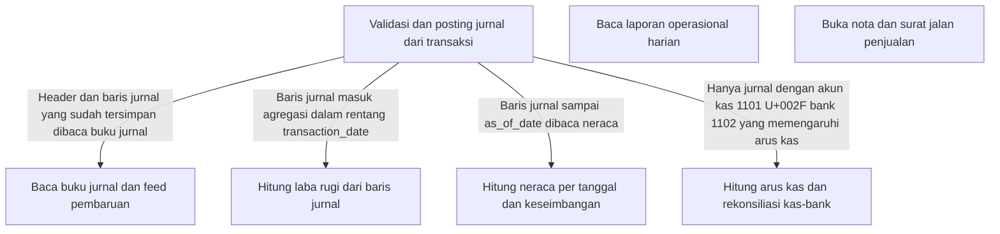

<!-- Generated by peta-alur-hidup/render.py; do not edit. -->

# Jurnal&#44; laporan harian&#44; dan laporan keuangan

## Rincian langkah

| ID | Langkah | Pelaku | Syarat awal | Hasil | Bukti kode | Tabel |
| --- | --- | --- | --- | --- | --- | --- |
| JL1 | Validasi dan posting jurnal dari transaksi | Service transaksi V2&#44; bukan tombol jurnal bebas | Operations&#44; SupplyTrips&#44; DeliveryTrips atau OpeningBalances memanggil Ledger&#58;&#58;post dengan reference&#95;type&#47;reference&#95;id&#44; tanggal opsional&#44; keterangan&#44; minimal dua baris akun&#59; debit&#47;kredit berupa string desimal atau integer&#44; bukan float&#47;bool. | Tolak referensi&#47;tanggal&#47;akun&#47;nilai tidak sah&#44; baris dua sisi sekaligus&#44; nol&#44; total nol atau debit tidak sama kredit. Dalam transaksi kunci akun aktif urut kode&#59; akun hilang menggagalkan posting&#44; tidak dibuat otomatis. Simpan journal&#95;entries dan journal&#95;entry&#95;lines dengan nama akun dari COA. Rollback mengikuti transaksi pemanggil bila gagal. | app&#47;Services&#47;V2&#47;Ledger.php&#58;19 | chart&#95;of&#95;accounts&#58; read&#59; journal&#95;entries&#58; create&#59; journal&#95;entry&#95;lines&#58; create |
| JL2 | Baca laporan operasional harian | Admin seluruh data&#59; kasir hanya shift&#47;penjualan&#47;pembayaran sendiri | GET &#47;v2&#63;date&#61;YYYY&#45;MM&#45;DD atau workspace root V2 &#8594; WorkspaceController&#58;&#58;index &#8594; ReportsDocuments&#58;&#58;daily. Tanggal harus sah. Hari bisnis penjualan&#47;laci menggunakan tanggal opened&#95;at shift&#59; bukan semua nota dengan created&#95;at hari itu. | Baca seluruh penjualan dalam shift terpilih&#44; pisahkan pendapatan barang&#47;diskon&#47;ongkir&#59; expected&#61;opening&#43;seluruh in&#45;seluruh out. Collections hanya in jenis sale&#47;collection&#44; bukan seluruh penjualan kredit&#47;transfer. Counted&#47;difference null bila belum dihitung. Bank posted memakai tanggal jurnal&#59; pending&#47;proposed memakai tanggal pengajuan. Laporan read&#45;only&#44; tidak menutup periode&#47;jurnal. | app&#47;Services&#47;V2&#47;ReportsDocuments.php&#58;41 | journal&#95;entries&#58; read&#59; v2&#95;invoices&#58; read&#59; v2&#95;payments&#58; read&#59; v2&#95;sales&#58; read&#59; v2&#95;shift&#95;movements&#58; read&#59; v2&#95;shifts&#58; read&#59; v2&#95;user&#95;roles&#58; read |
| JL3 | Buka nota dan surat jalan penjualan | Admin atau kasir pemilik penjualan&#59; selainnya 403 | GET &#47;v2&#47;documents&#47;&#123;id&#125;&#47;&#123;kind&#125;&#44; kind&#61;receipt atau delivery &#8594; WorkspaceController&#58;&#58;document &#8594; ReportsDocuments&#58;&#58;document. v2&#95;sales.id harus ada&#59; jenis delivery memerlukan v2&#95;deliveries terkait sale&#95;id sama. | Baca snapshot sale&#47;items beserta pelanggan dan pengiriman untuk cetak&#59; hitung goods&#95;net&#61;total&#45;delivery&#95;fee dari snapshot. Tidak mengubah stok&#44; status pengiriman&#44; piutang atau jurnal&#59; membuka surat jalan bukan otomatis dispatch&#47;receive. | app&#47;Services&#47;V2&#47;ReportsDocuments.php&#58;177 | v2&#95;deliveries&#58; read&#59; v2&#95;parties&#58; read&#59; v2&#95;sale&#95;items&#58; read&#59; v2&#95;sales&#58; read&#59; v2&#95;user&#95;roles&#58; read |
| JL4 | Baca buku jurnal dan feed pembaruan | Admin ketika V2 cutover aktif&#59; rute legacy hanya GET | GET &#47;journals atau &#47;journals&#47;feed &#8594; JournalController&#58;&#58;index&#47;feed. V2Cutover.php&#58;28 mengizinkan arsip legacy hanya admin&#43;GET jika v2.enabled. Filter tanggal&#44; sumber&#44; kata kunci&#44; after&#95;id divalidasi. | Baca header dan baris jurnal tersimpan&#59; saldo kas&#47;bank dari AccountBalanceService&#59; feed after&#95;id membaca jurnal lebih baru&#44; tidak menulis jurnal. POST penyesuaian&#47;saldo&#45;awal legacy ditolak saat cutover&#44; walaupun handler lama masih ada di source. Ini batas V2&#44; bukan jaminan rute lama hilang. | app&#47;Http&#47;Controllers&#47;JournalController.php&#58;18 | chart&#95;of&#95;accounts&#58; read&#59; journal&#95;entries&#58; read&#59; journal&#95;entry&#95;lines&#58; read&#59; opening&#95;balances&#58; read |
| JL5 | Hitung laba rugi dari baris jurnal | Admin melalui GET &#47;reports&#47;profit&#45;loss saat V2 aktif | ReportController&#58;&#58;profitLoss memvalidasi start&#95;date&#47;end&#95;date dan urutan tanggal&#59; AccountingReportService&#58;&#58;generateProfitAndLoss membaca journal&#95;entries.transaction&#95;date dalam rentang&#44; bukan status invoice atau uang fisik. | Kelompokkan 4xxx pendapatan&#44; 5xxx HPP&#44; 6xxx beban&#44; 7xxx penghasilan lain&#44; 8xxx beban lain. Pendapatan&#61;kredit&#45;debit&#59; beban&#61;debit&#45;kredit. Laba bersih&#61;pendapatan&#45;HPP&#45;beban&#43;penghasilan lain&#45;beban lain. Semua perhitungan BigDecimal&#59; keluaran HTML&#47;JSON atau CSV terpisah&#44; tanpa menulis saldo atau menutup buku. | app&#47;Services&#47;AccountingReportService.php&#58;95 | chart&#95;of&#95;accounts&#58; read&#59; journal&#95;entries&#58; read&#59; journal&#95;entry&#95;lines&#58; read |
| JL6 | Hitung neraca per tanggal dan keseimbangan | Admin melalui GET &#47;reports&#47;balance&#45;sheet saat V2 aktif | ReportController&#58;&#58;balanceSheet memvalidasi as&#95;of&#95;date &#40;default tanggal server&#41;. AccountingReportService&#58;&#58;generateBalanceSheet mengagregasi jurnal sampai tanggal tersebut&#59; saldo aset debet&#45;kredit dan kewajiban&#47;ekuitas kredit&#45;debet. | Tambahkan laba sampai as&#95;of&#95;date sebagai laba ditahan pada sisi ekuitas. is&#95;balanced mensyaratkan aset&#61;kewajiban&#43;ekuitas&#43;laba DAN setiap jurnal tidak kosong serta debit&#61;kredit &#40;journalsAreBalanced&#41;. Hanya pembacaan&#44; bukan membuat jurnal penutup&#44; neraca saldo baru&#44; atau approval bisnis. | app&#47;Services&#47;AccountingReportService.php&#58;229 | chart&#95;of&#95;accounts&#58; read&#59; journal&#95;entries&#58; read&#59; journal&#95;entry&#95;lines&#58; read |
| JL7 | Hitung arus kas dan rekonsiliasi kas&#45;bank | Admin melalui GET &#47;reports&#47;cash&#45;flow saat V2 aktif | ReportController&#58;&#58;cashFlow memvalidasi rentang&#59; AccountingReportService&#58;&#58;generateCashFlow hanya memperhitungkan akun 1101 dan 1102. Saldo awal sebelum start&#95;date&#44; saldo akhir sampai end&#95;date&#44; arus periode dari jurnal terkait. | Kelompok operasi&#47;investasi&#47;pendanaan menurut reference&#95;type lalu akun lawan. Perpindahan internal kas&#8596;bank dengan netCash nol dilewati dari arus bersih. Cek saldo awal&#43;perubahan bersih&#61;saldo akhir DAN jumlah rincian akun&#61;saldo akhir. is&#95;reconciled bukan bukti uang fisik cocok dan bukan pemisahan brankas vs setiap laci&#44; karena sama&#45;sama dapat memakai 1101. | app&#47;Services&#47;AccountingReportService.php&#58;303 | chart&#95;of&#95;accounts&#58; read&#59; journal&#95;entries&#58; read&#59; journal&#95;entry&#95;lines&#58; read |

## Indeks tabel

| Tabel | Langkah | Operasi |
| --- | --- | --- |
| chart&#95;of&#95;accounts | JL1 | read |
| chart&#95;of&#95;accounts | JL4 | read |
| chart&#95;of&#95;accounts | JL5 | read |
| chart&#95;of&#95;accounts | JL6 | read |
| chart&#95;of&#95;accounts | JL7 | read |
| journal&#95;entries | JL1 | create |
| journal&#95;entries | JL2 | read |
| journal&#95;entries | JL4 | read |
| journal&#95;entries | JL5 | read |
| journal&#95;entries | JL6 | read |
| journal&#95;entries | JL7 | read |
| journal&#95;entry&#95;lines | JL1 | create |
| journal&#95;entry&#95;lines | JL4 | read |
| journal&#95;entry&#95;lines | JL5 | read |
| journal&#95;entry&#95;lines | JL6 | read |
| journal&#95;entry&#95;lines | JL7 | read |
| opening&#95;balances | JL4 | read |
| v2&#95;deliveries | JL3 | read |
| v2&#95;invoices | JL2 | read |
| v2&#95;parties | JL3 | read |
| v2&#95;payments | JL2 | read |
| v2&#95;sale&#95;items | JL3 | read |
| v2&#95;sales | JL2 | read |
| v2&#95;sales | JL3 | read |
| v2&#95;shift&#95;movements | JL2 | read |
| v2&#95;shifts | JL2 | read |
| v2&#95;user&#95;roles | JL2 | read |
| v2&#95;user&#95;roles | JL3 | read |

## Batas analisis

- Tidak dibuat panah laporan harian &#8594; laba&#45;rugi &#8594; neraca &#8594; arus kas sebagai urutan wajib. Masing&#45;masing membaca sumber data berbeda&#59; laporan operasional dan laporan jurnal bukan total yang otomatis identik.
- Pemetaan laporan keuangan dibatasi service perhitungan&#44; controller akses&#47;input&#44; jurnal baca dan CSV. Tidak mengklaim audit nominal aktual&#44; kesesuaian seluruh akun historis&#44; atau validasi fiskal.
- V2Cutover hanya membatasi rute legacy ketika config v2.enabled aktif. Nilai konfigurasi runtime tidak dibaca dari .env atau aplikasi&#59; dokumen memaparkan cabang kode&#44; bukan sertifikasi deployment aktif.
- AccountAdjustmentService dan OpeningBalanceService legacy masih ada&#44; tetapi POST legacy tidak menjadi alur aktif pada cutover. Tidak disarankan sebagai jalan pintas koreksi final V2.
- Renderer memeriksa nomor baris dan kesamaan keluaran. Kebenaran seluruh aturan tetap memerlukan penelusuran manusia&#59; hash perubahan bukan pembuktian perilaku runtime.
